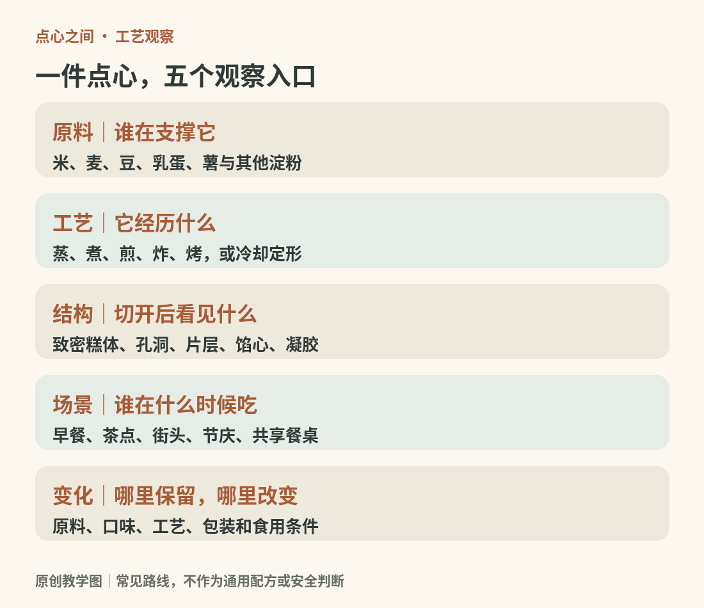

# 01　点心的边界：从一口食物读懂一套饮食文化

“点心”适合成为这本书的中心，因为它首先描述一种吃的方式：在正餐之间吃一点，配茶、分享、解馋，也可能吃成一顿饭。它并不自动等于甜食。虾饺、烧卖、咸挞、咖喱角都可以进入这张桌子；蛋糕和月饼固然在其中，凉糕、炸饼和奶冻也不必被排除。

<!-- teaching-art -->

图1　同一件点心可以沿原料、工艺、结构、场景与变化分别观察。原创教学图。

本书采用一个明确的编辑范围：以具有一定制作工艺、常以小份供应的糕、饼、包、团、卷、挞、派及冷甜点为主，向茶食、节令食品和街头小吃延伸。面包只选与点心日常关系密切的品种，不展开全部主食；糖果、巧克力、坚果零食和饮品在必要处讲解，不独立写成另一部百科。汤面、整份饭菜与大型宴席菜肴也不逐项收录。这里的边界是一种阅读安排，并不是宣称这些食物存在全球统一的法定分类。

## 同一件食物，可以有几个身份

看一只蛋挞，既可以说它是烤制小点，也可以说它由酥皮或饼干式挞皮与蛋奶馅组成；在茶餐厅里，它又属于某种日常饮食场景。三个说法回答的是不同问题。前者讲加热，中者讲结构，后者讲社会生活。分类发生重叠并不意味着分类错误。

| 观察轴 | 先问什么 | 能看见什么 |
| --- | --- | --- |
| 原料 | 米、麦、豆、薯、乳蛋中谁主导结构？ | 年糕与面包的差异不止形状 |
| 工艺 | 蒸、煮、煎、炸、烤，还是冷却凝固？ | 同一面团可能出现不同表皮 |
| 内部结构 | 致密、充气、分层、包馅还是凝胶？ | 戚风与千层酥不能只按颜色辨认 |
| 场景 | 早餐、茶点、节庆、宴席还是街头？ | 同一品种会改变尺寸和搭配 |
| 传承与变化 | 哪些做法稳定，哪些正在变化？ | 传统与新式可以共存在一件食物里 |

这几条轴线会贯穿全书。它们帮助读者从品名走向判断，而不是背下一个很长的菜单。

## 中西比较的用处与限度

中式糕点不是只有米，西式糕点也不是只有黄油。中国有丰富的麦面烤点和油酥点心，欧洲有布丁、奶冻和以坚果为主体的甜食。日本、东南亚、南亚、中东和拉美也都有各自的历史；把它们塞进“中式”或“西式”会损失信息。因此，本书先把几种结构学会，再沿地区进入具体传统，最后讨论流通、商业化和融合。

饮食传统也不只是食谱。UNESCO 对日本和食的说明，把食材取得、准备、食用与节令和社会关系放在一起讨论。这个例子提醒我们：理解一种食物，既要看盘子，也要看谁在什么时间与谁一起吃。[资料：UNESCO，和食传统饮食文化](https://ich.unesco.org/en/RL/washoku-traditional-dietary-cultures-of-the-japanese-notably-for-the-celebration-of-the-new-year-00869)

## 从外观走向截面

一块褐色的小点，可能是烘烤形成的外皮，也可能来自深色糖浆、可可或豆沙；一块白色的糕，既可能绵软多孔，也可能紧实黏糯。颜色只能提供线索。把它切开，观察孔洞、层次、馅心和水分，再轻轻按压、闻香，往往比看包装上“古法”“手作”“新中式”等词更有帮助。

阅读时不必每种都买。先用熟悉的一组作参照：馒头与年糕、蛋糕与饼干、虾饺与锅贴。问清它们在哪一步走向不同，陌生点心就有了可以安放的位置。后文的分类表与对照图是观察工具，并不是要求所有地方配方服从同一个标准。

全书的学习目标是能够描述、比较和解释一口食物：它靠什么成形，口感从哪里来，为什么出现在这张餐桌上，又如何在今天发生变化。

