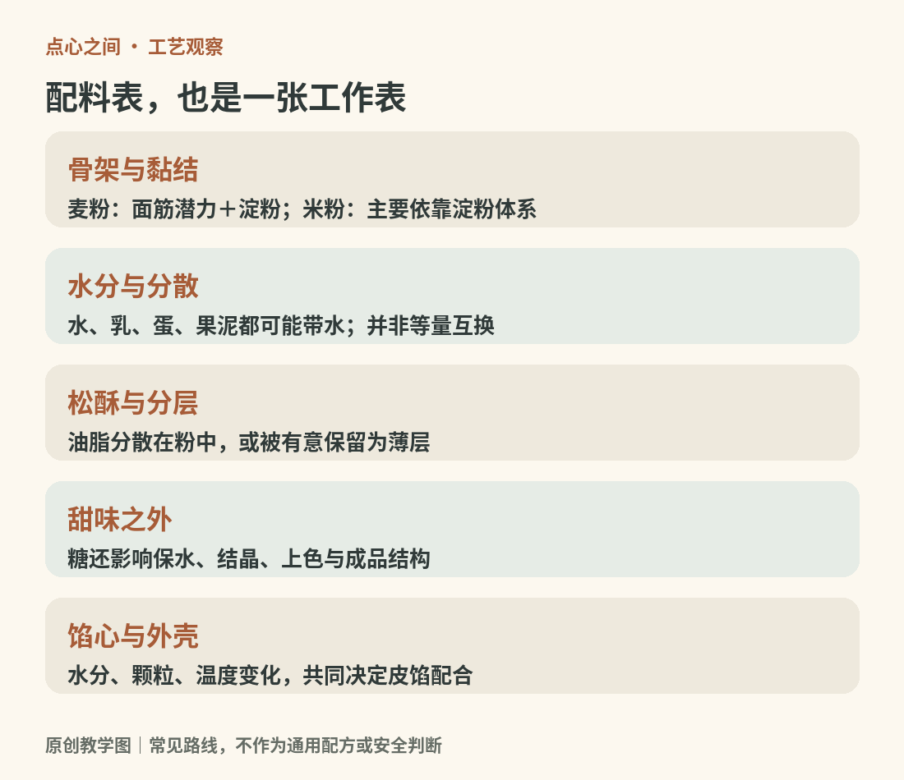

# 02　原料的工作：粉、水、油、糖、蛋与馅

同样一袋粉，加水、油、糖的顺序不同，做出来可能是筋道的皮、松散的酥，或者湿软的糕。原料不是各自孤立的风味标签，而是在争夺水分、支撑气泡、分隔层次或固定形状。

<!-- teaching-art -->

图2　原料按功能理解，比按风味名称替换更可靠。原创教学图。

## 米粉与麦粉，支撑方式不同

小麦粉中的相关蛋白质吸水并经过适当操作，可以形成具有延展性和弹性的面筋（gluten）网络。[^ch02-gluten]饺子皮需要能够擀薄又不易破，面包需要能够容纳膨胀的气体；酥性挞皮却往往要限制这种网络发展。粉的性质、水量、搅拌和油脂都会影响结果，不能简单理解成“揉得越久越专业”。[资料：英国食品科学与技术学会，面筋形成](https://lovefoodlovescience.org/resources/protein-gluten-formation/)

米粉糕团通常主要借助淀粉与水的变化成形，而不是建立小麦面筋网络。糯米粉、普通米粉、澄粉（小麦淀粉，wheat starch）、木薯淀粉并非同一种材料；“粉类”只是购物货架的邻居。某种虾饺皮的半透明，也不能仅凭照片断言全由一种淀粉构成。配方可能混用不同粉料，以调整柔韧性、透明度和放凉后的状态。[资料：原作者的米、粉与淀粉词汇说明](https://thewoksoflife.com/chinese-ingredients-glossary/rice-grains-and-flours/)。

## 淀粉要有水，受热才发生相应变化

把淀粉想成细小颗粒，比把它想成胶水更准确。它在适当水分与加热条件下发生糊化（starch gelatinization），[^ch02-gelatinization]颗粒吸水膨胀、内部有序结构被破坏，体系的黏度与成形能力发生变化。不同淀粉、糖油含量和水分条件使过程不同；低水高糖油的饼干和派皮，并不一定像高含水糕体那样充分糊化。[资料：美国烘焙学会，淀粉糊化](https://asbe.org/article/starch-gelatinization/)

这解释了一个常见误区：把配方中的水随意减少，不一定只让成品更干爽，也可能让粉没有得到合适的水化和熟化条件。增加水也不是单纯让成品更软，它还会影响摊展、蒸发和包馅是否成功。

## 油脂既能分层，也能让口感松散

油脂均匀分布在粉料中，可以改变颗粒接触水的机会与面团的连结；如果有意识地保留油脂层，则可能形成另外一套分层结构。一个是让整体更易酥散，一个是让片层彼此分隔，虽然都叫“酥”，咬下去的破裂方式却不同。后面的中式油酥与西式起酥章节会分别展开，不能把任何油脂面团都称为千层。

常温下较硬的油脂和液态油，在搅拌、塑形与入口时的表现也不一样。黄油还含水，不能把等重黄油换成纯油后，假定配方其余部分无须改变。

## 糖、蛋和乳，各有多个岗位

糖带来甜味，同时影响水分分布、上色、结晶与成品结构。蛋清中的蛋白质可以参与泡沫的形成，受热后蛋的蛋白质又能帮助固定结构；蛋黄中的乳化成分则有助于油水体系分散，这种分散过程称为乳化（emulsification）。[^ch02-emulsification]Exploratorium 的烹饪科普强调，鸡蛋在厨房中同时承担凝固、乳化和起泡等不同工作。[资料：Exploratorium，鸡蛋的多种作用](https://annex.exploratorium.edu/cooking/icooks/article_5-03.html)

因此，“少放糖”“不放蛋”“把牛奶换成另一种饮料”都可能改变口感之外的东西。替换不是不能做，而是要知道被替掉的是哪种工作。乳脂奶油（cream）、牛奶、奶粉和乳酪（cheese），也不能因都带“奶”字而等量互换。

## 馅心也是一个水分系统

豆沙、莲蓉、鲜肉、果酱、奶油馅看似只负责味道，其实会与外皮相互影响。湿馅可能让脆皮吸湿；高温会使某些馅流动，冷却后又变稠；肉馅需要熟透，鲜奶油馅需要考虑冷链。同一外皮包进不同馅后，尺寸、封口和加热过程都可能需要调整。

观察一件点心时，可以把配料表翻译成一张“工作表”：谁提供骨架，谁提供水，谁让它更松软，谁负责气泡，谁构成馅心。先理解角色，再讨论替换，比单纯寻找一种所谓万能健康原料更可靠。

[^ch02-gluten]: gluten 常译“面筋”或“麸质”。此处讨论小麦蛋白质吸水并经操作形成的面团网络；它不是米粉里也能按同样方式揉出的组织。[资料：IFST，面筋形成](https://lovefoodlovescience.org/resources/protein-gluten-formation/)。

[^ch02-gelatinization]: gelatinization 的英式拼法为 gelatinisation。这里指淀粉颗粒在水和热作用下的变化；“糊化”不是“加入明胶”，也不等于所有体系冷却后都能形成同样的凝胶。[资料：美国烘焙学会，淀粉糊化](https://asbe.org/article/starch-gelatinization/)。

[^ch02-emulsification]: emulsification 是使一种液体以细滴分散在另一种不易互溶液体中的过程。油水乳化不是把油真正溶解成水；搅拌后的短暂混合也不保证长期稳定。[资料：IFST，乳化](https://lovefoodlovescience.org/resources/fats-and-oils-emulsification/)。
