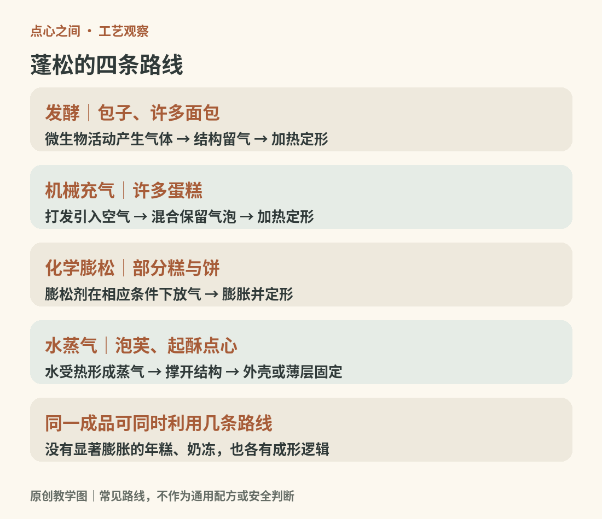

# 03　从生坯到成品：加热、膨胀与定形

一只生包子和一块生曲奇都很柔软，出锅出炉后却走向不同：包子多孔而湿润，曲奇较干脆。除了配方不同，它们经历的水分环境也不同。理解工艺，要同时看热怎样进入、气体怎样变化，以及结构何时固定。

<!-- teaching-art -->

图3　四种常见膨胀路线可以叠加；不是所有点心都需要显著膨胀。原创教学图。

## 蒸与煮：在湿润环境里熟化

蒸汽在食物表面凝结会传递热量，内部再逐渐升温。蒸制往往使表面保持较湿，因此一般不会出现烤饼那样的干燥褐色外壳。煮则让食品与水直接接触，粉皮表面与汤水之间的物质交换更明显。蒸饺和水饺即使采用相近的馅料，皮的配方、厚薄和熟后状态仍可能不同。

蒸制也不意味着从表面到中心瞬间同温。大小、厚度、装盘密度与馅料都会影响熟化。不能把一个小素团的时间直接套给大肉包，更不能把表面变色当作所有馅都已安全熟透的证明。

## 煎、炸与烤：表面更容易失水

煎主要强调食物与热锅、油膜接触的一面；炸让食物更多地被热油包围；烤箱则通过热空气、辐射和烤盘接触等方式传热。它们不是相同温度下可互换的按钮。锅贴常通过先后或组合使用水与油，让底部焦脆、其余部分蒸熟；油炸点心则需要处理外壳上色和内部熟化的节奏差。

褐变也有不同机制。美拉德反应涉及还原糖与氨基化合物，焦糖化则与糖受热发生的一系列变化有关。牛奶糖的褐色不能简单全部归为纯糖焦糖化，烤点表面的褐色也不证明它的中心已经烤熟。[资料：Kansas State University，美拉德反应](https://www.k-state.edu/news/wild-west-district/articles/2022/08/the-maillard-reaction.html)；[Exploratorium，焦糖化与奶油糖](https://annex.exploratorium.edu/cooking/bread/caramels-story.html)

## 蓬松不只有酵母这一条路

发酵可产生气体，打发能把空气带进蛋或油脂体系，化学膨松剂在相应条件下释放气体；水受热产生的蒸汽，也能参与膨胀。不同点心可能同时利用几种方式。把蛋糕都说成“发酵了”，或把泡芙空心解释为“酵母发起来”，都会错过关键。

膨胀还需要留下来。面团或面糊既要有容纳气体的能力，也要在合适阶段固定。美国烘焙学会对烘烤的说明，把淀粉变化和蛋白质变性等过程与结构定形联系起来。过早形成硬壳或内部支撑不足，都可能使最终体积和形态不理想；原因仍需结合具体配方判断。[资料：美国烘焙学会，烘烤](https://asbe.org/article/baking/)

## 烤箱里加蒸汽，并不等于把面包蒸熟

有些面包烘烤前段需要一定蒸汽，帮助表面在早期保持伸展能力；随后较干的烘烤阶段又有助于形成外壳。这与蒸笼里完成整个熟化过程不同。工艺名称只能提示主导环境，不能替代观察实际操作。[资料：King Arthur Baking，面包烘烤中的蒸汽](https://www.kingarthurbaking.com/blog/2017/02/28/steam-in-bread-baking)

## 冷却仍是制作过程的一部分

刚出炉的糕体与彻底冷却后的糕体不是同一状态：蒸汽继续移动，油脂逐渐改变状态，部分胶体或馅心继续凝固。把还很软的成品立即堆叠、密封或切开，可能造成粘连、返潮、压塌或馅心流散。但具体应该何时脱模、何时倒扣、何时冷藏，必须服从相应品种的结构，不能用一条规则管所有糕点。

看一段制作视频，可以按“准备结构—引入或产生气体—加热固定—冷却调整”记录四个阶段。年糕未必需要显著膨胀，奶冻也可能主要在冷却时定形。这条观察线索允许步骤缺席，不能反过来逼每件食物走同样流程。

