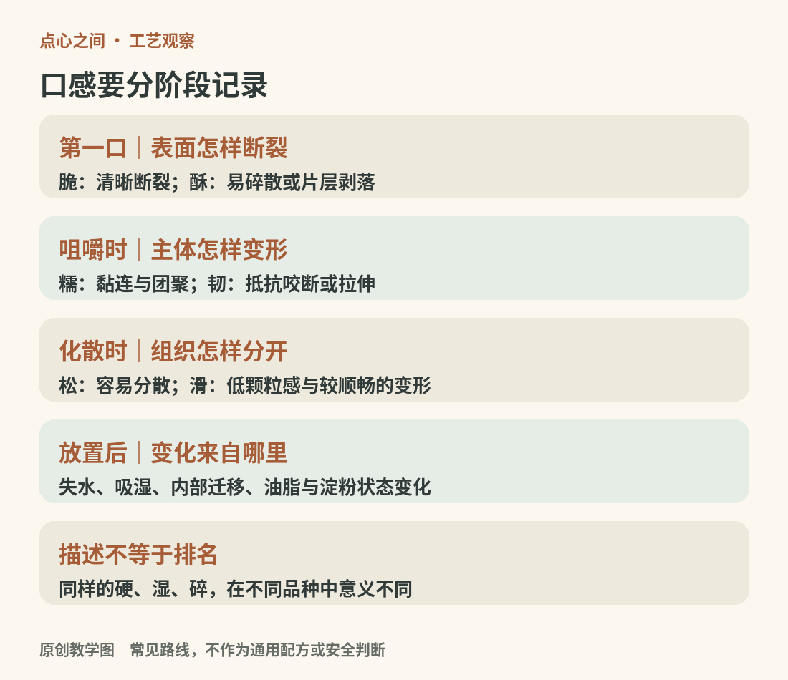

# 04　口感的地图：糯、韧、酥、脆、松、滑

“好吃”是一种判断，“外层脆、里面湿软、最后略黏牙”是一段可交流的观察。点心学习的第一步，就是让这些感觉变得具体。下面的词不是检验标准，而是一套读者可以反复修正的描述语言。

<!-- teaching-art -->

图4　从初咬到放置后的变化，分阶段记录口感。原创教学图。

## 先分开第一口与咀嚼以后

脆常在初咬时出现：薄壳迅速断裂，声音清晰。酥更多强调结构容易碎散，可能表现为细屑，也可能表现为片层脱落。两者可以同时存在，也可以分开。一块油酥饼不一定像薄脆饼干那样响；一只可颂的外壳脆，内部却可以柔软、有弹性。

糯通常令人想到黏连、延展和咀嚼时的团聚感，韧强调抵抗咬断或拉伸的程度。它们不是同义词，也不能直接拿来判断配方是否含糯米。木薯类糕点也可能产生某些弹韧感；含糯米的糕团还会因比例、加工与温度而很不一样。

松与轻也有区别。松散的曲奇容易崩解，却不一定充满大孔；轻盈的海绵蛋糕主要依赖保留下来的气泡结构。滑则涉及颗粒感、润滑和变形方式；光亮表面不保证入口没有粗粒，奶冻也不是越硬越“成形成功”。

## 切面可以提供证据

| 切面线索 | 可以先作的判断 | 还不能直接下的结论 |
| --- | --- | --- |
| 密集小孔 | 有某种充气与定形过程 | 一定用了酵母 |
| 可分离的薄层 | 制作中保留了片层结构 | 一定使用黄油或固定折叠次数 |
| 中央大空腔 | 壳体膨胀后保留了空间 | 与面包同一种发酵机制 |
| 致密连续 | 没有明显大气孔结构 | 一定没熟或一定不好吃 |
| 皮馅交界变湿 | 水分分布可能正在变化 | 一定变质或一定可食 |

最后一栏尤其重要。观察帮助提出问题，不能替代配料、过程与食品安全信息。

## 时间会改写口感

放凉后变硬，不一定只是“水跑掉了”。含淀粉食品的陈化还涉及淀粉重新排列以及水分在不同部位之间迁移；因此密封可以减缓失水，却未必阻止全部质地变化。美国烘焙学会对陈化的说明正是把它与单纯干燥区分开来。[资料：美国烘焙学会，陈化](https://asbe.org/article/staling/?topic=recipes-and-formulation)

相反，原本脆的外壳也可能吸湿变软。给湿馅酥点加上密封盒，既可能保存馅心水分，也可能让外壳更快失去酥脆。保存方式需要在口感目标、配料性质与安全要求之间选择，不能把某个动作称作对一切点心都有效的“锁鲜”。

## 做一次有控制的比较

选择同一家、同一批次的一种无须冷藏的普通饼干，取两小块，在合适食用时间内比较刚开封与短时接触室内空气后的状态。记录初咬声音、断裂颗粒和余味，不需要为了实验让食品久置。如果是奶油、肉馅或其他易腐食品，不进行室温久放观察。

另一次可以比较同一品种的边缘与中心：蛋糕边缘是否更干，挞皮底部是否比侧边更湿，煎糕的表面是否比内部更硬。这样能把“这份点心很普通”拆成具体问题：差异出在加热位置、水分移动，还是配方本来就追求这种结果？

## 不给口感排单一名次

细腻不一定胜过粗粒，湿润也不一定胜过干爽。粗粮糕可能保留谷物颗粒，坚果酥可能追求明显的碎粒，某些传统饼干就是为了耐放和浸饮。用蛋糕的标准评判所有糕点，会把本来成功的食物误读成失败。

本书后面的比较会尽量说明“哪种结构导致什么感觉”，而不是宣布某一派最好。一旦能够把表皮、主体、馅心和时间四个因素分开，读者就能更准确地理解自己的偏好，也更容易发现不同传统之间值得比较的共同工艺。

