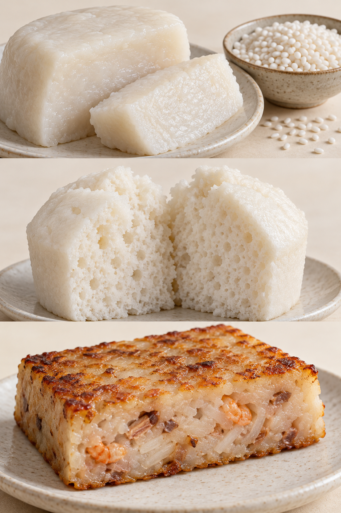

# 05　米与杂粮：糕、团、粿的不同骨架

切开一块萝卜糕，内部能看见萝卜丝；掰开一块松糕，断面松散；拉开一个糯米团，外皮却会粘连。这些差别不能用“都是米做的”解释。米的品种、磨粉方式、加水量，以及先成形还是先蒸熟，共同决定了成品。

<!-- teaching-art -->

图5　自上而下：致密米糕、多孔米发糕、煎萝卜糕。AI生成外观与切面示意，不能据图反推粉料比例或熟化参数。

## 糯米、粳米、籼米不是三个平行抽屉

日常购买时，糯米粉、粘米粉、粳米粉常并排出售，但这是方便使用的商品分类。籼、粳是稻米类型，糯性则与淀粉特征有关，籼稻和粳稻都可以有糯性品种。因而，长粒不必然不糯，圆粒也不必然就是糯米。

米淀粉含直链淀粉和支链淀粉。糯米淀粉以支链淀粉为主；普通非糯米含有更多直链淀粉。加水受热后，淀粉颗粒吸水膨胀，米粉逐渐变成有黏性、能支撑形状的体系。糯米常带来黏糯和拉扯感，非糯米粉通常更适合需要挺身、易切分的糕体，但实际表现仍受品种、含水量和配方影响。[资料：OECD《Rice》，淀粉组成及籼粳类型](https://www.oecd.org/en/publications/safety-assessment-of-foods-and-feeds-derived-from-transgenic-crops-volume-3_f04f3c98-en/full-report/component-8.html)

粤式食谱中的“粘米粉”通常指非糯性大米磨成的粉，并不是“越粘越好”的意思；“水磨糯米粉”强调加工方式，也不等于某一种固定用途。买粉时先确认原料与用途，比只看中文品名可靠。

## 同一袋米，可以走出几条路线

整粒糯米泡水后蒸煮，米粒仍可辨认，适合粽子、糯米鸡和部分八宝饭。把蒸熟的米反复捶打，会让米粒组织破碎、彼此黏合，形成打糕、糍粑一类紧实连续的质地。磨成粉再调团，则更便于包馅、着色和控制表面细腻程度。三条路线即使使用相近原料，也不会得到同一种口感。

粉还可以不揉成团。把湿润而仍松散的米粉筛入模具，靠蒸汽使颗粒连接，成品留下细小空隙，因此容易掰开。苏州黄天源糕团的非遗资料区分多种成形路线，其中就包括入模后直接蒸熟、无需再揉揿的糕类。可见“糕”不能一概理解为紧实的年糕。[资料：苏州非遗，黄天源苏式糕团制作技艺](https://szfy.wglj.suzhou.com.cn/fy-project/85)

| 观察对象 | 主要结构线索 | 吃的时候留意什么 |
| --- | --- | --- |
| 切片年糕 | 连续、致密的米粉或捣米结构 | 咬断需要的力、加热后软化程度 |
| 松糕、部分定胜糕 | 湿粉粒蒸结，保留细孔 | 是否松散、是否有干粉颗粒感 |
| 青团、糯米糍 | 可塑性较强的包馅粉团 | 外皮厚薄、黏性与馅料水分 |
| 米发糕 | 浆料或软团经发酵膨松 | 孔洞、酸香与弹性 |
| 萝卜糕、芋头糕 | 米粉凝结体包住蔬菜或芋块 | 能否切片、煎后外壳与内部反差 |

这张表描述常见路线，并不替代各地配方。同名“发糕”可能采用不同膨松方法，同名“年糕”也可能使用不同米粉比例。

## 青团的颜色之外，还有皮与馅

青团常用植物汁液或植物组织为米粉团提供颜色和气味；艾草、鼠曲草、浆麦草等使用情况因地区而异，不能将所有绿色糕团都认作同一种草。豆沙、芝麻等甜馅之外，咸馅及当代变化也很常见。

看青团时，不妨先分清三层信息：绿色来自什么，外皮由哪些粉组成，馅料是干爽还是湿润。细腻豆沙不会像流动酱汁那样立即浸湿外皮；油润馅料则可能让入口感显得更柔滑。颜色深浅受植物、处理与储存影响，不能单凭“越绿”判断原料更真或更好。

## 萝卜糕为什么能煎出壳

萝卜糕的名称容易让人以为它是一种蔬菜蛋糕。实际上，常见粤式做法把白萝卜丝及其水分与米粉浆结合，蒸熟后成为可切分的糕体；部分配方加入腊味、虾米等。米粉帮助连接萝卜丝，萝卜又提供水分、纤维与柔软感。比例不同，可能得到挺身易切的版本，也可能得到明显柔软、萝卜感更强的版本。[资料：香港大学教学收藏，萝卜糕](https://learning.hku.hk/ccch9051/group-8/items/show/8)

蒸熟只是完成内部结构。冷却后切片下锅，接触锅面的部分逐渐失水并上色，内部仍保留较多水分，于是有了外脆内软。若把“糕越硬越容易煎”当作唯一目标，便可能失去萝卜糕本来的柔润。

## 杂粮并非替换一个名称

小米、黄米、玉米、荞麦进入糕点，会同时改变颜色、气味、颗粒感和黏结能力。这里尤其要注意：北方常说的黏黄米不等于日常煮粥的小米。粗粉与细粉的吸水速度也不同，不能只按照颜色互相替换。加一点杂粮粉可能只是增香，大比例替换却会改变成形方式。

一次轻量观察可以选年糕、松糕和萝卜糕各一小块，先看断面，再按包装建议分别复热。记录哪一种恢复黏软、哪一种保持松散、哪一种适合煎。这个比较能把“软糯”拆成具体结构，也能说明为什么米制点心不能共享一套保存与食用方法。

