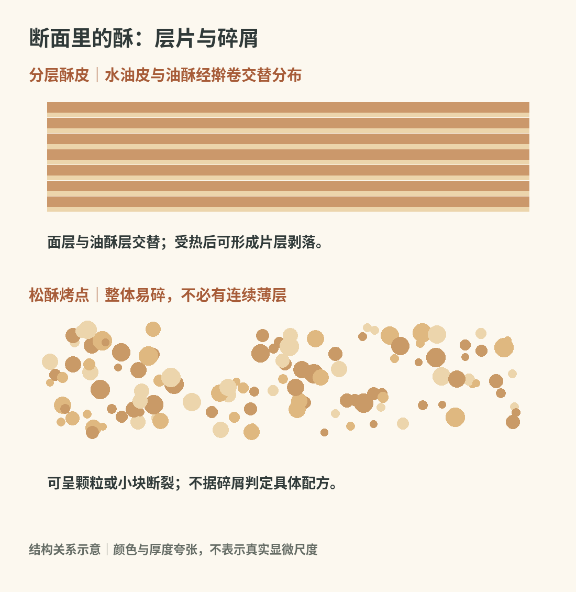
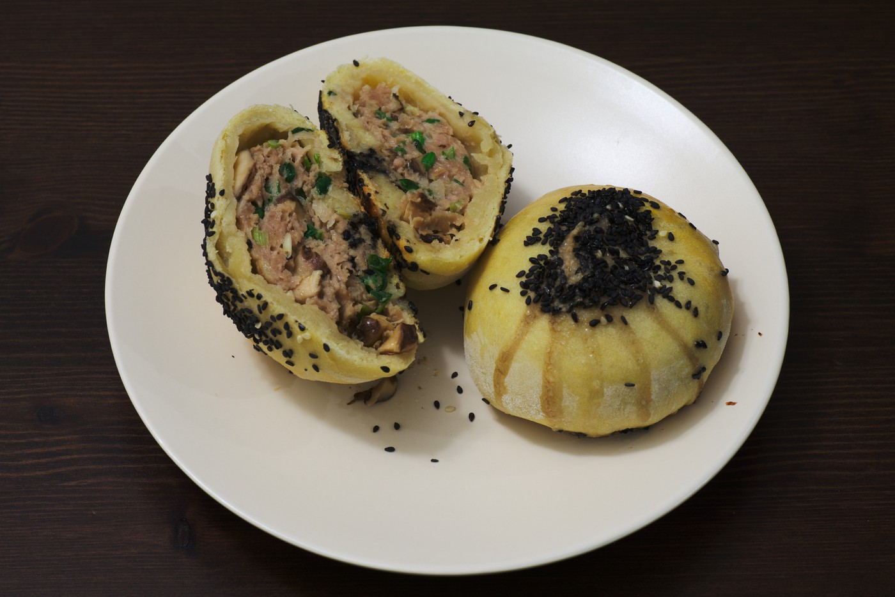
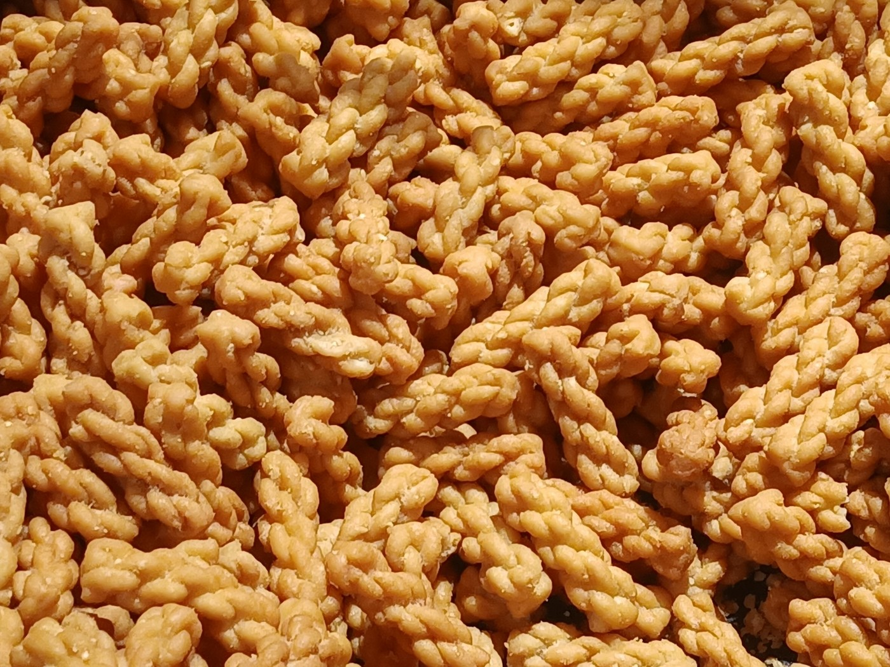
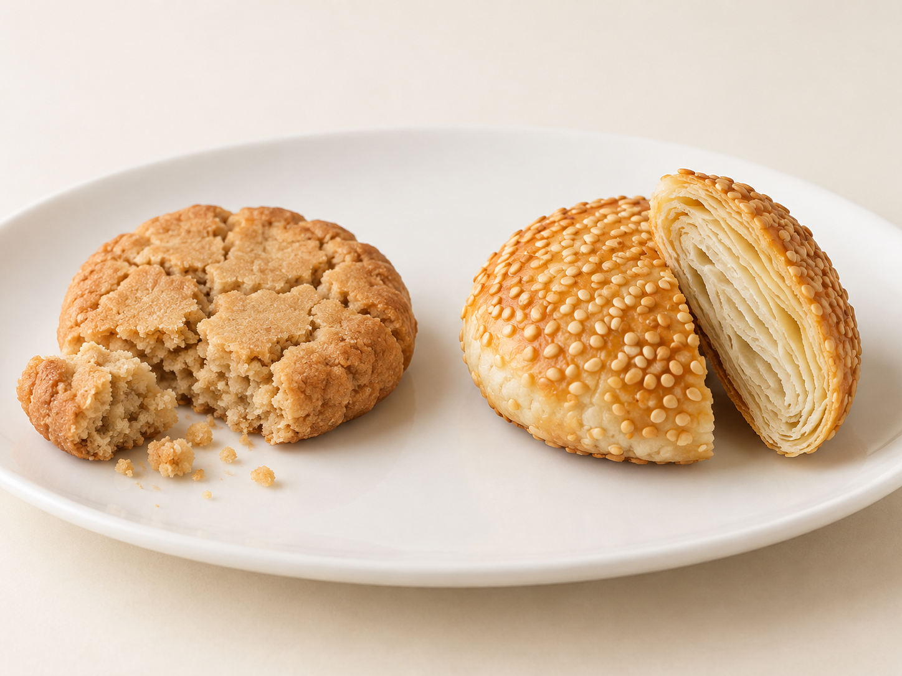
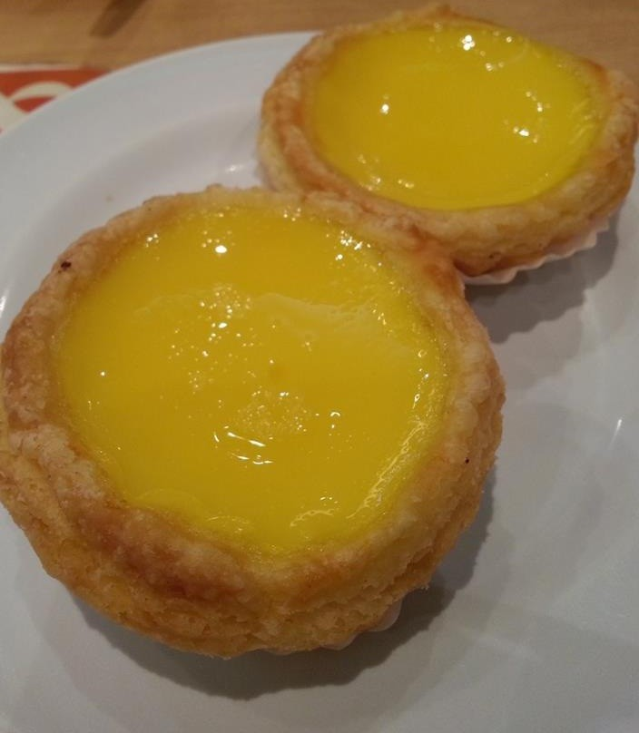

# 06　中式酥点与烤点：从油脂分层到蛋挞

同样会掉屑的点心，可能拥有完全不同的内部结构。桃酥常是颗粒状松碎，苏式酥饼可以沿层剥开，广式月饼的外皮却较柔韧。判断“酥”，需要看断面，而不能只看表面是否金黄。

<!-- teaching-art -->

图6　分层与松碎是两种不同的结构安排。原创关系示意，层厚与颗粒作了夸张，不表示显微尺度。

## 油酥怎样把面团分成薄层

常见中式酥皮由两部分组合：能擀开、包住内层的水油皮，以及面粉与油脂拌成的油酥。水油皮把油酥包住，再经过擀卷或折叠，使两者交替分布。烘烤时，薄层中的水分变成蒸汽，油脂帮助阻隔相邻面层，熟后的皮便能产生分层和易碎感。工艺目的不是把两团完全揉匀，揉匀反而会抹掉层次。

这里的“水油皮”不是液体油水混合物，而是一个面团名称；“油酥”也并不必然意味着必须使用猪油。油脂种类、软硬度及操作温度都会影响延展性。过软可能混层、漏油，过硬可能擀破外皮，最终表现为局部厚硬或层次不均。

层层卷起并不等于层数越多越好。薄层若被压断或彼此粘合，多擀几遍也不一定更酥。对读者而言，比数层更有用的是观察：成品侧面能否看见薄片，咬开是大片剥落还是整体碎散，底部有没有一块明显油湿的面层。

## 月饼是一组不同工艺的节令食品

月饼这个共同名字，主要来自食用场景与文化联系，并不意味着共享同一种皮。常见广式月饼以糖浆皮包馅并压模，烤后皮色较深；苏式月饼以分层酥皮见长；潮式月饼中有以芋蓉等为馅、能看见螺旋层次的酥皮品种。地区内部仍有诸多差异，不能把一个代表款当成整地的标准。

广式也不只是莲蓉蛋黄。五仁、豆沙、火腿等馅料展示甜、咸及两者混合的不同组织方式。国家非遗收录的安琪广式月饼技艺，是广式月饼传承中的一个具体项目，而非对全国月饼的统一配方规定。[资料：中国非遗，安琪广式月饼制作技艺](https://www.ihchina.cn/project_details/14651.html)

| 常见类型 | 观察重点 | 容易误会的地方 |
| --- | --- | --- |
| 广式糖浆皮月饼 | 压纹、皮馅比例、烤后皮的柔润 | 并非所有深色饼皮都代表酥皮 |
| 苏式酥皮月饼 | 薄层、底皮、甜咸馅的含水量 | 掉酥屑不等于变质或制作粗糙 |
| 潮式酥皮月饼 | 卷层方向、炸或烤的表面差别 | 螺旋外观不是所有潮式品种共有 |
| 冰皮月饼 | 软韧皮与冷藏馅料 | 不是把烤月饼简单放凉 |

<!-- public-photo:real-cn-suzhou-mooncake -->

图6-1　加拿大家庭制作的苏式咸馅月饼，品名依作者说明。切面可观察外皮与馅心的比例。

实物照片：Dllu；[CC BY-SA 4.0](https://creativecommons.org/licenses/by-sa/4.0)。[原图与许可页](https://commons.wikimedia.org/wiki/File:Savoury_Suzhou-style_meat_mooncake.jpg)。

## 烧饼、桃酥、麻花，各自怎样变脆

烧饼可以靠擀卷形成薄层，也可以着重于发面后的孔隙与炉壁烘烤形成的壳。芝麻提供香气和表面颗粒感，但芝麻多少不能告诉我们内部是否分层。咸酥烧饼、甜馅烧饼、吊炉烧饼也不是同一配方换馅。

桃酥一类松酥烤点，更多依赖油脂、糖及膨松方式共同形成容易咬碎的结构，不必出现整齐的层。麻花虽然形似扭结，常见的脆口主要来自面条状坯体的炸制定型和失水，夹酥版本还会增加内部层次。十八街麻花的国家非遗项目明确反映了这是一套包含多道工序的面食技艺，不能只用“拧起来炸”概括。[资料：中国非遗，桂发祥十八街麻花制作技艺](https://www.ihchina.cn/project_details/14646.html)

这些食品提醒我们：“脆”描述受力后的断裂，“酥”往往同时涉及易碎与油润；同一个点心可以两者兼具。

<!-- public-photo:real-cn-mahua -->

图6-2　麻花实物。条状面坯扭结成小环，炸后呈金黄色。

实物照片：François Nguyen；[CC BY 2.0](https://creativecommons.org/licenses/by/2.0)。[原图与许可页](https://commons.wikimedia.org/wiki/File:Mahua_%E9%BA%BB%E8%8A%B1.jpg)。

<!-- atlas-expansion:atlas-cn-taosu-shaobing -->

图6-4　左：桃酥的松碎断面；右：芝麻烧饼的一种分层款式。AI对照示意。

AI生成示意：用于观察代表外形与组织关系。[工艺参照资料](https://ahas.agriir.cn/resources/detail/1/179C477D-B592-4F1B-9554-27601D400EE0.html?projectId=405fc0ca-2997-11e7-b5f5-3440b5b17484)。

## 蛋挞让中西边界变得具体

香港常见蛋挞有酥皮与牛油皮，也就是俗称的曲奇皮。前者有薄层和剥落感，后者更接近一块连续、松碎的饼干壳。香港非遗办的饮食文化资料把两种皮并列介绍，也记录蛋挞进入茶餐厅和中式茶楼的日常场景。[资料：香港非遗办《饮食文化》](https://www.icho.hk/documents/Education/exhibition_panels/Exhibition_panel_food_culture.pdf)

澳门葡挞又是另一条具体的发展路线：当地在葡萄牙甜点技艺基础上形成有地方特色的焦糖酥皮蛋挞，常见特征为分层挞皮与带焦斑的蛋浆表面。澳门文化局同时强调各店用料和烘焙手法存在差异。[资料：澳门文化遗产网，葡挞制作技艺](https://www.culturalheritage.mo/detail/102289)

因此，不能把所有港式蛋挞都称作葡挞，也不宜用某家店的创立年份代替整类蛋奶挞的起源。传播并不是原样搬运；挞皮、蛋奶比例、烤制表面和消费场景，都可能在新地方改变。

下次比较两枚蛋挞，可先不讨论哪枚“正宗”，而是分别记录外壳是分层还是颗粒状松碎、馅心是否流动、底部是否仍干爽。再把它与一块中式酥饼并看，就能发现相近的分层原理怎样服务于完全不同的馅料。

<!-- public-photo:real-cn-hk-egg-tarts -->

图6-3　两枚香港蛋挞实物。浅黄色蛋面与褐色挞壳形成对照；本图不区分挞皮配方。

实物照片：CCheungimm；[CC BY-SA 3.0](https://creativecommons.org/licenses/by-sa/3.0)。[原图与许可页](https://commons.wikimedia.org/wiki/File:Two_Egg_Tarts_CC_02_HK.jpg)。

