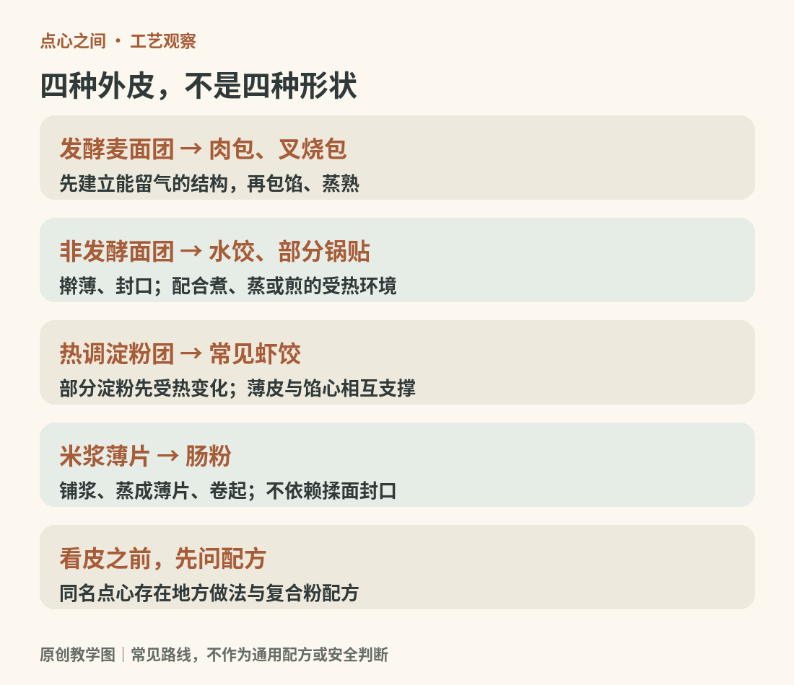
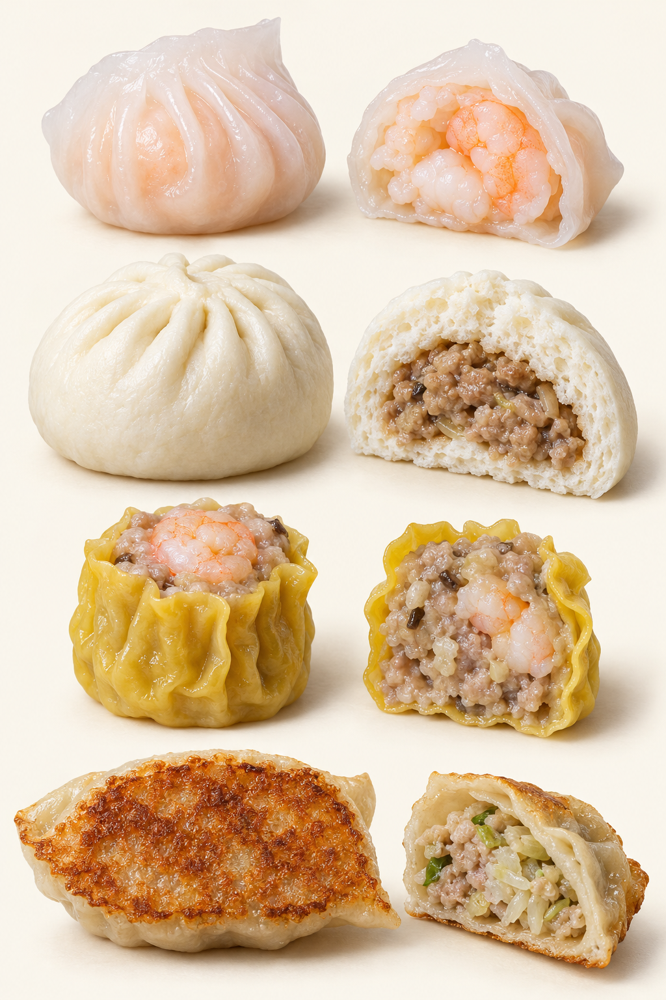
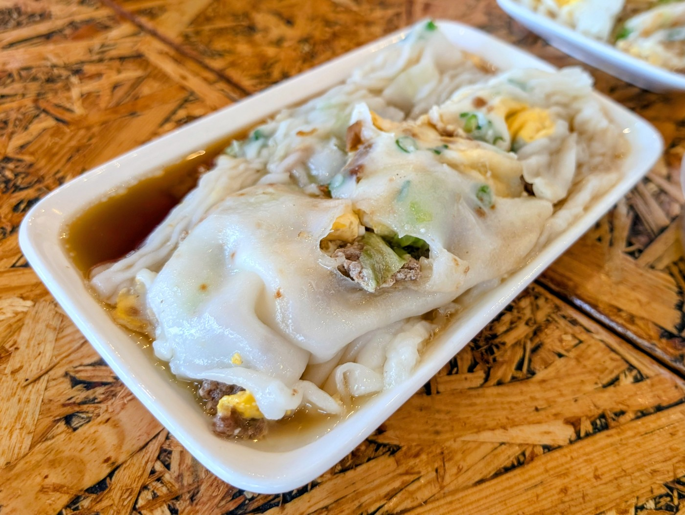
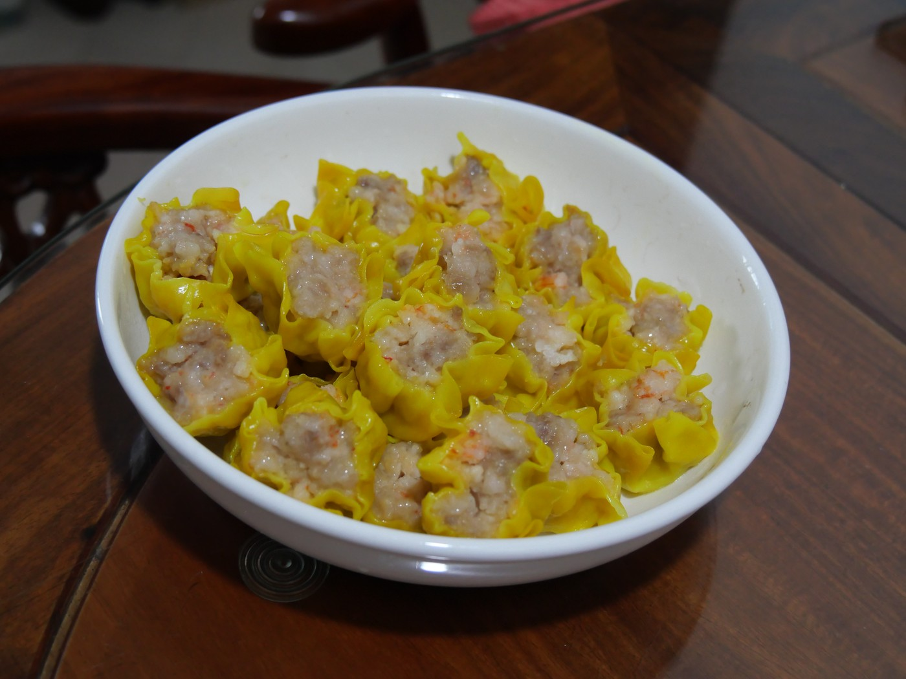
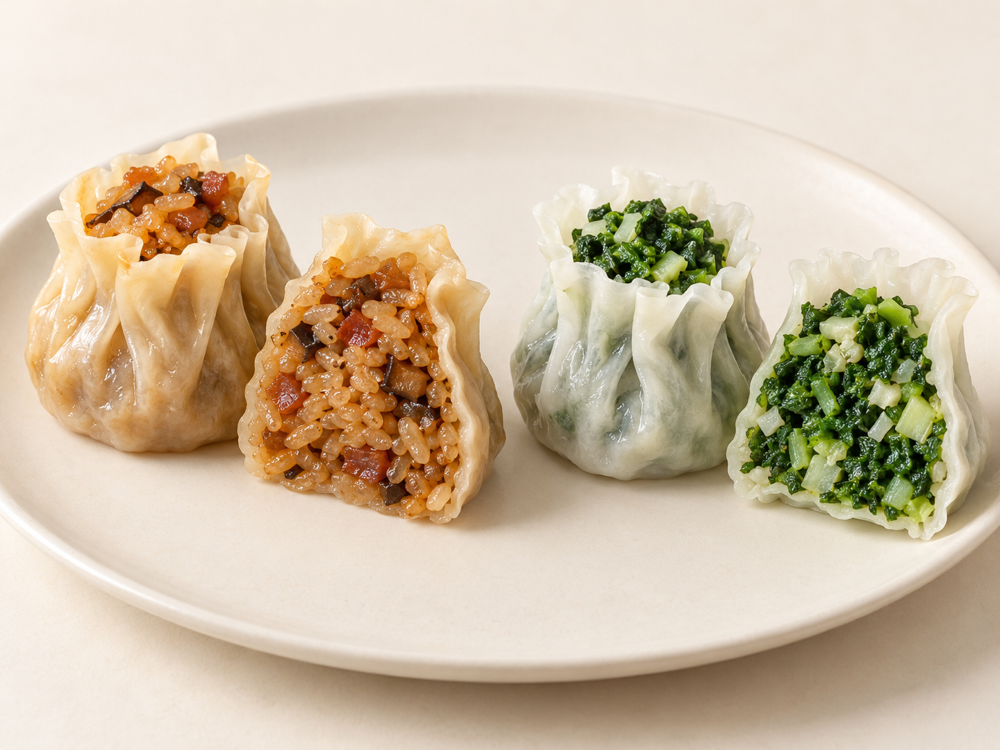

# 07　包、饺与蒸煎咸点：外皮怎样照顾馅心

包子、虾饺、烧卖、肠粉在茶桌上相邻，却不应归为“换形状的面皮包肉”。包子常需要蓬松外皮，虾饺追求薄而略透的皮，肠粉则由米浆蒸成薄片。外皮的任务不同，决定了揉面、成形和加热的方法。

<!-- teaching-art -->

图7a　先辨外皮路线，再比较形状与馅心。原创教学图。

图7b　自上而下：虾饺、肉包、广式烧卖、锅贴。AI生成常见外观示意；透明度、孔洞和皮厚并非统一标准。

## 先辨认皮，再辨认形

小麦面粉加水揉制，能形成有延展性的面团，适合擀皮、包馅与封口。发酵面团再利用气体形成孔隙，蒸熟后变得松软；不发酵的饺皮则更突出薄、韧和耐煮。部分面点使用烫面，热水使部分淀粉先吸水变化，同时改变面团的操作性，常用于需要柔软而不以强筋为目标的皮。

虾饺常见的透明皮通常使用澄面，即小麦淀粉，并配合其他淀粉，以热水调制。它与普通面粉饺皮的延展方式不同，不能期待它像冷水小麦面团那样久揉后更筋道。透亮也不等于没有厚度：过厚会让皮与虾的口感失衡，过薄则容易破裂。

肠粉走的是浆料路线：将以米为基础的浆料薄薄铺开，蒸成连续薄片，再卷起或裹入馅料。它不需要捏紧封口，重点是浆的分布、熟化与脱离蒸布或盘面。不同地区的浆料配合、厚薄和酱汁均可不同。

| 外皮路线 | 常见例子 | 结构目标 |
| --- | --- | --- |
| 发酵小麦面团 | 肉包、叉烧包及部分菜包 | 内部有孔、松软承托馅心 |
| 非发酵面团 | 水饺、蒸饺、部分锅贴 | 薄而完整，适应煮、蒸、煎 |
| 热调淀粉团 | 常见虾饺、水晶类点心 | 能成形的薄皮与适度透明感 |
| 米浆薄片 | 肠粉、部分粉卷 | 柔滑、连续、易卷折 |

这些是辨认路线，并非每种点心的唯一做法。复合粉、预拌粉与地方手法都可能形成变体。

<!-- public-photo:real-cn-cheung-fun -->

图7-2　潮汕式肠粉在澳大利亚阿德莱德的一种店售实例，店家为Stonemill Rice Roll。图中可见薄片的折叠、卷裹与酱汁。

实物照片：Asamboi；[CC BY-SA 4.0](https://creativecommons.org/licenses/by-sa/4.0)。[原图与许可页](https://commons.wikimedia.org/wiki/File:Chaoshan_rice_noodle_roll.jpg)。

## 包馅不是把所有原料塞进皮里

外皮薄厚必须配合馅料的含水量、颗粒大小和熟化速度。粗切蔬菜带来咬感，但若出水过多，容易让接缝受潮；细碎肉馅容易分布均匀，但并不代表所有点心都应把肉打成同一种胶状。虾粒、笋粒、菌菇与肉末分别保留多少形态，是风味设计的一部分。

包子通常封口，烧卖则保留开放的顶部。开放让馅料成为视觉中心，也改变表面水分散失和入口次序。广式烧卖常见肉与虾的组合，江南糯米烧卖则把米饭变成主体，扬州翡翠烧卖又展示蔬菜馅的路线。只根据顶部收口形状，就把它们理解为相同馅料的亲属，会忽略很大一段差别。

扬州富春茶点的代表品种包括三丁包、千层油糕和翡翠烧卖，说明同一茶点传统可以同时容纳不同的面团与馅心组织，而不是统一成一种口味。[资料：国家图书馆中国记忆项目，富春茶点制作技艺](https://ich.nlc.cn/detail/6016)

<!-- public-photo:real-cn-shumai -->

图7-1　香港家庭风格猪肉烧卖，名称依原图说明。开放顶部露出馅心，薄皮在外围形成褶皱。

实物照片：Peachyeung316；[CC BY-SA 4.0](https://creativecommons.org/licenses/by-sa/4.0)。[原图与许可页](https://commons.wikimedia.org/wiki/File:Homemade_style_pork_shumai_in_Hong_Kong.jpg)。

<!-- atlas-expansion:atlas-cn-shaomai-fillings -->

图7-3　左：糯米烧卖；右：白皮透出青菜馅的翡翠烧卖代表款。AI对照示意。

AI生成示意：用于观察代表外形与组织关系。[工艺参照资料](https://lzhbwg.mofcom.gov.cn/edi_ecms_web_front/thb/detail/4cbac9b1689b44498c33653f95dcbb35)。

## 蒸、煮、煎决定了外皮经历什么

蒸制依靠蒸汽传热，皮不会像水煮那样持续浸在大量水中，因此适合保留较精细的形态。蒸笼空间仍不能塞满：点心可能膨大，贴住邻居后会粘连；水滴直接落在表面，也可能造成局部湿软。香港非遗资料把竹蒸笼制作与茶楼点心制作分别呈现，显示器具本身也是技艺链条的一部分。[资料：香港非遗办《饮食文化》](https://www.icho.hk/documents/Education/exhibition_panels/Exhibition_panel_food_culture.pdf)

水煮时，皮直接接触水并吸水，封口和皮的完整性尤其重要。煎制则让接触锅面的一侧失水上色；常见锅贴做法还会加入水并加盖，让蒸汽帮助内部熟化，最后继续煎干底部。它不是把已熟水饺随意烤黄，也不必每一面都变脆。

小笼包的汤汁提供了另一个有趣对照：一些做法把冷时凝结的肉皮冻混入馅料，加热后融成液体。重点是馅料结构随温度变化，不是包子先做空、再灌入汤。具体配方各店有别，汤汁多少也不能单独衡量质量，皮、馅与食用时的温度要一起考虑。

## 茶桌上的相邻，不等于营养或工艺相同

虾饺、烧卖、牛肉球和肠粉是香港非遗资料列出的常见茶楼点心。它们可以分成“薄皮包馅”“开放包馅”“无皮成团”“浆片卷裹”等结构来观察，而不仅是四个要记住的名字。

想做一次低负担比较，可在两三人共享的茶桌上选一笼发面包、一笼虾饺、一份肠粉，先各自掰开看断面，再尝外皮与馅心。留意包子的孔隙、虾饺皮的连续感、肠粉卷层间的酱汁。酱汁暂少放一点有助于辨认本身的味道；这只是观察方法，并不规定哪一种吃法更正确。

真正理解咸点，是看见皮与馅怎样共同完成一口：外皮可能吸汁、保持形状或制造反差，馅心则提供香气、汁水和颗粒感。小巧尺寸把这些关系集中起来，也让一点厚薄与含水量的变化格外明显。

## 继续按品种阅读

[饺子家族](19-dumplings.md)、[馄饨云吞抄手](20-wontons.md)、[早餐包点](22-breakfast.md)进一步展开这里涉及的品种与食用场景。
