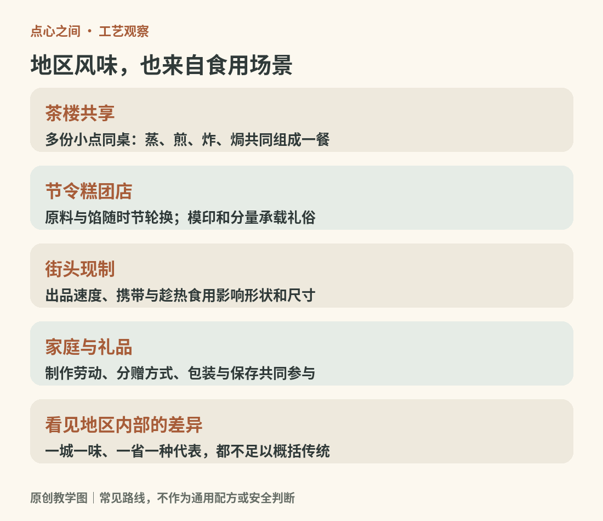
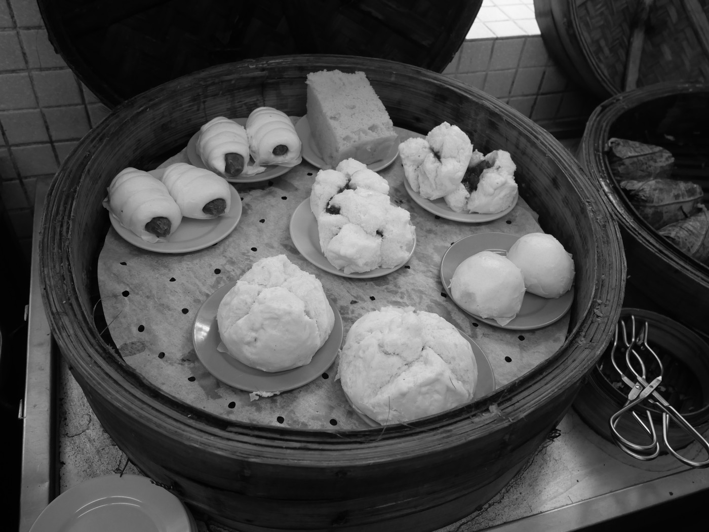
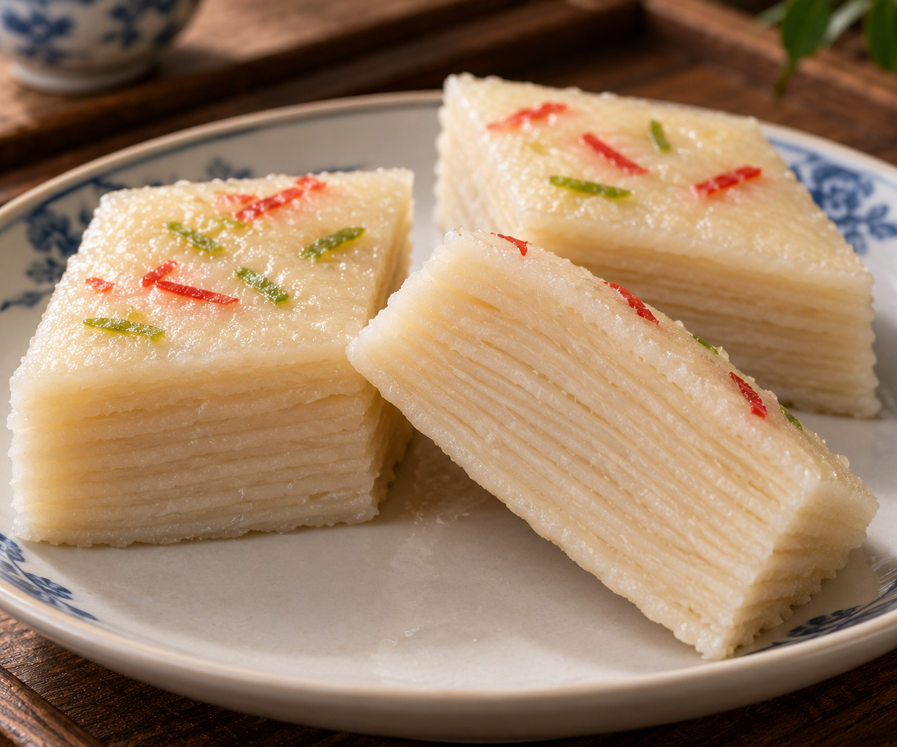
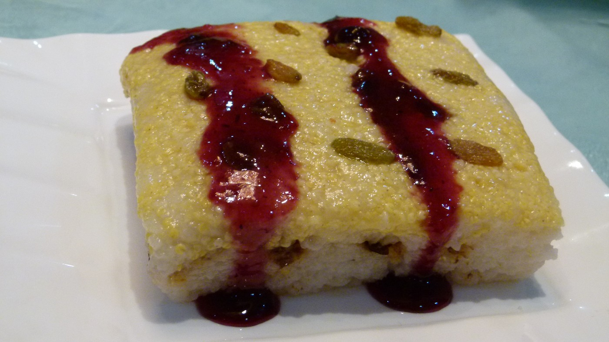
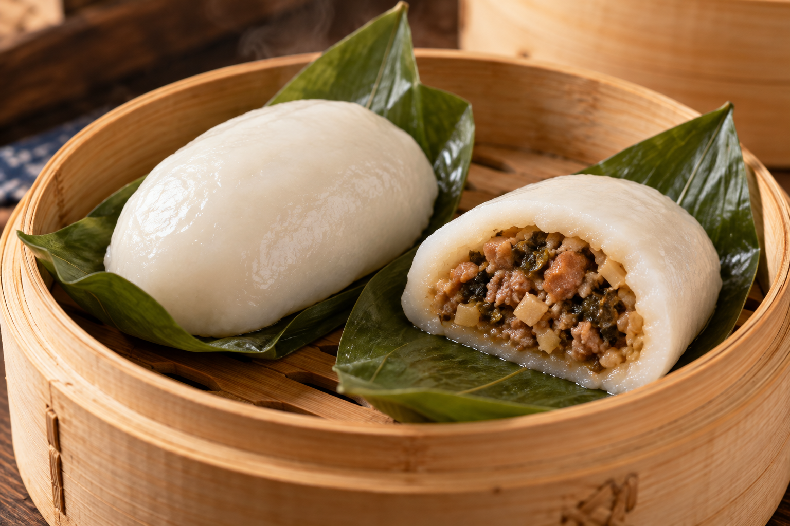
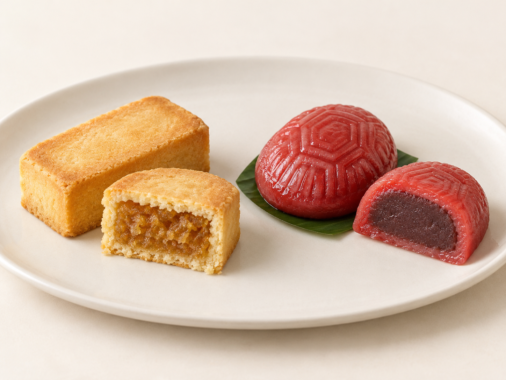

# 08　地区茶点与街头小吃：从一张餐桌读到一座城市

地区风味并不是一张“每省一种名吃”的地图。港口、移民、粮食供应、城镇市场和家庭节令共同影响点心；一道小吃跨过省界，也可能继续保留原来的名称，或者换了名称却与邻地共享做法。

<!-- teaching-art -->

图8　茶桌、街头、家庭与礼品影响点心的分量和组合。原创教学图。

本章把茶点与街头小吃放在一起，是为了观察它们的食用场景。纳入范围的是能帮助理解糕点与小份面食的代表，不试图把所有地方菜、烧烤和汤面都改称为点心。

## 粤港：一桌共享的多种结构

广式饮茶（粤语常音译为 yum cha）把茶与多份小点放在同一餐桌上[^ch08-yum-cha]，蒸、煎、炸、焗可以同时出现。虾饺的薄皮、叉烧包的蓬松、萝卜糕的软实、蛋挞的酥壳构成一组质地差异。“一盅两件”中的“两件”并非规定只能点两只点心，而是泛指点心；它体现的是喝茶吃点的生活方式。[资料：香港非遗办《饮食文化》](https://www.icho.hk/documents/Education/exhibition_panels/Exhibition_panel_food_culture.pdf)

茶楼、街坊饼店和茶餐厅也不是互相隔绝的系统。蛋挞、菠萝包等食品能在不同场景流通，分量、售卖温度和搭配随之变化。香港非遗展览将茶楼点心、茶果、菠萝包、蛋挞和港式奶茶同时纳入饮食文化，提醒我们“地方传统”也包含长时间的交流和改造。[资料：香港非遗办“香港滋味”巡回展览](https://www.icho.hk/en/web/icho/taste_of_ICH.html)

<!-- public-photo:real-cn-dim-sum-table -->

图8-1　香港荃湾川龙端记的点心蒸笼。原图列明叉烧包、马拉糕和腊肠卷；黑白影像突出几种形态的并置。

实物照片：Peachyeung316；[CC BY-SA 4.0](https://creativecommons.org/licenses/by-sa/4.0)。[原图与许可页](https://commons.wikimedia.org/wiki/File:Dim_Sum_on_the_table.jpg)。

## 江南与淮扬：不能只用甜概括

江南米制糕团丰富，桂花、豆沙、芝麻等形成鲜明印象；但鲜肉月饼、菜馅团子、烧卖等咸点同样重要。季节改变植物与馅料供应，糕团店因此会形成按时令轮换的产品。苏州非遗黄天源糕团资料展示的多种成形技法，也说明变化不只是颜色与花样。[资料：苏州非遗，黄天源苏式糕团制作技艺](https://szfy.wglj.suzhou.com.cn/fy-project/85)

淮扬茶点则适合观察茶社的组合方式。扬州富春茶点把茶艺、点心和菜肴联结起来，三丁包、翡翠烧卖、千层油糕展示咸馅、菜馅与层状糕体的并存。这里的“细致”落实在切配、皮馅关系和火候，不能仅理解为小巧好看。[资料：中国非遗，富春茶点制作技艺](https://www.ihchina.cn/project_details/14648.html)

<!-- atlas-expansion:atlas-cn-qianceng-yougao -->

图8-3　淮扬千层油糕：菱形蒸糕与贴合的柔软薄层。AI示意，不表示固定层数。

AI生成示意：用于观察代表外形与组织关系。[工艺参照资料](https://lzhbwg.mofcom.gov.cn/edi_ecms_web_front/thb/detail/4cbac9b1689b44498c33653f95dcbb35)。

## 华北：麦面、豆类与不同的干湿口感

北京的小吃与饽饽传统，既有豌豆黄、芸豆卷、驴打滚等豆米制品，也有酥皮糕点与各种烤点。一个地区并不因为小麦消费多，就排除糯米、豆粉和淀粉。驴打滚外面的熟豆粉提供干爽表层，内部糯性米团保持黏软，正好展示材料如何在同一口中产生反差。

天津麻花则让人看见适于携带的干脆点心：扭结形状、粗细和炸后的含水量共同影响断裂方式。山西太谷饼又是另一条路线，厚实与松软并不等于酥皮薄层。国家非遗分别为麻花和太谷饼建立技艺项目，适合把它们作为独立案例阅读，而不是归结为“北方口味重”。[资料：中国非遗，太谷饼制作技艺](https://www.ihchina.cn/project_details/23788.html)

<!-- public-photo:real-cn-baotou-ricecake -->

图8-2　包头餐厅拍摄的“米糕”，名称依原图说明。可见浅黄与白色两层，以及表面的酱汁和颗粒配料。

实物照片：Brücke-Osteuropa；[CC0](http://creativecommons.org/publicdomain/zero/1.0/deed.en)。[原图与许可页](https://commons.wikimedia.org/wiki/File:Chinese_rice_cake_1.jpg)。

## 川渝：小份、调味与组合

叶儿粑、糖油果子、凉糕和抄手展示了米团、油炸、凝结糕体与薄皮包馅的差别。香辣是其中一部分，不能解释全部。红油抄手与原汤抄手的差别，除了辣度，还在于油脂、香料、汤液怎样进入薄皮褶皱；甜点又以糖浆、芝麻和米香建立另一种平衡。

观察小吃组合时，要问它是单独垫饥，还是作为一桌多样小份的一员。同一碗抄手放在早餐里可能是主食，放在小吃宴中又是一小份。分类应说明场景，而不是给它永久贴上“零食”的标签。

<!-- atlas-expansion:atlas-cn-yeerba -->

图8-4　叶儿粑的白色米粉皮、咸馅与垫叶。AI代表款示意，不指定叶种。

AI生成示意：用于观察代表外形与组织关系。[工艺参照资料](https://www.sctu.edu.cn/cyzx/info/1087/1596.htm)。

## 闽台与潮汕：看懂“粿”的开放性

“粿”常出现在米制食品名称中，但不是一种固定形状。红龟粿、碗粿、菜头粿等可能采用包馅、模压、碗蒸或切片煎食，原料和口感必须逐一确认。台湾凤梨酥则属于烘烤包馅酥点，与米粿的结构不同；馅料中凤梨与其他原料的组合也应看具体产品，不能由名字直接推出纯度。

福建沙县小吃的国家非遗介绍特别指出其饮食技艺兼具南北特色，与迁徙和当地节令生活有关。这是理解地区传统的有用提醒：边界是在交流中形成的，并非从一开始就封闭存在。[资料：中国非遗，沙县小吃制作技艺](https://www.ihchina.cn/project_details/23591.html)

去一座城市时，可以选一家茶社、一家街坊饼店与一个现制小吃摊，记录它们怎样售卖、分量多大、需要立刻吃还是能带走。比起一次收集十个“必吃名词”，这种观察更容易看懂传统点心如何嵌入现实生活。

<!-- atlas-expansion:atlas-cn-fengli-honggui -->

图8-5　左：凤梨酥的烤酥壳与果馅；右：红龟粿的模印米皮与包馅。AI对照示意。

AI生成示意：用于观察代表外形与组织关系。[工艺参照资料](https://www.th.gov.tw/Epaper_Content/237/7530/)。

## 继续按品种阅读

[街头与夜市专题](23-street-snacks.md)进一步展开这里涉及的品种与食用场景。

[^ch08-yum-cha]: yum cha来自粤语“饮茶”的读音，在餐饮语境中常连着吃点心的活动一起使用；英文菜单中的dim sum通常指点心本身。两者不是两种面团或烹饪方法。[参照：香港旅游发展局，Yum Cha释义](https://www.discoverhongkong.com/eng/travel-guide/qts/must-try-restaurants-for-your-first-visit-to-hong-kong.html)。
