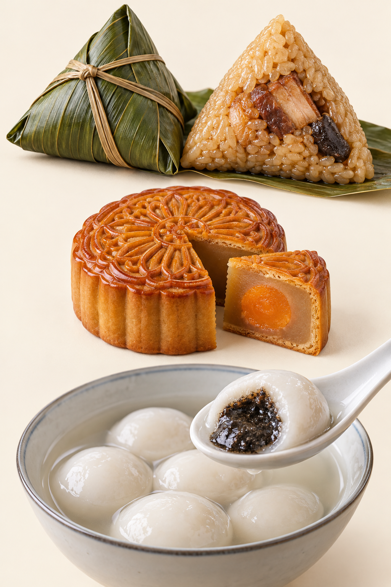
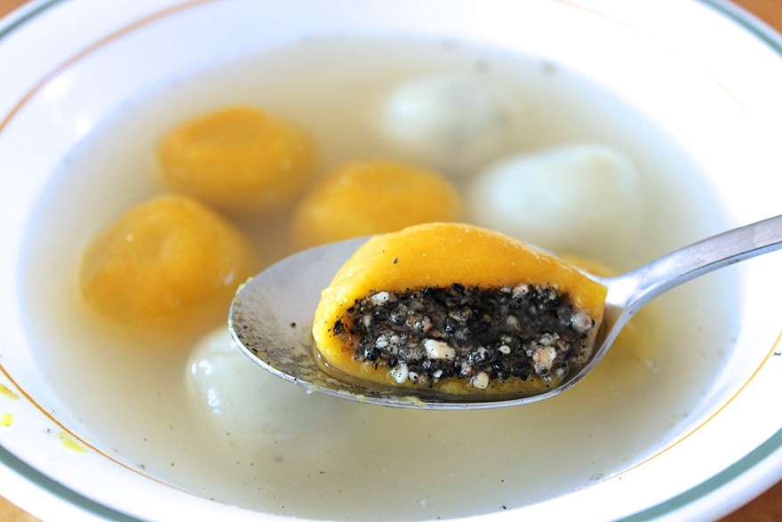
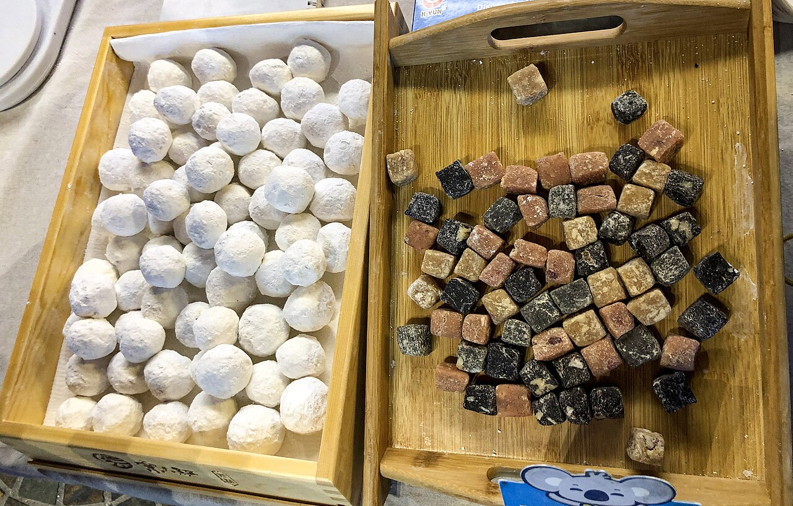
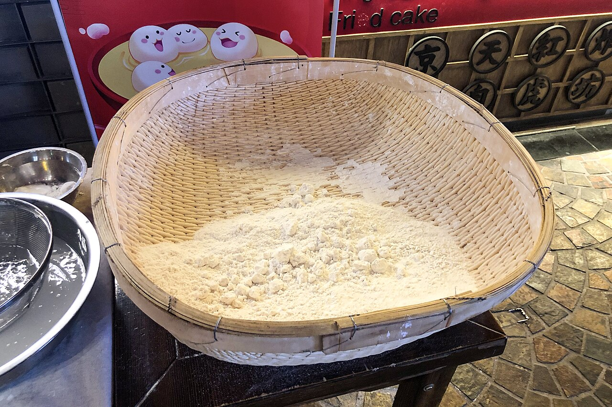
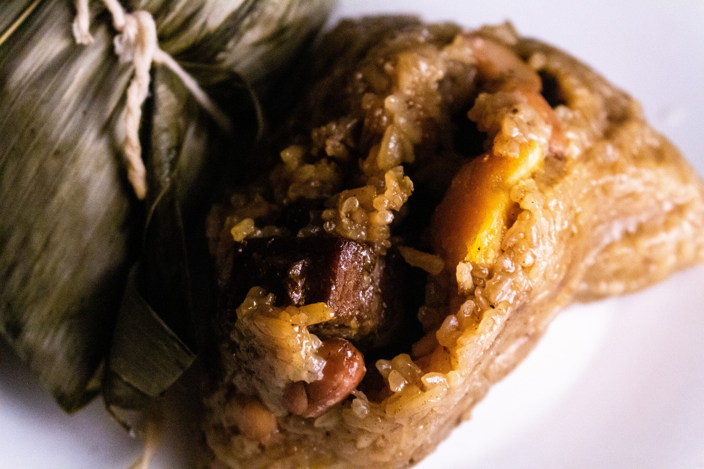

# 09　节令、礼俗与传播：点心怎样成为共同记忆

一块糕点可以同时是食物、礼物和时间的标记。相同配方平日吃是茶点，放进中秋礼盒便增加馈赠意义；一个团子由家人共同包制，又承载了操作过程和相聚经验。理解节令点心，不必把每种寓意都追溯为唯一古老起源。

<!-- teaching-art -->

图9　自上而下：粽子、广式莲蓉蛋黄月饼、黑芝麻汤圆。AI生成当代代表外观示意，不作为历史复原或起源证据。

## 寓意说明人们怎样解释，不一定说明最初怎样发生

“糕”与“高”的谐音，使年糕容易与成长、进步联系；圆形食品也常被赋予团聚、圆满的解释。这些寓意是真实文化实践的一部分，却不能证明食物最初就是为某句吉祥话发明的。同一种形状可以容纳多种解释，同一节日的食品也随家庭、地区和时代改变。

点心历史常有三类材料：可以查到年代和制作描述的文献；传承人、店家与家庭保存的记忆；广泛流传的起源故事。三者都有阅读价值，但证据用途不同。店家的百年沿革能说明这家店的历史，不能自动成为全国同类食品的发明史。

## 元宵与汤圆：同一个节令中的不同动作

元宵节常见圆形糯米食品，但“元宵”和“汤圆”不能只当作南北异名。常见制作区别是：元宵以结实馅块为核心，反复沾水、滚上干糯米粉；汤圆则把和好的粉团分剂，包住馅料并搓圆。前者通过一层层附粉形成外壳，后者通过包制形成连续外皮，因此表面、吸水和煮后状态可能不同。[资料：中国质量新闻网，南京市标准化研究院专家解读](https://www.cqn.com.cn/ms/content/2026-03/03/content_9146302.htm)

但市场命名并非处处严格，阅读包装与观察做法比只看招牌更可靠。无馅小圆子、咸馅汤圆以及其他节日食用习惯，也不应被甜馅的主流印象遮住。

<!-- public-photo:real-cn-tangyuan -->

图9-1　南瓜汤圆实例；红豆与黑芝麻馅的信息来自原图说明。前方匙上的切面呈现了皮与馅的关系。

实物照片：cherrylet；[CC BY 2.0](https://creativecommons.org/licenses/by/2.0)。[原图与许可页](https://commons.wikimedia.org/wiki/File:Pumpkin_tangyuan_%28%E6%B1%A4%E5%9C%86%29_with_red_bean_baste_and_black_sesame_fillings.jpg)。

<!-- public-photo:real-cn-yuanxiao -->

图9-2　未煮元宵与滚制用馅块并置。左侧已经裹粉，右侧保留馅块形态。

实物照片：N509FZ；[CC BY-SA 4.0](https://creativecommons.org/licenses/by-sa/4.0)。[原图与许可页](https://commons.wikimedia.org/wiki/File:Yuanxiao_and_fillings_%2820210225185338%29.jpg)。

<!-- public-photo:real-cn-yuanxiao-basket -->

图9-3　滚制元宵用的笸箩与糯米粉，器具和材料身份依原图说明。可与前图的馅块、成品联系理解。

实物照片：N509FZ；[CC BY-SA 4.0](https://creativecommons.org/licenses/by-sa/4.0)。[原图与许可页](https://commons.wikimedia.org/wiki/File:Bamboo_basket_filled_with_glutinous_rice_flour_for_Yuanxiao_shaking_%2820210225185342%29.jpg)。

## 清明前后的绿色糕团

青团、艾粿等让植物、稻米与春季生活相遇。植物处理和配粉方式不同，会造成青草气味、表面光泽与柔软度的差别；食用时间也可能因商业供应而延长。全年可以买到，不意味着它原有的节令联系不存在；反过来，节令销售也不证明所有配方都从古代原样延续。

观察一款时令点心，可以分别记下原料季节、节日使用和当代售卖时间。这三个时间表可能重合，也可能因为冷冻、加工和流通技术而分开。这样的区分有助于理解“新式传统”：有些改变发生在馅料，有些改变发生在供应方式。

## 端午与粽子：一种节日，多种地方记忆

粽子通过叶片包裹米与馅料，在蒸煮后形成便于分份的食物。糯米的黏性、包裹紧实度、米粒吸水程度和馅料脂肪共同影响切面。甜粽、肉粽、碱水粽与不同叶材，显示共享形式之下存在许多地方路线，不能概括成绝对的“北甜南咸”。

屈原故事是端午最广为人知的解释之一，却不是所有地区的唯一纪念对象。联合国教科文组织（UNESCO）的端午项目（英文名 Dragon Boat festival）介绍明确呈现地方间不同的纪念人物与活动传统[^ch09-dragon-boat]，因此不宜把节日全部习俗都写成某一事件的直接后果。[资料：UNESCO，Dragon Boat festival](https://ich.unesco.org/en/RL/dragon-boat-festival-00225)

这一点也影响粽子图鉴的写法：把今天的品种、做法与吃法先说明白，再介绍相关故事及其地方范围，比先给出一个全国统一的“发明传说”更准确。

<!-- public-photo:real-cn-two-zongzi -->

图9-4　粽子的叶包、系绳与解开状态。打开后仍可辨认米粒及包入其中的馅料块。

实物照片：Stevenliuyi；[CC BY-SA 4.0](https://creativecommons.org/licenses/by-sa/4.0)。[原图与许可页](https://commons.wikimedia.org/wiki/File:Two_Zongzi.jpg)。

## 中秋月饼：模具、分食与礼物

月饼模具上的文字、花纹与形状既传达祝愿，也可帮助辨别款式和馅料。模具不是纯装饰；它影响压纹、脱模、外皮厚薄与批量生产时的稳定性。中国文艺网的月饼模具资料即讨论了图案和形状与工艺、馅料识别的关系。[资料：中国文艺网，月饼模具的历史和制作](https://www.cflac.org.cn/wywzt/2014/ZhongQiu/sszq/201409/t20140904_268621.html)

分切共享与整枚赠送形成两种不同经验。前者让一家人比较不同馅料，后者借包装、产地和品牌表达心意。小份化、冰皮、流心及复合口味延伸了月饼的表现，但“更新”不能单由稀奇馅料判断：食用方便、皮馅协调和保存方式是否清楚，同样影响它能否长期进入生活。

## 婚寿、祭祀与跨地区传播

寿桃、喜饼、红龟粿等常与祝寿、婚庆、祭祀相连，但具体数量、颜色和使用场合须尊重地方与家庭差异。展示形态相似，不等于礼俗意义完全一致。对于不熟悉的礼饼，先了解谁制作、送给谁、何时分食，通常比只问寓意更有收获。

点心传播也不只有“中传西”或“西传中”两条方向。移民家庭、港口商贸、茶馆、饼店和烘焙教育都可能改变原料与技术。澳门葡挞的文化遗产资料将其描述为在葡萄牙甜点技艺基础上进行地方创新与传承的实例；这种表述能同时保留来源和本地变化。[资料：澳门文化遗产网，葡挞制作技艺](https://www.culturalheritage.mo/detail/102289)

阅读节令食品时，可以把一句说明改写成三个问题：目前可观察到什么做法，哪些历史材料能核实，哪些说法属于地方故事。保留这些层次，点心的文化意义并不会变薄，反而更容易让不同地区和家庭的经验都得到合适的位置。

## 继续按品种阅读

[汤圆、元宵与圆子的日常吃法](21-rice-balls.md)进一步展开这里涉及的品种与食用场景。

[^ch09-dragon-boat]: Dragon Boat festival是该非物质文化遗产项目的英文名。英文题名突出龙舟，但项目说明同时涉及纪念、节令礼俗与食品等活动；不能把英文名称当成节日只有龙舟竞赛的定义。原项目页面有时要求验证，可参阅同机构的[项目影像说明](https://www.unesco.org/archives/multimedia/document-335)。
