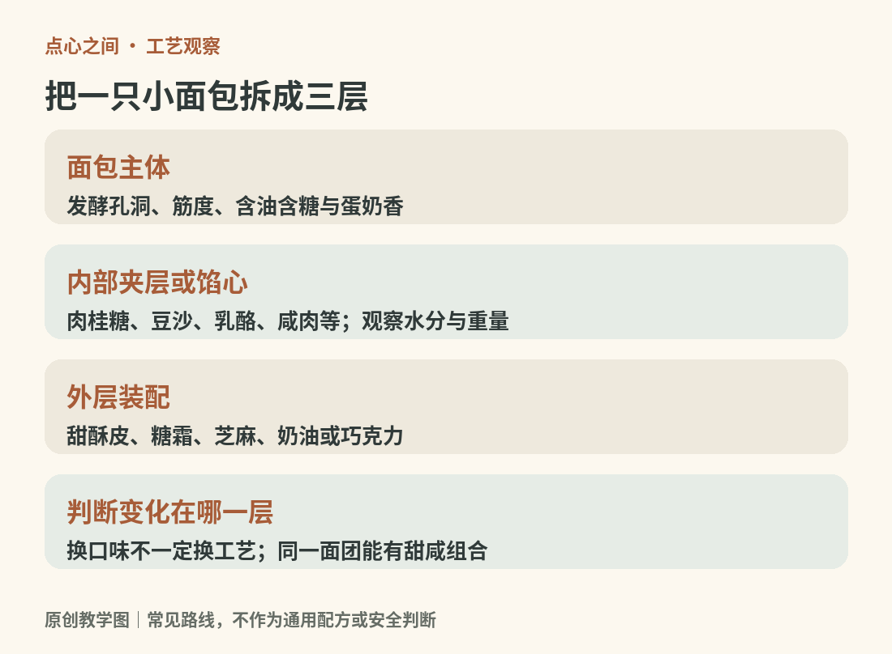
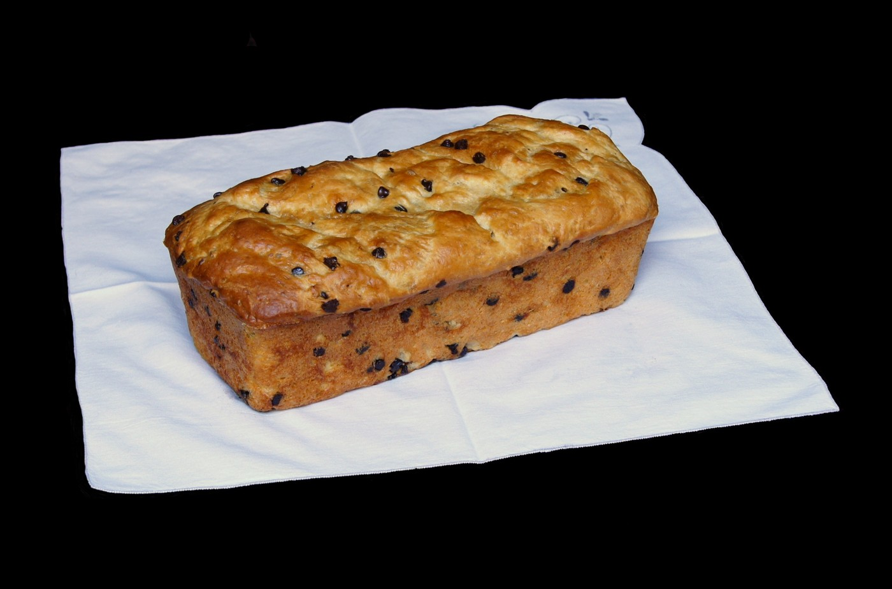
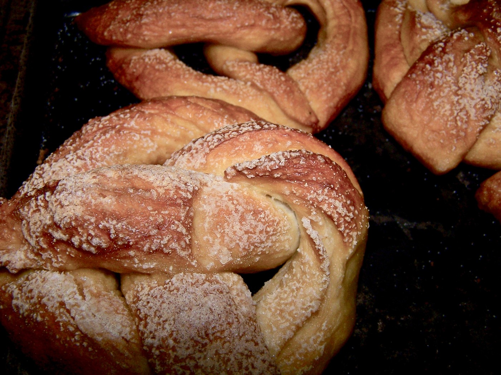
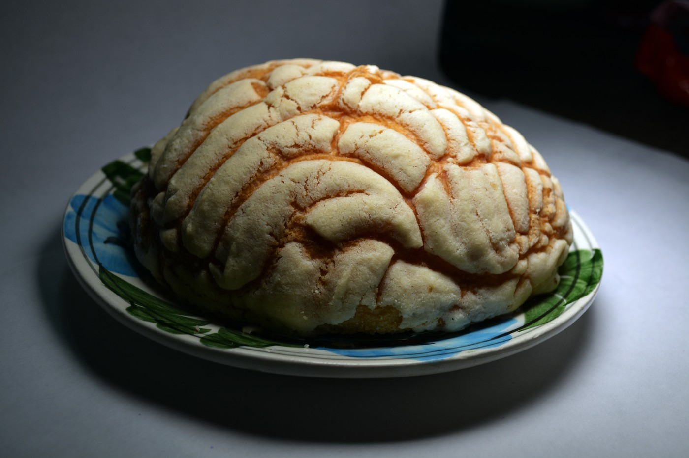

# 10　从小餐包到布里欧修：发酵面团的点心生活

面包既能是主食，也能是点心。一片配菜的乡村面包、一只午后吃的肉桂卷，可能使用相近的发酵原理，却进入不同的饮食场景。本书把适合单独食用、分量较小，或以甜咸馅料构成完整风味的面包纳入点心讨论。这个边界是阅读上的安排，并不意味着各地都把它们叫作“糕点”。

<!-- teaching-art -->

图10　分开观察面包主体、夹馅与外层装配。原创教学图。

## 先看面包体，再看馅料

判断一只面包，不妨先观察未接触馅料的部分：它是略有韧性的麦香面团，还是带蛋奶香的柔软组织？用手轻轻撕开，断面是大小不一的孔洞、细密拉丝，还是层状薄片？最后才看表面的糖霜、坚果和肉松。这样能避免把“巧克力口味”误当成一种独立的面包工艺。

酵母发酵产生气体，面团中的网络把气体留住；烘烤时，原本柔软的气泡壁逐渐固定。面粉、水、盐和酵母已经能做成面包；加入糖、蛋、奶、油脂后，面团的味道、柔软度和操作方式会变化。“富集面团”指加入这类丰富配料的面团，并不是营养评价。布里欧修就是以蛋和黄油为重要特征的发酵面包。[资料：King Arthur Baking，Classic Brioche](https://www.kingarthurbaking.com/recipes/classic-brioche-recipe)

糖和油脂也不是加得越多越好。配方需要同时照顾发酵、支撑和成形：馅料很多而面包体太薄，可能撑不住；黄油丰富的面团温暖时较软，冷却后更容易分割。读到配方要求冷藏，不宜只把它理解成“等待”，还要注意它在管理面团状态。

<!-- public-photo:real-we-brioche -->

图10-1　巧克力豆布里欧修。金黄色长条面包上可见分散的深色配料。

实物照片：Jebulon；Public domain（见原许可页）。[原图与许可页](https://commons.wikimedia.org/wiki/File:Brioche_aux_p%C3%A9pites_de_chocolat.jpg)。

## 几条值得一起认识的支线

| 类型与例子 | 看哪里 | 点心中的作用 |
| --- | --- | --- |
| 小餐包、奶油卷 | 单纯面包体与柔软内瓤 | 配汤、配茶，也能夹咸馅 |
| 布里欧修 brioche | 蛋奶油香、细致的面包组织 | 本身即可食用，也常做夹馅或甜点基底 |
| 肉桂卷 | 卷入的糖香料和螺旋断面 | 面团、夹层和淋面的连续组合 |
| 普雷结 pretzel 与普雷结小面包 | 深色外皮、割口、咀嚼感 | 咸点，也能成为三明治外壳 |
| 墨西哥 concha 贝壳面包 | 软面包上的带纹甜酥皮 | 表层与面包体形成口感对照 |
| 甜甜圈中的酵母型 | 蓬松面包体与炸制表皮 | 与蛋糕型甜甜圈形成另一条工艺支线 |

普雷结的辨识点不能只有扭结形状：同样的面团也能做成圆形小面包。King Arthur 的家庭版本在烘烤前使用小苏打水浴，帮助形成深色表面；专业产品还可能采用不同的碱处理。家用小苏打水浴与专业强碱工艺不可按同一浓度随意替换。[资料：King Arthur Baking，Pretzel Buns](https://www.kingarthurbaking.com/recipes/pretzel-buns-recipe)

Concha 的名字意为贝壳，外观来自表层纹路，但它的学习价值在于“双层”：下方是发酵面包，上方是可形成裂纹的甜酥皮。它属于墨西哥广阔的 pan dulce 传统；pan dulce 不能简单翻译为某一种固定面包，更不宜只用一款 concha 代表整个类别。[资料：King Arthur Baking，Conchas](https://www.kingarthurbaking.com/recipes/conchas-recipe)；[Pan Dulce 专题](https://www.kingarthurbaking.com/pan-dulce)

<!-- public-photo:real-we-pretzel -->

图10-2　家庭制作的普雷结面包。扭结形态、深褐色表皮与表面浅色颗粒共同构成辨认线索。

实物照片：Charles Smith；[CC BY-SA 2.0](https://creativecommons.org/licenses/by-sa/2.0)。[原图与许可页](https://commons.wikimedia.org/wiki/File:Pretzel_bread_baking_experiment.jpg)。

<!-- public-photo:real-we-concha -->

图10-3　墨西哥concha贝壳面包。浅色甜酥皮覆盖面包主体，弯曲刻纹与烤后裂缝清楚可见。

实物照片：ProtoplasmaKid；[CC BY-SA 4.0](https://creativecommons.org/licenses/by-sa/4.0)。[原图与许可页](https://commons.wikimedia.org/wiki/File:Concha_%28pan_dulce_mexicano%29_02.JPG)。

## 甜与咸，经常只隔着一个组合

面包的基础风味并不决定它只能服务甜食。布里欧修可与果酱搭配，也能承接咸味馅料；小餐包可以撒芝麻、加奶酪，或夹入肉类和蔬菜。判断它是否协调，需要把面包体、馅和酱料放在一起考虑：柔软的面包配湿馅容易整只变软，较有韧性的外壳则可能与细嫩馅料形成反差。

肉桂卷提供另一个例子。它看起来像卷起来的面包，实际有三个能分别调整的层面：面团是否柔软、糖馅是否湿润、表面淋酱是否厚重。换成黑芝麻或豆沙，并不自动成为一种全新的基础工艺；它可能是既有结构的风味改写。认识结构以后，传统与新式之间的关系会更清楚。

## 面包、蛋糕和起酥的边界

理解发酵面包，还可以沿着制作顺序观察一次。混合时，原料从分散状态成为面团；揉制与静置影响面团的延展和支撑；第一次发酵让体积与状态发生变化；分割、整形把气体与面团重新安排；最后发酵与烘烤再把形状固定。这个顺序解释了为什么把一份面团直接搓圆、立即烤熟，不能自动获得配方所期待的组织。各阶段的时间没有通用答案，面团温度与状态比单看钟表更有意义。

夹馅面包则多出一组配合问题：馅料应该在整形时包入，还是烤后加入？前者需要承受发酵与烘烤，后者保留了冷馅的选择，却改变储存方式。对读者来说，这也是辨识“新式面包”的实用问题。奶油水果包与烤制豆沙包即使外形相近，也不能因为同在面包架上，就假设它们具有相同的保存条件。家庭制作应沿用对应配方的加热、冷却和储存说明。

有些产品名字带 bread，做法却更接近化学膨松的蛋糕糊；“香蕉面包”就是常见例子。相反，可颂也含酵母，但还有反复包油折叠产生的层次，应到起酥章节继续理解。不能凭名称、形状或是否甜来判定技术类别。

在店里选三种分量相近的小面包，先各留下一口不带馅的面包体，再比较外皮、孔洞、咀嚼感和香气。随后把馅一起吃下，判断哪一个变化最明显。这个练习的目的不是给软硬排优劣，而是学会区分“面团的性格”和“组合后的效果”。同样柔软的面包，也可能因馅料含水、表面油脂和食用温度而呈现不同体验。

