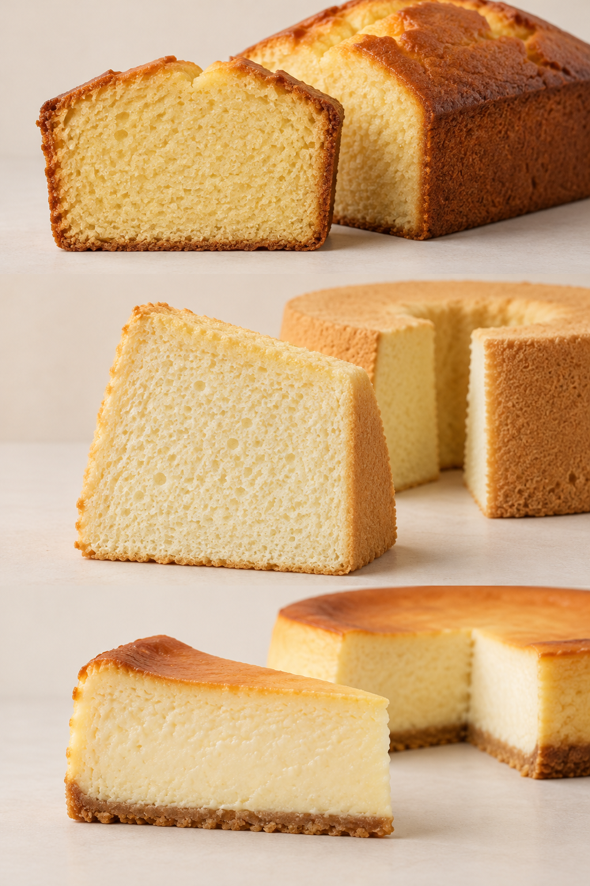
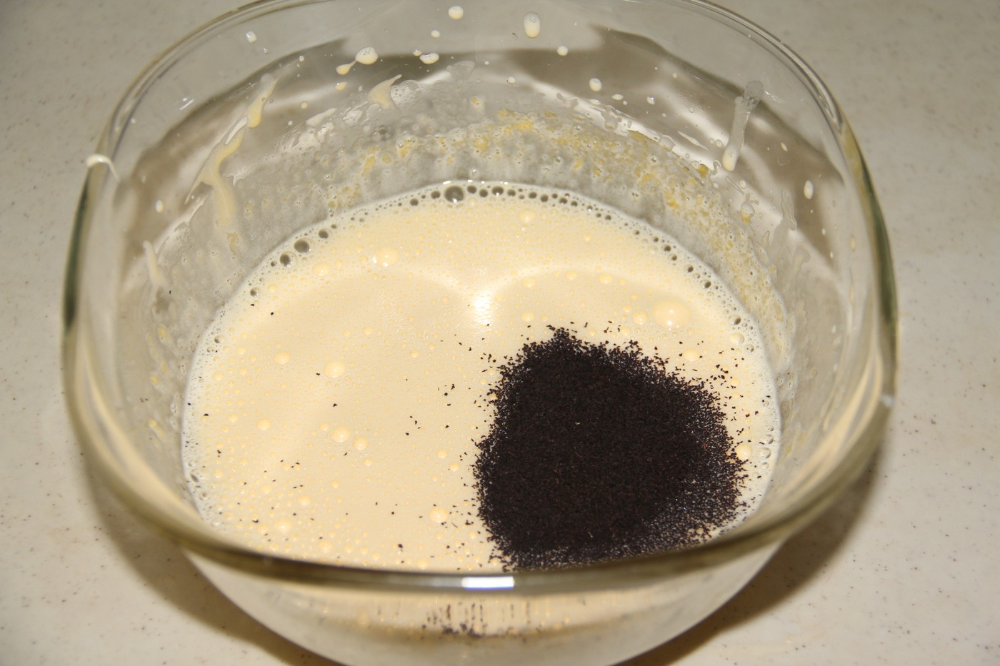
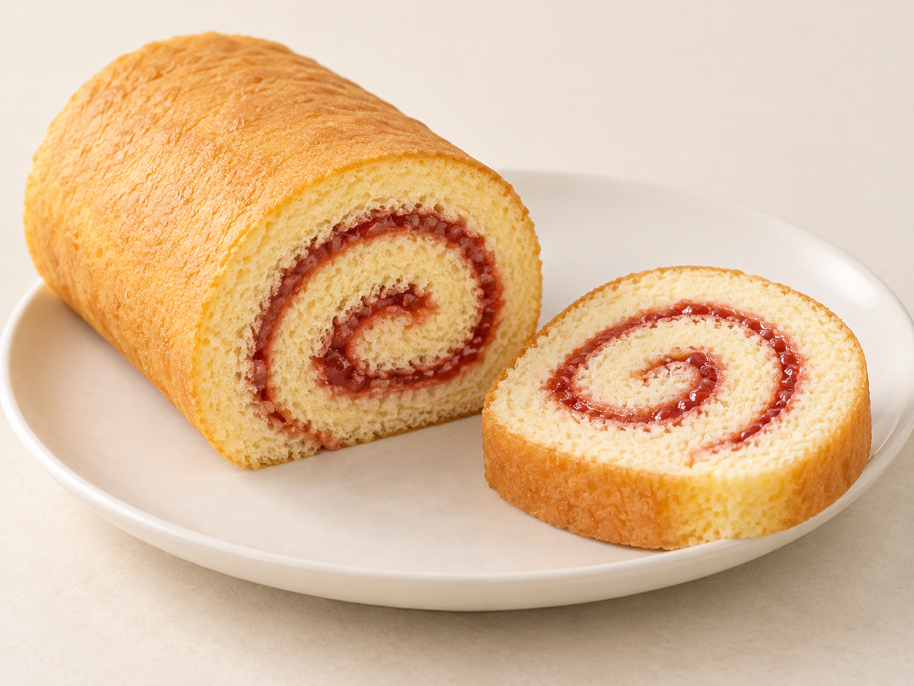

# 11　蛋糕里的空气：从海绵到芝士

切开一块蛋糕，首先看见的常常不是面粉，而是孔洞。蛋糕的蓬松感来自分散在组织中的气体，但这些气体可以通过不同方式进入面糊。知道空气从哪里来，比记住蛋糕外面裱了什么花更能帮助理解类别。

<!-- teaching-art -->

图11　自上而下：磅蛋糕、戚风切件、烤芝士蛋糕。AI生成组织外观示意，不表示实测气孔或含水差异。

## 打发与烘烤，各负责什么

打发全蛋、蛋白，或把黄油和糖搅打（creaming method），都能以不同方式引入空气[^ch11-creaming]；某些配方还使用泡打粉或小苏打。入炉后，已有气体受热膨胀，水蒸气增加；使用化学膨松剂的配方还会产生气体。蛋白质与淀粉的受热变化，使气泡壁逐渐定形。如果气泡消失得太快，或组织尚未固定便失去支撑，成品就可能塌陷。配方的搅拌顺序，因此是一项结构安排。[资料：King Arthur Baking，Cake Mixing Methods](https://www.kingarthurbaking.com/blog/2017/04/28/cake-mixing-methods)

“打发得越久越蓬松”并不是普遍规则。打发的对象和目标不同，后续混入面粉、油脂的方式也不同。读者不必先记下全部操作术语，只要抓住两问：这一步在引入空气，还是在把已经形成的泡沫与其他材料结合？当前动作会让结构更稳定，还是可能损失空气？

<!-- public-photo:real-we-chiffon-process -->

图11-1　戚风蛋糕制作记录中的一次混合：浅色液体表面有气泡，深色配料尚未拌散。

实物照片：Roozitaa；[CC BY-SA 3.0](https://creativecommons.org/licenses/by-sa/3.0/)。[原图与许可页](https://commons.wikimedia.org/wiki/File:Making_Chiffon_cake_1.jpg)。

## 海绵、戚风与黄油蛋糕

海绵蛋糕（英语 sponge cake）通常以打发鸡蛋形成的泡沫为重要基础，但“海绵”并不是一张全球统一的配方。使用全蛋、分蛋、少量黄油或不加油脂，都会形成分支。热那亚蛋糕（法语 génoise）是其中常见的一支；所引配方先打发全蛋与蛋黄，再混入融化黄油，不能把它直接归入黄油糖打发法。[^ch11-genoise]较清爽的蛋糕体常与奶油、果酱或糖液搭配，成品的湿润程度不能只归因于蛋糕本身。[资料：King Arthur Baking，Cake Guide](https://www.kingarthurbaking.com/learn/guides/cake)

戚风蛋糕（英语 chiffon cake）把蛋白泡沫与含油、含蛋黄的面糊结合。[^ch11-chiffon]液态油让它在不同食用温度下保持与黄油蛋糕不同的口感，蛋白泡沫提供轻盈感。具体配方也可能含化学膨松剂，因此不宜把戚风定义成“绝对不使用泡打粉的蛋糕”。[资料：King Arthur Baking，Chiffon Cake](https://www.kingarthurbaking.com/recipes/chiffon-cake-recipe)

磅蛋糕（pound cake）和其他黄油蛋糕（butter cake）重视油脂带来的香气与细致组织。传统磅蛋糕名称与面粉、黄油、糖、蛋各取一磅的配方有关，现代版本却不必严格使用同重量的四种材料。[^ch11-pound]它们较扎实，不代表制作失败；把所有蛋糕都以“像云一样轻”作标准，会失去许多风格。

| 观察对象 | 常见结构线索 | 阅读时应避免的判断 |
| --- | --- | --- |
| 海绵、热那亚蛋糕 génoise | 蛋泡沫占重要地位，适合与夹层组合 | 只凭颜色判定是否加黄油 |
| 戚风 chiffon | 轻盈而有弹性，常见分蛋操作 | 把柔软直接等同于含水更多 |
| 磅蛋糕、黄油蛋糕 | 香气浓、组织较细密 | 把扎实等同于没有膨松 |
| 天使蛋糕 angel food cake | 蛋白泡沫是关键 | 把白色蛋糕都称为天使蛋糕 |
| 布朗尼 brownie | 可从湿润浓厚到较似蛋糕 | 用单一“正宗口感”覆盖所有版本 |
| 芝士蛋糕 cheesecake | 乳酪馅的凝固或冷藏定形 | 因名字含 cake 就认为必有海绵组织 |

## 芝士蛋糕：名称相近，组织可能很远

芝士蛋糕（英语 cheesecake，也常译乳酪蛋糕）提醒我们，糕点名称常同时承载外观、习惯和历史。[^ch11-cheesecake]烤制型通常利用乳酪、蛋等形成细腻组织；免烤型则可能依靠冷藏、明胶或其他稳定方式定形。饼干底、酥底或没有底，都是配方选择。美国烘焙学会的技术条目也把芝士蛋糕的馅描述为类似蛋奶凝固体系，而非一般充气面糊。[资料：American Society of Baking，Cheesecake](https://asbe.org/article/cheesecake/)

巴斯克风格的深色表面、纽约风格常见的浓密口感，都是理解产品的线索，却不能代替配料与做法。尤其“日式芝士蛋糕”在市场上可能指轻乳酪蛋糕，也可能泛指其他日本风格产品；读到名称时，应继续观察断面和配方，而不是直接套用结论。

## 装饰是第二张地图

如果要把结构读得更细，还可以比较蛋糕卷与层叠生日蛋糕。卷需要蛋糕片能承受弯曲，切开的螺旋让蛋糕与馅在每一口交替出现；层叠蛋糕则要让底坯支撑上方重量，切片以后仍能维持层次。两者不能只按“奶油多少”区分。相同风味做成不同形态，底坯厚度、湿润程度与夹馅稠度都可能需要调整。

纸杯蛋糕（cupcake）也不是固定的一种面糊，它描述的是小模具中的成形方式；玛芬（muffin）与它常在外观上相近，却可能采用不同混合方法和目标口感。进一步说，表面裂口、圆顶、紧密组织在某一种产品中可能符合风格，在另一种产品里却值得检查。认识具体类别以后再讨论成败，才不会让“必须平顶”“必须拉丝”“必须入口即化”这类单一标准统治整柜蛋糕。

同一种海绵可以做成奶油生日蛋糕、水果卷或小方切件；同一种奶油夹层也能搭配不同蛋糕体。因此，辨识一块成品要分开看底坯、夹层、包覆和装饰。草莓、抹茶、巧克力是风味线索，“千层”和“卷”还可能描述组装方式。名字里信息很多，但未必处在同一层。

日常观察时，可以比较一块不加淋面的磅蛋糕和一片奶油海绵蛋糕。把后者的蛋糕体与奶油分开品尝，再合起来吃：清淡底坯可能正是为了让夹层得到空间，浓香底坯则可能无需厚重装饰。记录“轻、弹、细、湿、香”的相对感受，比简单写“好吃、太干”更有助于下一次选择。这些词描述体验，不构成质量排名；储存、包装和食用温度同样会影响结果。

<!-- atlas-expansion:atlas-we-sponge-roll -->

图11-2　果酱海绵蛋糕卷教学示意：蛋糕片与薄果酱夹层卷成连续螺旋。

AI生成示意：用于观察代表外形与组织关系。[工艺参照资料](https://www.kingarthurbaking.com/recipes/jelly-roll-recipe)。

[^ch11-creaming]: creaming method在此指黄油与糖搅打引气的混合方法，不是把现成奶油霜加进面糊。“打发”还可以指全蛋、蛋白或稀奶油的操作，英文须按对象辨认。[参照：Cake Mixing Methods](https://www.kingarthurbaking.com/blog/2017/04/28/cake-mixing-methods)。

[^ch11-genoise]: génoise是法语名称，英语资料也常省略重音写genoise。它属于海绵蛋糕的分支；含有黄油不代表一定用creaming method来引入空气。[配方参照：Genoise](https://www.kingarthurbaking.com/recipes/genoise-recipe)。

[^ch11-chiffon]: chiffon cake是“戚风蛋糕”对应的英语名称。蛋白泡沫、液态油面糊和配方中的泡打粉可以共同存在，不能用“完全无泡打粉”定义这个家族。[配方参照：Chiffon Cake](https://www.kingarthurbaking.com/recipes/chiffon-cake-recipe)。

[^ch11-pound]: pound是重量单位“磅”。本段说明传统命名与四种主要材料的等重关系；并非要求今天所有黄油蛋糕都遵守同一比例。[参照：American Society of Baking，Butter Cake](https://asbe.org/article/butter-cake/)。

[^ch11-cheesecake]: cheesecake中的cheese指乳酪。“芝士”与“乳酪”在此为常见译法差别，不是两种凝固技术；烤制型和免烤型仍须分别看配方与定形方式。[参照：American Society of Baking，Cheesecake](https://asbe.org/article/cheesecake/)。
