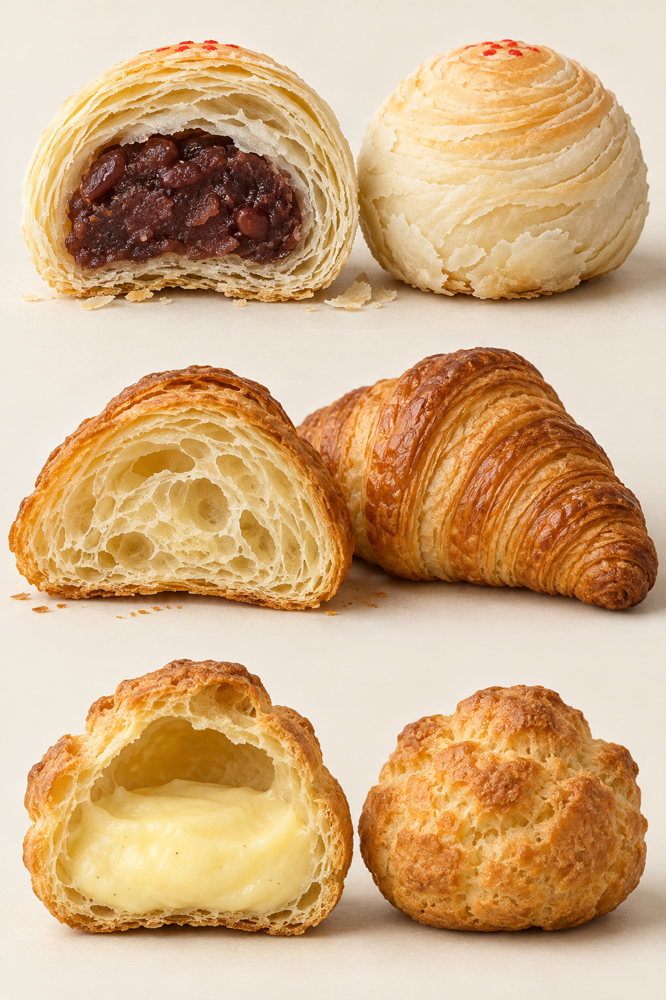

# 12　层层展开与一腔空心：起酥和泡芙

可颂、千层酥和泡芙都能在烤箱里显著鼓起，断面却揭示了三种不同的安排：可颂在发酵面团中保存层次；千层酥主要让薄层彼此分离；泡芙则把湿润面糊撑成中空外壳。外形相似的“蓬”，并不说明工艺相同。

<!-- teaching-art -->

图12　自上而下：中式分层酥点、可颂、填馅泡芙。AI生成切面示意。上方酥点仅作分层参照；可颂含发酵组织，泡芙主要形成壳内空腔。

## 包油折叠，究竟在制造什么

起酥面团通过包油、擀开和折叠，让面团与油脂形成交替层。制作时要维护这些层，烘烤时才有条件分开。水分在受热中形成蒸气，帮助薄层展开；油脂同时影响分隔、香气与口感。King Arthur 的烘焙示范把包油、折叠和烤后的断面放在一起，便于观察这种对应。[资料：King Arthur Baking，Puff Pastry: Layer It Like the Pros](https://www.kingarthurbaking.com/blog/2013/08/02/puff-pastry-layer-it-like-the-pros)

这里最需要的是油脂与面团在操作时状态协调。油脂太硬，擀压时容易碎裂；太软，则可能渗进面团而难以维持清楚的分层。冷藏的意义是管理温度、让面团松弛，并非一律“冷得越低越好”。实际操作还要服从具体配方、室温和油脂特性。

## 可颂与不发酵千层酥

| 家族 | 是否通常含酵母 | 膨起与组织的重点 | 常见成品 |
| --- | --- | --- | --- |
| 可颂类 | 是 | 发酵组织加上包油层次 | 可颂、巧克力面包 pain au chocolat |
| 丹麦类 | 是 | 发酵起酥，常与蛋奶馅、水果组合 | 风车、方形或卷形丹麦点心 |
| 法式千层酥 pâte feuilletée | 基础配方通常不含 | 层间蒸气与分层 | 蝴蝶酥、拿破仑、酥盒 |
| 泡芙 pâte à choux | 基础配方通常不含 | 高含水面糊受热鼓起并固定 | 圆泡芙、闪电泡芙、奶酪泡芙 |

可颂需要照顾酵母活动，也要避免让包入的油脂失去状态；不发酵千层酥则没有同样的酵母发酵阶段。这是理解两者的关键差别。“千层”是对层次的形容，不能要求每件成品有固定数量的可见层。[资料：King Arthur Baking，Baker's Croissants](https://www.kingarthurbaking.com/recipes/bakers-croissants-recipe)；[Classic Puff Pastry](https://www.kingarthurbaking.com/recipes/classic-puff-pastry-pate-feuilletee-recipe)

折叠次数也不是品质积分。层次过细可能改变最终的蓬松与酥脆表现；King Arthur 的对照试验显示，减少折叠在其测试配方中能获得更开放的可颂组织，但作者也强调这不是所有配方的唯一标准。[资料：King Arthur Baking，Why Fewer Folds Make a Better Croissant](https://www.kingarthurbaking.com/blog/2021/10/19/fewer-folds-makes-better-croissants)

丹麦点心进一步展示了结构与填馅的协商。水果和蛋奶馅带来水分、重量与甜味，折角和边框则不只是装饰，也为馅料安排位置。选购时可同时看底部是否熟透、边缘是否有层、中心是否与馅料协调；只看表面光亮，容易漏掉最重要的口感。

外层碎屑和内里组织也要分开理解。可颂表皮破成薄片，不代表内部一定干燥；外表层次漂亮，内部仍可能过于紧密。拿破仑的酥片则与湿润夹层交替，往往需要刀叉协助切开。它不方便整齐咬下，并不能单独作为品质结论；产品本来安排的食用方式，也应进入判断。

## 泡芙为什么能空心

泡芙不靠包油折叠。典型流程先把液体和油脂加热，加入面粉形成熟面糊，再分次加入蛋，调整到能够挤出的稠度。烘烤中，水蒸气促使面糊鼓起，外壳逐渐定形并干燥。它因而能留下放馅的空间。[资料：King Arthur Baking，What Is Pâte à Choux?](https://www.kingarthurbaking.com/blog/2022/10/24/what-is-pate-a-choux-why-we-love-this-versatile-french-dough)

泡芙的“壳”与“馅”常在不同阶段完成。壳需要足够支撑，馅则追求细腻湿润；填好后，水分会逐渐改变外壳口感。新鲜酥壳与放置后柔软的壳，不能只用同一项标准评价，但外壳内侧黏湿与细腻柔软也不是一回事。具体制作时应使用经测试的配方，不能只凭外表上色就判断内部已经完成。

同一面糊能挤成长条成为 éclair 闪电泡芙，也能制成圆形；加入奶酪可做咸味 gougère。可见泡芙不是“夹奶油的圆球”的同义词。[资料：King Arthur Baking，Pâte à Choux](https://www.kingarthurbaking.com/recipes/pate-a-choux-recipe)

## 用断面读懂三种“蓬”

对于第一次接触起酥的读者，可以把完整变化想成一条连续路线：起初是两种独立材料；包入以后成为有边界的组合；擀开让边界变长、变薄；折叠把层重新叠放；最后切割、成形并烘烤。关键在于每一步保留前一步建立的层次，而不是不断把材料揉匀。与中式水油皮包油酥相比，两者都在安排油脂与面粉的关系，但油脂层的组成、面团含水和操作方法并不相同，不能把名字相近当成配方可直接互换。

泡芙的连续变化正好不同：加热后形成能聚成团的熟糊；加入蛋后逐渐变得有光泽且可挤；挤出的坯体还没有中空；入炉鼓起并逐渐固定；内部进一步干燥后才有条件承托馅料。成品图看不见前半段的熟糊，却正是这段过程使它区别于一盘普通蛋糕糊。比较时应把过程和断面同时看，避免只背“蒸气膨松”而不理解蒸气如何被留下。

把可颂、蝴蝶酥和未填馅的泡芙并排观察：可颂有薄层与发酵孔洞共同构成的内部；蝴蝶酥能看到更紧密的折叠线和糖化表面；泡芙最醒目的是壳内空间。再分别听咬下时的声音、看碎屑形状。这个练习能把“酥”拆成不同经验，也能解释为什么三者不适合用同一种方法替换或回温。理解工艺以后，再看新式圆筒可颂、可颂塔或加脆壳泡芙，就能区分形状创新、组合创新和面团本身的改变。

