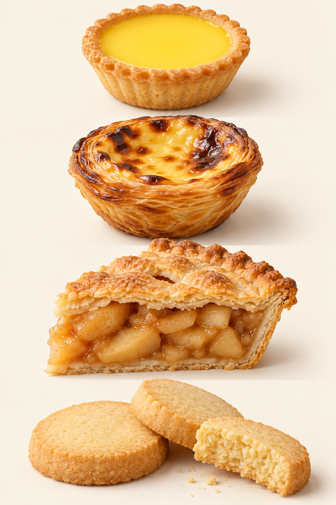

# 13　酥底与小饼：塔、派、曲奇和饼干

塔与派常以“外壳加馅”组织味道；曲奇与许多饼干则把味道集中在一小块面团里。它们之间有交集：一份甜酥面团可以烤成塔壳，也可以切成小饼。但同样的材料经过不同厚度、烘烤与装配，会承担不同任务。

<!-- teaching-art -->

图13　自上而下：曲奇皮蛋挞、葡式酥皮蛋挞、双皮苹果派、黄油酥饼。AI生成外观示意，具体店家与地区做法有差异。

## 短酥，指向容易咬断的组织

短酥中的“短”不描述长度，而指向较松散、容易咬断的口感。面粉接触水并经过搅拌，可能形成更连续的面筋网络；油脂、较少的游离水和适度混合，则帮助获得酥松效果。这是观察思路，不能简化成“所有面筋都必须消灭”。饼干对强度、延展和脆度的要求并不相同。[资料：American Society of Baking，Cookies](https://asbe.org/article/cookies/)

法式名称 pâte brisée、pâte sucrée、pâte sablée 分别指向常见的基础酥皮、甜酥皮与沙酥类面团传统，但实际配方和混合方法存在流派差异。对初学者，更有用的是先问它要包住湿馅，还是独立烤成可承托水果和奶油的壳；需要薄脆、松酥，还是足够结实便于拿取。名称可以继续学习，功能应先看明白。

## 塔与派，没有全球统一的外形边界

塔常以开放表面、较清晰的边缘和独立酥壳进入读者视野；派既可以敞口，也可以加顶皮，既能甜也能咸。不同地区的命名并不严格一致。水果塔、柠檬塔、苹果派、南瓜派和咸派 quiche，最好同时用“外壳工艺＋馅料体系”来描述，而不是仅凭模具形状判定。

| 成品 | 需要同时处理的关系 | 常见观察点 |
| --- | --- | --- |
| 新鲜水果塔 | 烤好酥壳与湿润奶油、水果 | 底壳是否仍有酥感，水果是否大量出水 |
| 柠檬塔 | 酸甜馅与酥底 | 酸味是否清楚，壳是否承托得住 |
| 双层苹果派 | 上下皮与受热出汁的水果 | 底皮、馅料熟度和上皮是否协调 |
| 蛋奶派、咸派 | 凝固较温和的蛋奶馅与酥皮 | 馅是否细腻，底部是否熟透 |
| 小型塔点 | 便携与一口中的比例 | 边壳会不会过厚、馅料会不会过少 |

“盲烤”指先烤空壳。对于后填的冷馅，壳需要先完成烘烤；对于某些湿润、烘烤时间较短的馅，预烤能帮助底皮先定形。压重物可以限制空壳鼓包和边缘滑落，但具体操作仍须按配方区分。并不是所有派都要预烤，双层派尤其不能机械套用。[资料：King Arthur Baking，How to Prebake Pie Crust](https://www.kingarthurbaking.com/blog/2026/09/01/prebake-blind-bake-pie-crust)；[Culinary Institute of America，Blind Baking Pie and Tart Shells](https://app.ckbk.com/reference/baki28653c15s001e003/blind-baking-pie-and-tart-shells)

## 曲奇不只是裱花形状

中文日常用语中的“曲奇”常让人想到黄油裱花小饼，英文 cookie 的使用范围却宽得多。按成形方法观察，可以看到舀放、擀切、挤压、冷藏切片和盘烤后切块等方式。它们是有帮助的操作分类，不是互不相交的物种：同一类面团可能有多种成形选择。[资料：King Arthur Baking，Classic Cookie Recipes](https://www.kingarthurbaking.com/recipes/collections/classic-cookie-recipes)

黄油酥饼 shortbread 重视简洁的油脂香与酥松；巧克力豆曲奇可以松脆，也可以中心柔韧；biscotti 常经整条烘烤、切片再烤，强调干燥和便于蘸饮；薄脆小饼则让厚度成为口感的一部分。中文“饼干”、英式 biscuit 和美式 biscuit 也不能逐字对等，遇到食谱时需要看实物与做法。

小饼摊开多少，不只取决于黄油有没有融化。糖量、面粉、冷藏、烤箱状态、烤盘表面和铺垫材料都可能参与作用。King Arthur 的烤盘铺垫对照就是一个提醒：把所有扁平曲奇都归罪于配方，容易漏掉操作条件。[资料：King Arthur Baking，Cookies Spreading? It Might Be Your Pan Lining](https://www.kingarthurbaking.com/blog/2022/12/01/keep-cookies-from-spreading)

比较小饼时还应控制厚度。相同面团薄薄擀开和做成厚块，水分散失与入口受力的方式不同；把一片薄脆与一块厚曲奇的硬度直接排名，无法判断是哪种材料或工艺发挥作用。

## 酥感是一项会变化的性质

一只水果塔的制作，实际上可以分成几段相互独立的工作：做面团和冷藏松弛，铺入模具并修整边缘，烤成能承托的壳，再放入已经准备好的馅与水果。最后装配不只是摆盘，它也决定湿料从什么时候开始接触壳。家庭阅读配方时，先把“必须烤熟的部分”和“烤后加入的部分”标出来，往往比一口气记住全部操作更有效。

饼干的连续路线又略不同：混合先决定面团状态，成形决定厚薄，烘烤决定上色与干燥，冷却使成品达到可以判断的状态。有些小饼刚出炉时仍柔软，完全冷却才显出预期脆度；据热态就追加长时间烘烤，可能造成过度上色。反过来，软心曲奇也不应因中心柔软就一概当成未熟。应把目标风格、尺寸与可靠配方放在一起判断，而不是只靠一个“摸起来硬不硬”的动作。

塔壳接触湿馅以后，饼干在潮湿环境里放置以后，都可能改变原本的酥脆。理解一件点心，还要把“何时吃”纳入评价。工厂包装的小饼追求较长的稳定性，现做水果塔则常以较短时间里的壳馅对照为特点；两者的产品目标不同。

可以选一块黄油酥饼、一块软心曲奇和一片 biscotti，先比较断裂方式，再少量蘸饮观察变化。不要只记录谁最硬，而要记录碎成粉屑、出现清脆断口，还是弯折后才断。随后再吃一口塔壳，体会同样的“酥”如何从主体变成承托层。这能帮助读者看懂新品：换馅、换形、叠层与改变面团，是不同层次的设计。

