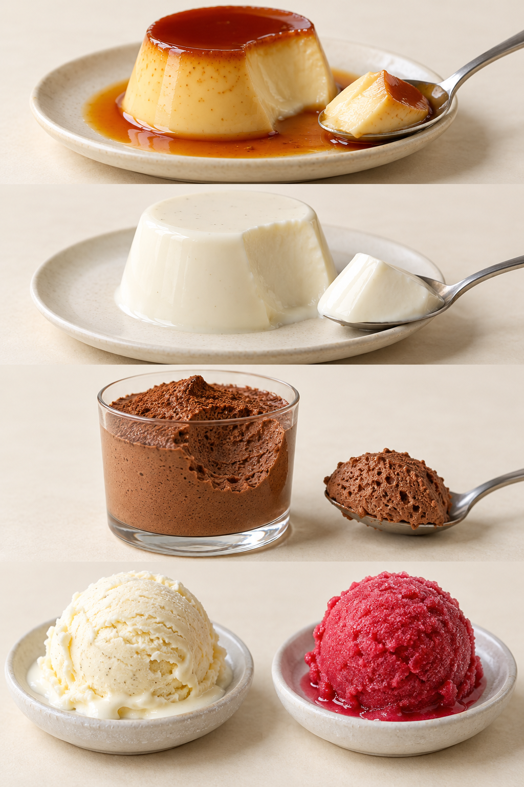
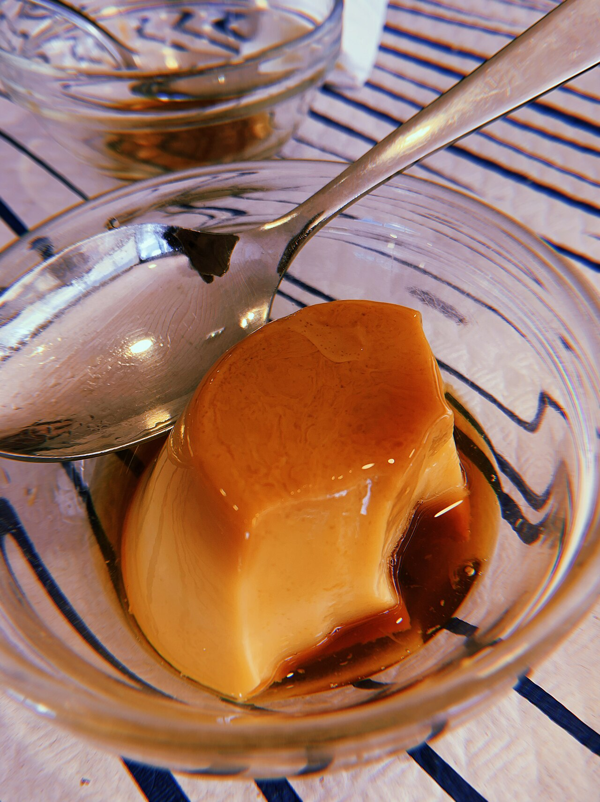
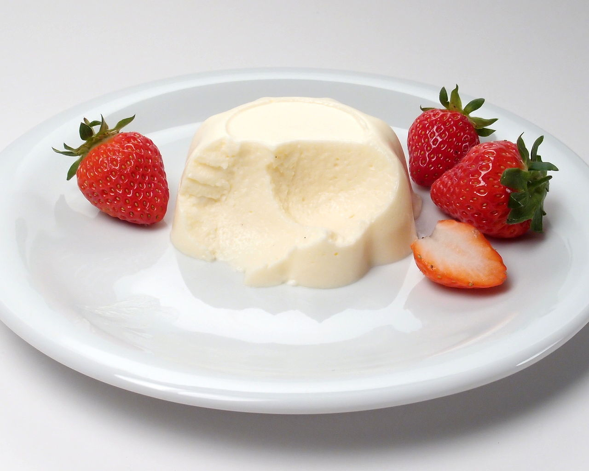

# 14　凝固、充气与冻结：冷甜点的几条路线

布丁、奶冻、慕斯和冰淇淋都可能装在小杯里，入口也都显得细腻，但杯子掩盖了工艺差别。一份靠蛋凝固，一份靠胶凝体系，一份含有大量细小气泡，另一份把冰晶、空气和未冻结的液体组织在一起。先问“它靠什么站住”，许多名称就不再混乱。

<!-- teaching-art -->

图14　自上而下：焦糖布丁、奶冻、巧克力慕斯、乳类冰淇淋与果味sorbet。AI生成外观示意；表面光滑不能证明使用同一凝固方式。

## 布丁与蛋奶：先把词语放回语境

中文“布丁”常指可用勺舀取的柔软甜点，英语 pudding 的范围却远大于此，不能据此判定所有产品都靠蛋凝固。讨论具体工艺时，用蛋奶凝固、淀粉增稠或胶凝来补充描述更准确。

Custard 指蛋参与增稠或凝固的蛋奶体系。流动的英式蛋奶酱 crème anglaise，可以作淋酱或其他甜点的基础；烤制的焦糖布丁则形成可脱模的柔软凝胶。并不是名字含 crème 就一定是同一种奶油。糕点奶油 crème pâtissière 还通常借助淀粉增稠，便于填入泡芙或塔壳。[资料：Le Cordon Bleu，Crème Anglaise](https://app.ckbk.com/reference/cuis81374c03s001ss023e002/creme-anglaise)；[King Arthur Baking，Pastry Cream](https://www.kingarthurbaking.com/recipes/pastry-cream-creme-patissiere-recipe)

蛋奶体系追求的是恰当的凝固程度。柔软不等于没熟，结实也不必然更成功；口感目标和食品安全应分别按可靠配方判断。初学时不宜只凭摇晃程度模仿短视频，还应关注材料、分量、加热方式和冷却要求。

<!-- public-photo:real-we-creme-caramel -->

图14-2　焦糖布丁实物。主体的缺口显露内部，表面及碗底的褐色焦糖液与浅色布丁形成对照。

实物照片：Amanda  Coutinho；[CC BY 2.0](https://creativecommons.org/licenses/by/2.0)。[原图与许可页](https://commons.wikimedia.org/wiki/File:Cr%C3%A8me_caramel_2.jpg)。

## 奶冻与巴伐利亚奶油

Panna cotta 的名称意为“煮过的奶油”。今天常见的版本以乳制品和糖构成风味，通过明胶等使其冷藏定形；但也存在使用蛋白等不同路线的配方，不能把“绝对无蛋”写成所有版本的定义。蓝带的公开示例就结合了蛋白奶油层与含明胶的巧克力层。[资料：Le Cordon Bleu，Panna Cotta](https://www.cordonbleu.edu/news/panna-cotta/en)

巴伐利亚奶油 bavarois／Bavarian cream 则常以蛋奶酱为基础，加入胶凝材料并拌入打发奶油。它同时运用凝固与充气，因此既不同于单纯流动的蛋奶酱，也不同于未打入空气的奶冻。[资料：Le Cordon Bleu，Preparing a Classic Bavarois](https://app.ckbk.com/reference/dess51206c03s001ss002e001)

慕斯 mousse 更强调轻盈泡沫的组织，可以由打发奶油、蛋白泡沫或其他体系构成；有的借助明胶，有的利用巧克力等材料冷却后的性质支撑。读到“慕斯”不能直接推断它一定含生蛋，或一定含明胶。购买时若有饮食限制，仍应查看具体配料。

| 观察路线 | 常见代表 | 需要理解的重点 |
| --- | --- | --- |
| 蛋奶受热凝固 | 焦糖布丁、烤蛋奶 | 凝固程度与细腻度 |
| 淀粉辅助增稠 | 糕点奶油、部分杯装布丁 | 稠度与填馅用途 |
| 冷藏胶凝 | 常见奶冻、果冻 | 胶凝强度与入口融化感 |
| 凝固加充气 | bavarois、许多慕斯 | 支撑结构与轻盈感并存 |
| 搅拌冻结 | 冰淇淋、许多 gelato 与 sorbet | 冰晶、空气、糖和温度的共同作用 |

<!-- public-photo:real-we-bavarois -->

图14-1　配草莓的巴伐利亚奶油（bavarois）。被挖去一口后，浅色内部与勺取痕迹清楚可见。

实物照片：SKopp；[CC BY-SA 3.0](https://creativecommons.org/licenses/by-sa/3.0)。[原图与许可页](https://commons.wikimedia.org/wiki/File:Bavarian_cream_with_strawberries,_part_eaten.jpg)。

## 冰淇淋不是一整块冻奶

冷冻甜点的细腻感，依赖配方与冻结过程共同管理的结构。空气并不只是“偷工减料”的同义词，它也参与形成口感；评价时应结合密度、融化和风味，而不能只追求一勺最重。糖除了带来甜味，也参与影响冻结状态；随意大幅减糖，得到的可能是更硬、更难舀取的成品。

Gelato 通常让人联想到意式冷冻甜点，但不能仅凭名称给所有产品规定相同的脂肪、蛋量和含气量。宾夕法尼亚州立大学的食品科学说明特别指出，意大利内部就有地区差异，在其他市场上以 gelato 出售的产品配方也不一致。比较时，把名称和实际配方、食用温度一起看更可靠。[资料：Penn State，The Difference Between Ice Cream and Gelato](https://www.psu.edu/news/research/story/probing-question-what-difference-between-ice-cream-and-gelato)

Sorbet 通常以水果、水和糖等为基础，不以乳制品为主要结构；sherbet 在美国语境中则常含少量乳成分。它们与冰淇淋的差别是配方和组织，而不只是“清爽版”和“浓厚版”。冷冻酸奶又引入发酵乳风味，不应只按一个酸甜指标分类。[资料：International Dairy Foods Association，What's in the Ice Cream Aisle?](https://www.idfa.org/news-views/media-kits/ice-cream/whats-in-the-ice-cream-aisle)

## 一次容易完成的观察

冷甜点还会让“顺序”变得格外可见。制作多层杯时，下层如果尚未获得足够支撑，倒入上层就可能混合；上层如果太热，也可能改变下层状态。慕斯加入打发奶油时，需要同时考虑基底温度与泡沫；冰淇淋则要把混合、必要的加热处理、冷却、搅拌冻结和后续储存看成一套连续工作。这里没有一套适用于所有甜点的温度数字，应分别跟随经过测试的配方。

这些结构也影响命名。果冻配奶油可能被卖作杯装甜品，慕斯加一片海绵可能被称为慕斯蛋糕，冰淇淋包入糯米皮又成为可拿取的小点心。外壳、容器和销售名称变了，内部的凝固、充气或冻结机制仍可追踪。把机制作为观察线索，读者便能理解新品如何借用已有技术，也能分辨真正改变口感的结构调整，与只更换颜色、香料和造型的变化。

把一小份奶冻、一小份慕斯和一小勺冷冻甜点放在各自的小碟上，短时间内观察边缘、勺痕和入口后的变化，并随即食用或按产品要求冷藏。奶冻显示凝胶的整体性，慕斯的勺面可能露出细小气孔，冷冻甜点则随着升温改变硬度。这个对照不用于判断谁“更高级”，而用于把“滑”“轻”“弹”“凉”拆开。现代杯装甜点常把多条路线叠在一起：上层慕斯、下层果冻、底部酥粒。读懂每层，就能理解组合如何工作。

