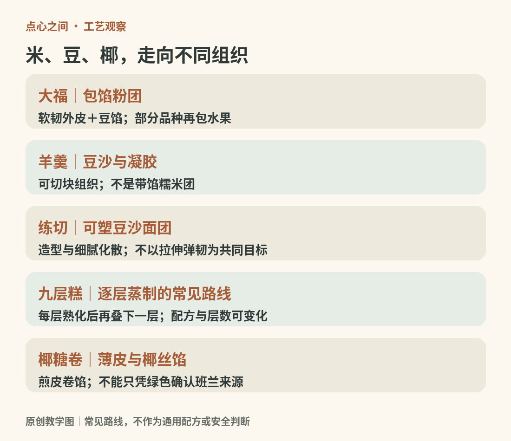
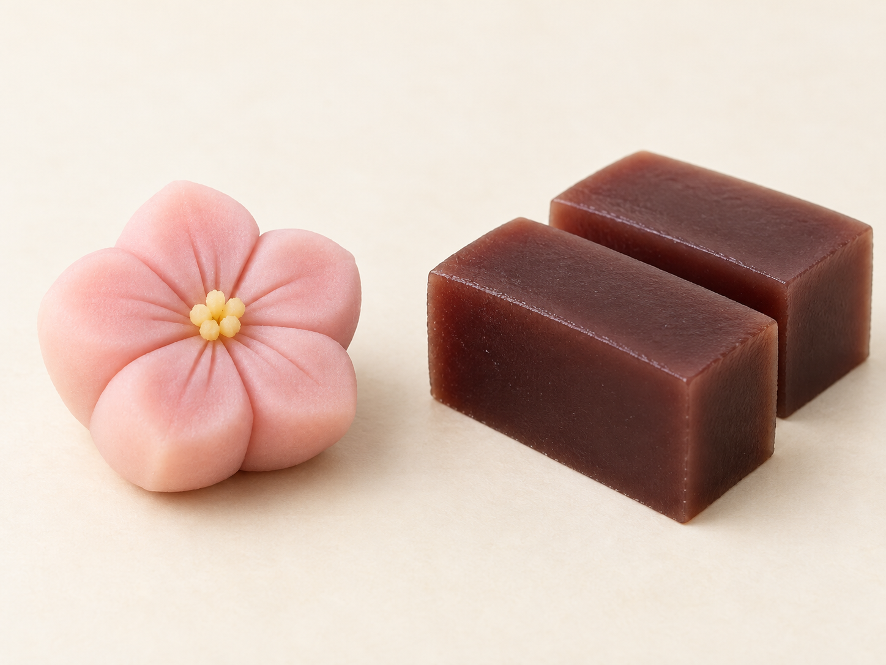
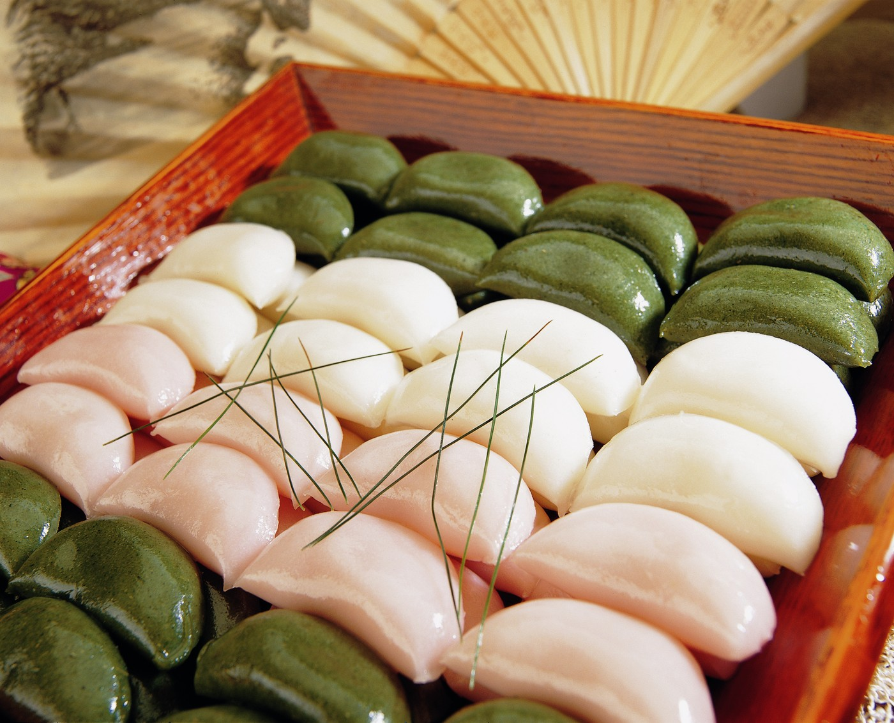
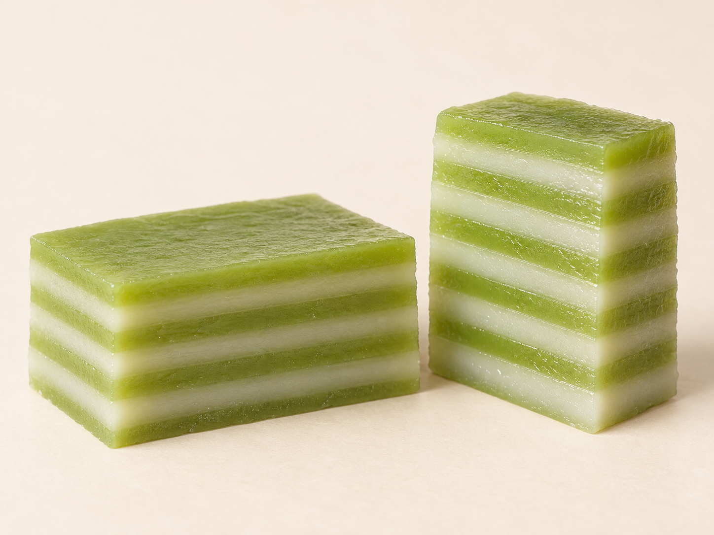
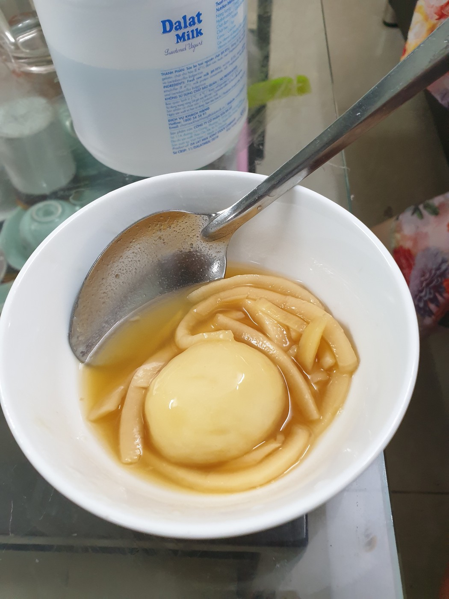

# 15　东亚与东南亚：米、豆、椰与季节

一只大福、一块松饼、一片九层糕，放在同一只盘子里，最明显的共同点是柔软。但把“软糯”当作同一种口感，会漏掉很多知识：有的黏而能拉伸，有的细密易断，有的带清楚的分层，还有的外壳脆、内馅柔。比较这些点心，既要看原料，也要看米如何被磨、蒸、捣或调成浆。

<!-- teaching-art -->

图15　相近原料可形成不同组织；图中给出常见路线，不概括所有地方配方。原创教学图。

## 和菓子是一组工艺，不只是花形甜豆沙

日常所说的和菓子包括大福、团子、羊羹、铜锣烧、最中、练切等。日本农林水产省的介绍按制作方法区分米饼类、蒸制类、煎烤类、浇注类、塑形类与组合类，并提醒其原料和做法会随地区与制作者改变。这个分类比把所有和菓子理解为“精致糯米团”更有用。[来源：日本农林水产省，Japanese sweets](https://www.maff.go.jp/e/policies/market/dento_syoku/bunrui/kasirui.html)

大福的识别重点是软韧外皮包馅。团子更适合观察米粉调制后形成的咬感；不同粉类、配比和熟化方式，会让它从柔软转向较紧实。羊羹常见的结构是豆沙与凝胶体系形成的可切块组织；最中则把脆壳与豆馅组合起来。同样用了豆，豆粒保留程度、含水量和外围结构也能让体验完全不同。东京和菓子协会的品类图录可作为名称与外形的核对入口。[来源：东京和菓子协会，Types of Wagashi](https://www.wagashi.or.jp/japanesesweets-wagashi/en/types/)

练切的细致造型来自可塑的豆沙面团，而不是把完整米糕雕成花。日本政府的介绍将其概括为白豆沙与糯米成分组成的可塑材料。它适合表现花瓣、叶片和季节主题，但外形漂亮不意味着内部应当富有弹性；细腻、绵密和入口的化散也是评价维度。[来源：日本政府，Wagashi](https://www.japan.go.jp/tomodachi/2016/spring2016/wagashi.html)

读和菓子历史，也要保留时间层次：茶文化、糖的供应、城市消费和机械生产都参与了演变。今天被称作传统的一组食品，经历过持续交流与改造，不能倒推为从古至今固定不变的一套成品。

<!-- generated-photo:ai-wagashi -->

图15-3　花形练切与切块羊羹的外观示意。前者展示塑形，后者展示连续的切块组织。

AI生成示意：用于辨认常见外观，不是实店产品照片或配方实测。

## 韩国年糕：先问“怎样成形”

韩语 tteok 对应一个宽广的年糕家族。不要因为年糕汤或辣炒年糕最常见，就认为它们代表全部。米粉蒸成的糕、熟米捣打成的糕、带馅的小糕以及煎制点心，对颗粒结构与表面口感的处理各不相同。

秋夕的松饼 songpyeon 是很好的观察对象。韩国旅游发展局把家庭制作松饼列入代表性节令活动，常见造型是半月形，内有芝麻、豆类等馅。观察时应区分外皮、馅与蒸制香气，不能用中文“松饼”一词把它误认成西式 pancake。[来源：韩国旅游发展局，Recipes for Signature Chuseok Foods](https://english.visitkorea.or.kr/svc/contents/contentsView.do?vcontsId=224166)

米糕变硬也不能直接说明制作差。原料、含水量、温度与放置时间共同影响口感。一次比较最好采用相近的新鲜程度；若一块刚蒸好、一块已冷藏，测到的主要可能是保存状态。先记下温度与时间，再讨论哪一种糕更柔软，结论才有可比性。

<!-- public-photo:real-wo-songpyeon -->

图15-1　韩国年糕松饼（songpyeon）实物。白、粉、绿的外皮呈半月形；这里的“松饼”不指西式pancake。

实物照片：wizdata；[CC0](http://creativecommons.org/publicdomain/zero/1.0/deed.en)。[原图与许可页](https://commons.wikimedia.org/wiki/File:Songpyeon.jpg)。

## Kuih／kueh：不由一个国家独占的点心家族

在马来西亚、新加坡、印度尼西亚等地区，kuih、kueh 等拼写所指的范围既有重叠，也有地方差异。米粉、糯米、木薯淀粉、椰浆、椰丝、棕榈糖和班兰经常出现，但并非每一件都同时具备这些成分。新加坡国家文物局强调，当地 kueh 与马来、土生华人等文化相关，也吸收其他饮食传统的影响。[来源：新加坡国家文物局，Kueh](https://www.roots.gov.sg/ich-landing/ich/kueh)

把九层糕、红龟粿、椰糖椰丝卷放在一起，可以形成三个清楚问题：层是逐次蒸出来的，还是由不同组织叠成的？皮是可延展的糕团，还是薄薄的煎皮？香气主要来自椰浆、椰糖，还是叶片？这比只认颜色更可靠。班兰常提供特有香气与绿色视觉线索，但绿色也可能来自其他原料或着色处理，不能仅凭照片确认配方。

红龟粿的模印、椰糖卷的卷包、薄脆蛋卷的烘烤，说明同一文化圈也容纳蒸、煎、烤与模压等多种技术。新加坡博物馆收藏的蛋卷模具，还能提醒读者：工具、节庆与家庭劳动本来就是点心史的一部分。[来源：国家文物局，Love letters mould](https://www.roots.gov.sg/Collection-Landing/listing/1235363)

<!-- generated-photo:ai-kueh-lapis -->

图15-4　蒸制层糕的一种外观示意，致密湿润的层面与烤制千层蛋糕不同。图中配色与层数仅作举例。

AI生成示意：用于辨认常见外观，不是实店产品照片或配方实测。

## 越南甜食：从一块糕走向一碗组合

越南的 chè 很适合打破“点心必须是一件固体”的预设。豆类、米团、木薯珠、凝胶、椰浆或水果可以在一碗中组合；不同材料提供的不是重复甜味，而是咀嚼层次。越南旅游官方介绍中的 chè trôi nước 是带绿豆馅的米团配姜糖浆，炸香蕉则用脆壳与软果肉形成另一种对照。[来源：越南旅游，15 dreamy desserts to try in Vietnam](https://vietnam.travel/things-to-do/15-dreamy-desserts-try-vietnam)

越南的糕饼还包括本地米点与外来技术的再发展，因此不能见到泡芙、焦糖布丁就把它们从当地饮食中排除。技术来源和今天的归属，是两个可以同时讨论的问题。对初学者而言，先认识它在当地怎么吃、用什么原料，再追踪可证实的传播路径，比争论唯一发源地更有收获。

<!-- public-photo:real-wo-che -->

图15-2　越南Bình Long的chè trôi nước，名称依摄影者说明。一碗中组合了大圆团、条状配料与液体。

实物照片：Phương Huy；[CC BY-SA 4.0](https://creativecommons.org/licenses/by-sa/4.0)。[原图与许可页](https://commons.wikimedia.org/wiki/File:M%C3%B3n_ch%C3%A8_%E1%BB%9F_B%C3%ACnh_Long_n%C4%83m_2020.jpg)。

## 一次跨地区的小比较

选择两种来源清楚的新鲜米点，先切开看颗粒与馅，再用小口比较黏性、弹性、断裂与化散。记录三个判断及其依据，例如“团子比练切需要更长咀嚼”，而不是“这个更高级”。最后补记温度、品牌和购入时间。这样得到的是一组可以修正的观察，而不是把某一次购买的状态概括成整个地区的特点。

