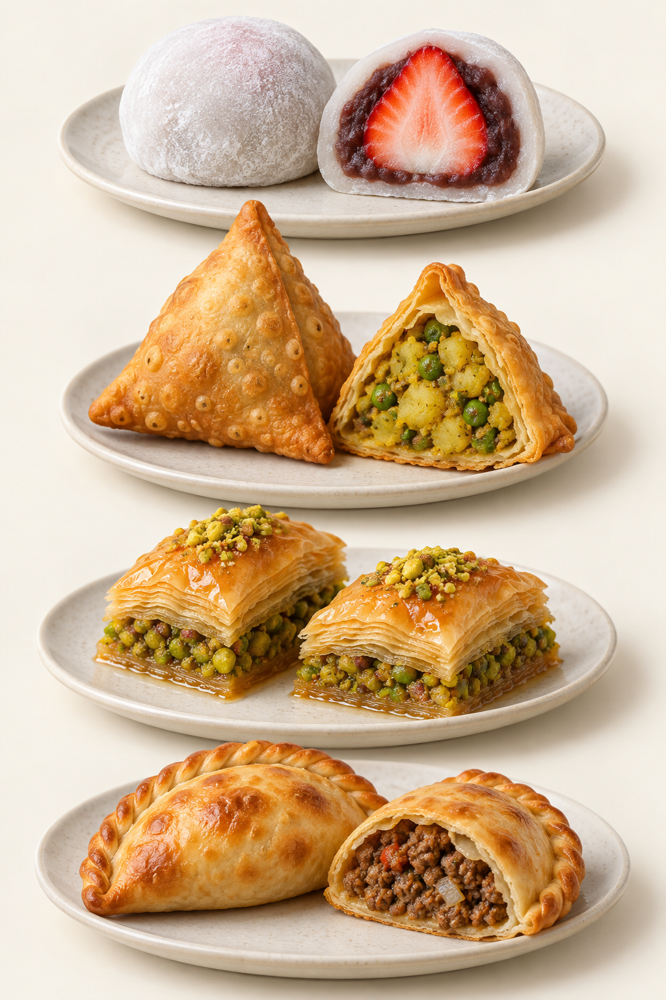

# 16　更广阔的点心地图：薄片、糖浆与包馅

“中式与西式”便于日常交流，却不足以描述世界点心。地中海、西亚、南亚和拉丁美洲有各自的谷物、乳品、坚果与甜味体系，也与其他地区长期往来。本章沿三个工艺问题旅行：薄片怎样保持层次，糖浆怎样进入组织，面皮怎样携带馅料。相似技术可以帮助比较，但相似外形不能证明同一起源。

<!-- teaching-art -->

图16　自上而下：草莓大福、samosa、baklava、烤empanada。AI生成代表外观示意。大福参见第15章，其余见本章；并列用于结构比较，不推断同源。

## Baklava：薄片叠层，与可颂的层不一样

Baklava 常译为巴克拉瓦，是多个地区共享并发展出差异的点心家族。典型结构由薄面片、油脂、坚果与糖浆构成。土耳其官方旅游资料展示了开心果、核桃、卷形和巢形等做法，说明同一名称之下也存在形态与含水程度的差别。[来源：Go Türkiye，Best Baklava Varieties](https://goturkiye.com/gastronomy/blog/indulge-that-sweet-tooth-with-every-kind-of-baklava-you-can-imagine)

它与可颂都能看到层，却不是同一条工艺路线。可颂把脂肪包进发酵面团，经擀折建立层次；典型 baklava 则把已经很薄的 filo／phyllo 面片逐层铺叠。评价前者，常关注发酵体积与内部孔洞；评价后者，常关注薄片断裂、坚果粒度、糖浆分布与咀嚼后的黏润。把所有层状糕点都称为“千层酥”，会遮住这些不同。

糖浆也不只是表面的调味。它能进入烤后多孔的结构，改变酥脆与湿润的平衡。观察一小块时，可以分别咬边缘与中心：若两处口感不同，先考虑液体迁移与厚度，而不是立即判断“有一边没做好”。具体成品的目标并不相同，有的追求更干爽的片层，有的本来就更湿润。

## Halva：同名食品不一定同结构

Halva、halvah、halvas 等名称跨越很多语言与地区。最值得初学者记住的，是芝麻酱型与谷物粉型可以完全不同：前者常呈紧实又易碎的块状，芝麻香突出；后者可以通过炒制粗粒小麦粉等原料，再加液体形成柔润组织。希腊国家旅游组织同时列出芝麻酱型、粗粒小麦粉型及地区性的淀粉型，正好说明不能凭一个译名推断配方。[来源：希腊国家旅游组织，Culinary Traditions of the Lent](https://www.visitgreece.gr/en/experiences/gastronomy/greek-wines/culinary-traditions-of-the-lent)

土耳其文化与旅游部门公布的 irmik helvası 配方可作为粗粒小麦粉型的具体参照。[来源：土耳其文化与旅游部，Semolina Halva](https://www.ktb.gov.tr/EN-98886/semolina-halva.html) 对照时不用给它们排“正宗程度”，只需先确认主要固体来自芝麻，还是来自谷物。芝麻酱的油润、谷物的颗粒与淀粉吸水后的稠度，分别给出不同线索。

## 南亚：炸物可以靠糖浆，也可以靠香料与酸味

Jalebi 的典型形态是面糊挤成盘绕线条，油炸后浸入糖浆。印度官方旅游材料对这一过程有直接描述。[来源：Incredible India，Jalebi](https://prod.incredibleindia.gov.in/content/incredible-india-v2/es/destinations/agra/food-and-cuisine/Jalebi.html) 它的要点不只是“很甜”：细长线条提高了表面积，炸后形成的组织又让糖浆获得附着与进入的空间。吃到的脆、黏与汁感，来自这两步先后叠加。不同地区的面糊与发酵安排有变化，不宜把一张配方推广成全体规范。

Gulab jamun 常被称为印度奶球，能与 jalebi 形成明确对照：它以乳固形物构建主体，而不是把可流动的面糊挤成细圈。具体版本可采用奶粉与面粉等组成柔软面团，搓成球后炸制，再浸糖浆。味之素马来西亚的公开配方提供了这一奶粉型实例。[来源：Ajinomoto Malaysia，Gulab Jamun](https://www.ajinomoto.com.my/recipes/gulab-jamun-milk-based-indian-dessert) 两者都经历炸与浸，口感却不相同：前者更适合观察球体内部的柔润与吸浆，后者更适合观察细条的脆与黏。奶粉型只是可核对的一个版本，不代表所有传统配方都以奶粉为唯一原料。

Samosa 则展示包馅炸点的另一面。印度恰塔普尔地方政府介绍的常见版本以精制小麦粉面皮包土豆、豌豆与香料馅，搭配茶和酸甜蘸酱。[来源：恰塔普尔地区政府，Samosa](https://chhatarpur.nic.in/en/culinary-delight/samosa/) 新加坡印度文化馆也指出，其馅料可含蔬菜、肉类或扁豆，制作可炸可烤。[来源：印度文化馆，Sikh Exhibition](https://www.indianheritage.gov.sg/en/whats-on/programmes/sikh-exhibition)

这种点心不能只按三角形识别。面皮厚薄、馅料颗粒、含水量、封口与油炸状态都影响咬感。酸味蘸酱并非附带装饰：它让油脂感、淀粉感和香料感出现不同的组合。品尝时先吃一小口原味，再蘸少量酱，能更清楚知道变化来自哪里。

## Churros：条纹与新鲜度比名字更可观察

西班牙的 churros 是典型油炸面点，马德里官方旅游资料介绍其条状或圈状外形，以及早餐、下午点心时配巧克力饮用的场景。[来源：马德里旅游，Repostería tradicional](https://www.esmadrid.com/reposteria-tradicional) 它不是“西班牙油条”的完全对应物：形态、面团和食用方式都有自己的变化。这样的中文类比只能帮助第一次想象，不能代替学习。

观察一根 churro，可先看表面沟槽是否清楚，再看断面与油润程度。刚炸后的脆壳会随放置而改变，糖粉、糖粒与夹馅也会改变吸湿与入口体验。不要拿放凉外卖与现炸堂食直接比较，再把差异解释成国家风格。拉丁美洲又发展出许多当地版本，夹馅和调味丰富，说明传播后的食品会形成新的日常传统。

## Empanada：包馅面点不止一个标准答案

Empanada 的中文常译作馅饼或烤饺，但这两个词都只捕捉到一部分形态。阿根廷政府介绍了不同省份的版本：肉的切法、土豆、鸡蛋、香料、面皮与烤制方法各有侧重。[来源：阿根廷政府，Empanadas](https://www.argentina.gob.ar/jefatura/turismo/viaja-por-argentina/empanadas) 同在阿根廷，地区差异已很明显；放到整个拉丁美洲，更不能以某一种牛肉馅定义全部。

它与中式包饺、南亚 samosa 可以进行结构比较：都是面皮容纳馅料，但面皮有没有发酵、是否含脂肪、馅是否预熟、采用烤还是炸，都可能不同。比较应先落在这些可验证的问题上。若只因为都是半月形就讲成同源，便把外观联系误写成历史事实。

读世界点心地图，最有用的收获并非记住最多名字，而是遇到新食品时能问对问题。先辨认原料和工艺，再理解地方生活中的位置；关于“最早是谁发明”，只有在史料能支持时才进一步下结论。

