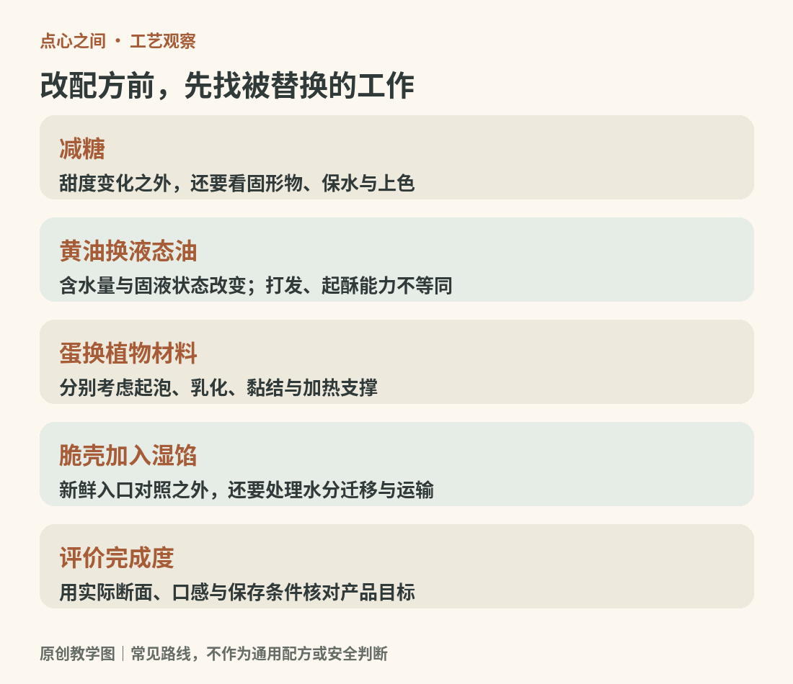

# 17　新式点心：改变口味，也改变结构

新式点心并不只有“把抹茶放进可颂”这一条路。原料替换、工艺组合、温度变化、包装与销售方式，都可能改变一件食品。认识新式产品时，先问变化发生在哪里：是香味换了，主体结构换了，还是连食用场景也换了？分清这一点，便能同时欣赏创意和判断效果。

<!-- teaching-art -->

图17　配方替换需要考虑原料的工作，而非只匹配味道。原创教学图。

## 三种变化，带来不同的学习问题

第一种是风味迁移。红豆、芝麻、乌龙茶、班兰、柚子或味噌进入蛋糕、塔和奶油夹馅，主体技术可以基本保留。学习重点是风味怎样被携带：茶粉会贡献固体颗粒，茶汤会带入水，浓缩提取物又有另一种强度。它们不只是“同一种味道的三种写法”。

第二种是组织嫁接。例如把软韧夹心放进面包，让脆壳包裹凝胶，或者用酥皮承托大量奶油。此时必须处理相邻材料的关系：软馅是否压塌外壳，湿馅是否让脆底回软，冷藏是否使原本柔软的部分变硬。外观层次越多，保存中的相互影响通常也越值得关注。

第三种是工艺重组。Dominique Ansel 的 Cronut® 于2013年5月推出，创作者把它描述为可颂与甜甜圈的混合体。[来源：Dominique Ansel，The Cronut®](https://www.dominiqueansel.com/rising%20stars/the-cronut/) 这个案例的意义不在于出现了一个合成名称，而在于把起酥面团放进另一种成形、加热与调味路径。学习类似产品时，应看实际配方和制作，不能把所有圆环起酥点心都认成同一品牌产品。

## 冰皮月饼：节令外形延续，食用条件改变

冰皮月饼保留了模印、包馅和中秋礼品的视觉语言，却采用柔软外皮与冷食方式。新加坡旅游局将其介绍为软韧外层、馅料多样且通常冷食的现代月饼类型。[来源：新加坡旅游局，Mid-Autumn Festival](https://www.visitsingapore.com/whats-happening/all-happenings/festivals/mid-autumn-festival/)

它与传统烘烤月饼的区别不能只写成“颜色更淡”。吃之前需要确认冷藏或冷冻条件，运输也要配合。香港食物安全中心特别提醒冰皮和冰淇淋月饼的卫生及温度控制要求。[来源：香港食物安全中心，Mooncakes and Food Safety](https://www.cfs.gov.hk/english/whatsnew/whatsnew_sfst/whatsnew_sfst_Mooncakes_and_Food_Safety.html) 产品的新意因此不仅属于外观，也属于生产、流通与家庭保存方式。

冰皮仍有很多配方，不能从“无烤色”推断它一定使用生粉，更不能把所有冷食糕点都叫冰皮。读包装中的原料和保存要求，比仅凭一个名字更可靠。

## “麻薯”在商品名称里，未必意味着同一配方

传统米制麻薯、含麻薯夹心的面包，以及市场上称作麻薯包的弹韧烤点，可能采用不同粉类与结构。判断时先看断面：主体有没有明显面包孔洞？弹性来自整块外壳，还是独立的一层夹馅？是否列有木薯淀粉、糯米粉或预拌粉？

这不是要替商品改名，而是把市场语言与原料知识接起来。“软欧”“爆浆”“生”“轻乳”等词，有的描述吃感，有的描述工艺，有的主要承担营销功能，不能自动当作严格分类。所谓爆浆也可能来自奶油、蛋奶酱、巧克力或淀粉馅，流动状态相似，成分、温度反应和保存要求却不同。

## 植物基：替换原料，先看原料在做什么

把黄油换为植物油、牛奶换为植物饮、鸡蛋换为果泥，不是同一难度的操作。固体脂肪能参与打发或起酥，液态油不能自动复制它；植物饮的蛋白、脂肪、糖和水也不相同。蛋则可能同时提供乳化、黏结、膨松与加热后的支撑。King Arthur Baking 的无蛋烘焙试验明确指出，不同替代品适用范围不同，鹰嘴豆液也不能通用于高度依赖蛋白泡沫的所有产品。[来源：King Arthur Baking，Our best recipes and tips for baking egg free](https://www.kingarthurbaking.com/blog/2023/02/03/bake-egg-free)

观察植物基产品，应先比较目标而非预设高低。一款本来不依赖鸡蛋的水果派，和一款必须重建蛋白泡沫的蛋糕，是两类问题。植物基配方可以形成自己的风味和口感，不必每件都模仿得毫无差异；但“植物基”也不能直接推出低脂、低糖或适合所有过敏者。

## 低糖：甜味下降，组织也可能改变

糖参与保水、蛋白泡沫稳定、脂肪打发以及褐变，不只是给舌头提供甜味。King Arthur Baking 的糖类说明解释了这些不同作用。[来源：King Arthur Baking，A guide to different types of sugars](https://www.kingarthurbaking.com/blog/2023/03/21/a-guide-to-different-types-of-sugars-how-to-use-them-and-when-to-substitute) 因此，直接把配方的糖减半，可能让蛋糕更干、饼干的扩展与断裂方式改变，未必只是得到“同样的点心但不甜”。

甜味剂还要区分甜度与体积。少量高甜度成分能够补回甜味，却未必补回糖原有的固形物和保水作用。比较成品时，既尝甜度，也记录湿润、颗粒感、冷感、余味和口腔残留。包装上的无蔗糖、减糖与无添加糖也不是同一句话；具体含义须结合所在地标签规则和营养标示阅读，不能凭宣传词推断总糖或总能量。

## 一个判断新式点心的办法

买到新产品，可以用一段话描述：“它以什么为主体，加入什么结构，改变哪一种感官体验，附带什么食用条件。”例如“起酥外壳加湿润蛋奶馅，获得脆与滑的对照，需要按标示冷藏”。这句话比“中西合璧、口感丰富”更具体，也能暴露设计是否兑现：若脆壳到手已全软，问题可能在水分管理与运输，而不只是口味不合。

新式与传统不必排成升级顺序。一个更复杂、更昂贵的组合可能适合拍照和立即食用，一种朴素的小糕则可能更适合日常携带。理解每件点心试图解决的需求，才能评价它的完成度。

