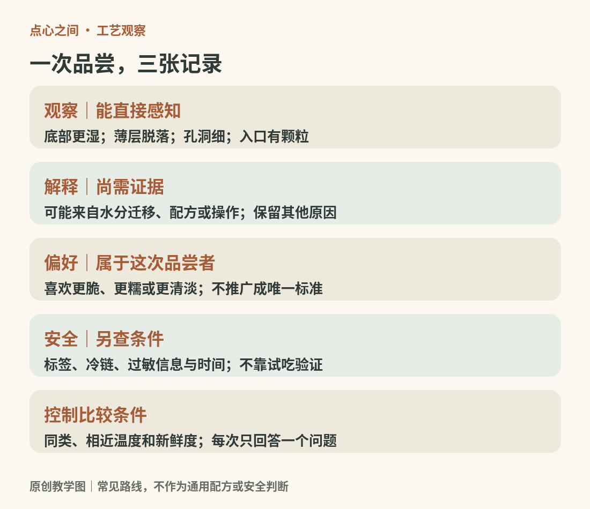

# 18　把知识带到餐桌：品尝、选购与保存

学会点心分类以后，下一步是让判断具体起来。一块酥饼为什么好吃，是因为碎得细，还是因为内外的湿度合适？一只米糕变硬，是原本的风格，还是存放造成的变化？本章把观察方法与购买、运输、保存连接起来。味觉喜好可以不同，比较条件却应尽量清楚。

<!-- teaching-art -->

图18　把观察、解释、偏好与安全信息分开记录。原创教学图。

## 先看目标，再评价结果

“越软越好”“层越多越好”“甜度越低越好”都不是通用标准。短酥饼干可以追求松散断裂，法棍类面包可以追求外脆内韧，某些糖浆点心则以黏润为特点。评价前先判断它属于哪一种结构、希望呈现什么口感。

切开观察时，可记录皮与馅的比例、孔洞大小、层是否连续、颗粒是否均匀。入口以后，把笼统的“糯”拆开：黏性是是否附着牙齿或上颚；弹性是压后是否回弹；韧性是需要多少咀嚼才能断开；化散则是组织怎样在口中分开。词汇不必装得专业，只要每次使用的意思相近，记录就会逐渐有用。

香气也有顺序。先闻未切开的表面，再闻断面，最后注意吞咽前后的余香。烤色很深不必然代表更香，奶香强也不能证明用了更多黄油。包装信息、实际配料与感官观察应相互补充，避免仅凭鼻子认定原料品牌或比例。

## 让一次比较只回答一个问题

最容易做的家庭观察，是选择同类两件点心，保持份量与温度相近。先不配浓茶或咖啡，品尝后用水清口，再试饮品搭配。若要比较加热前后，应分成两份并记下加热方法；不要把刚出炉与隔夜冷藏混为同一条件。

可以设置三种小比较：同类酥点看断裂；两种米糕看黏弹与颗粒；同类蛋糕看孔洞和湿润。每次记录“我观察到了什么”和“我推测原因是什么”两栏。例如“底部比表面软”是观察，“馅料水分向底部迁移”是解释；后者可能合理，却还需要配方、放置时间等信息验证。保留这一区别，能避免把个人猜测写成食品事实。

比较不需要大量购买。各分一小块、由几位同伴共享，更容易在同一次品尝中获得信息，也避免为了学习而过量食用。味道偏好本身没有标准答案，但“这款更适合趁热吃”应当有具体的温度对照作依据。

## 购买时，保存条件也是产品信息

选购除了看完整度与生产信息，还要看商品是否在它要求的温度下陈列，冷藏点心的包装是否完好，运输途中能否保持条件。生鲜奶油、蛋奶馅、熟肉海鲜馅与切开的水果，不能因为被面皮包住就自动变成可常温久放的食品。

香港食物安全中心对冰皮月饼给出的建议是冷藏于4℃或以下，冰淇淋月饼则冷冻于−18℃或以下，并提醒购买后尽快带回适当储存。[来源：香港食物安全中心，Mooncakes and Food Safety](https://www.cfs.gov.hk/english/whatsnew/whatsnew_sfst/whatsnew_sfst_Mooncakes_and_Food_Safety.html) 这是特定类别的指导，不能把它直接当作所有糕点的统一保质期。具体商品仍应遵守标示，开封后的要求也可能不同。

对于散装产品，可以直接询问制作时间、是否需要冷藏、运输方式和建议食用时段。若卖方无法说明，便缺少了作出可靠保存决定的必要信息。价格与“手作”标签都不能替代这些条件。

## 安全与口感，是两张不同的记录表

饼干受潮、酥皮回软、米糕变硬，首先是品质变化；看起来正常、闻起来正常，也不能证明食品安全。FDA明确提醒，致病微生物可能不会造成能被感官发现的变化。[来源：FDA，Are You Storing Food Safely?](https://www.fda.gov/consumers/consumer-updates/are-you-storing-food-safely)

美国 FoodSafety.gov 的家庭指导建议：易腐食品尽快冷藏，不在室温放置超过两小时；环境超过32℃时缩短为一小时。[^ch18-temperature]冰箱应维持4℃或以下，冷冻室为−18℃或以下；熟食可分装到浅容器帮助及时冷却。[来源：FoodSafety.gov，4 Steps to Food Safety](https://www.foodsafety.gov/keep-food-safe/4-steps-to-food-safety) 这些是一般家庭操作指导，不能把“两小时”理解成每件点心都能安全摆满两小时的许可，更不能把多次离开冷藏的时间重新归零。

冷冻能减缓许多变化，却不会消除所有有害微生物。复热也不能挽救所有保存不当的食品。需要复热的商品按包装指示处理；对来源与温度历史不明、已明显变质或超过要求的易腐点心，不以试吃来判断是否还能吃。

## 复脆与回软，应尊重不同组织

对明确适合复烤的干燥酥点，短时加热可能改善表面脆度；但含鲜奶油、冷凝胶或冰淇淋的组合，不能照同一方式处理。微波可能使部分米点暂时变软，却也可能让边缘先失水、内部过热。先读产品建议，少量分次调整，比直接提高功率更容易控制。

保存时也要考虑气味与水分。干燥饼干与湿馅糕点混装，口感可能相互影响；开封后密封可以减少环境交换，但密封不是无条件延长安全期限的方法。家庭记录中应同时留下购买、开封与冷藏时间，避免只凭“好像昨天买的”回忆。

## 过敏信息要问到配料与接触环节

糕点常涉及奶、蛋、小麦、坚果、花生、大豆和芝麻；咸点还可能含鱼或甲壳类。FDA的过敏原说明提醒，食品制作中的过敏原交叉接触（英语 allergen cross-contact）也需要控制。[^ch18-cross-contact][来源：FDA，Food Allergies](https://www.fda.gov/food/nutrition-food-labeling-and-critical-foods/food-allergies) 因此，坚果装饰拿掉以后，食品并不会自动适合坚果过敏者；无乳糖（英语 lactose-free）也不等于不含乳蛋白，植物基也不等于不含大豆或坚果。

有明确过敏需求时，应读取完整标签并向制作者确认，不用小口试吃验证。家庭共享时保留包装、分开工具和盛放容器，能让每个人更清楚自己在吃什么。

读完一本点心书，不需要把每次下午茶变成考试。偶尔停下来看看断面、问一句保存条件、把一个含糊的形容改为具体观察，知识便已经进入了日常生活。

[^ch18-temperature]: 这里沿用美国机构给出的摄氏参考值；原文同时以40°F、0°F和90°F标示约4℃、−18℃和32℃。它们用于家庭冷藏与易腐食品处理，不是某种点心的保质期或任意食品的精确失效温度。[FoodSafety.gov](https://www.foodsafety.gov/keep-food-safe/4-steps-to-food-safety)。

[^ch18-cross-contact]: Allergen cross-contact 指过敏原在制作、器具或盛放过程中非预期进入另一件食品。它与微生物交叉污染的关注对象不同。乳糖是不耐受问题中常见的糖类对象，乳蛋白则可能引发过敏；“无乳糖”不能替代乳过敏者所需的配料与接触核查。[FDA，Food Allergies](https://www.fda.gov/food/nutrition-food-labeling-and-critical-foods/food-allergies)；[NHS，乳糖不耐受及与过敏的区别](https://www.nhs.uk/conditions/lactose-intolerance/)。
