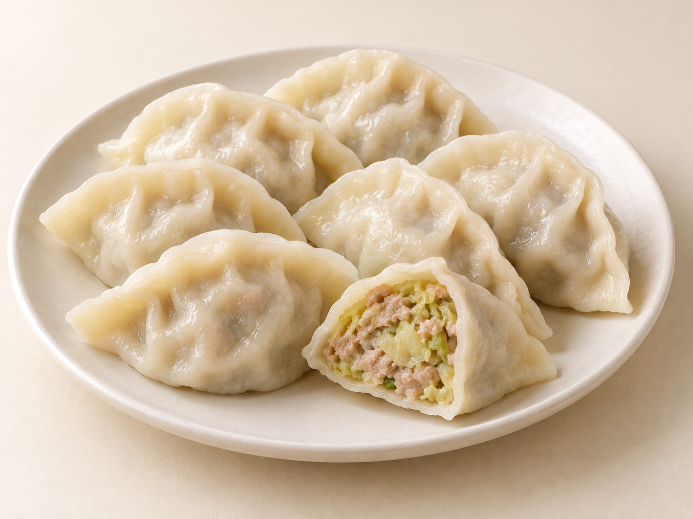
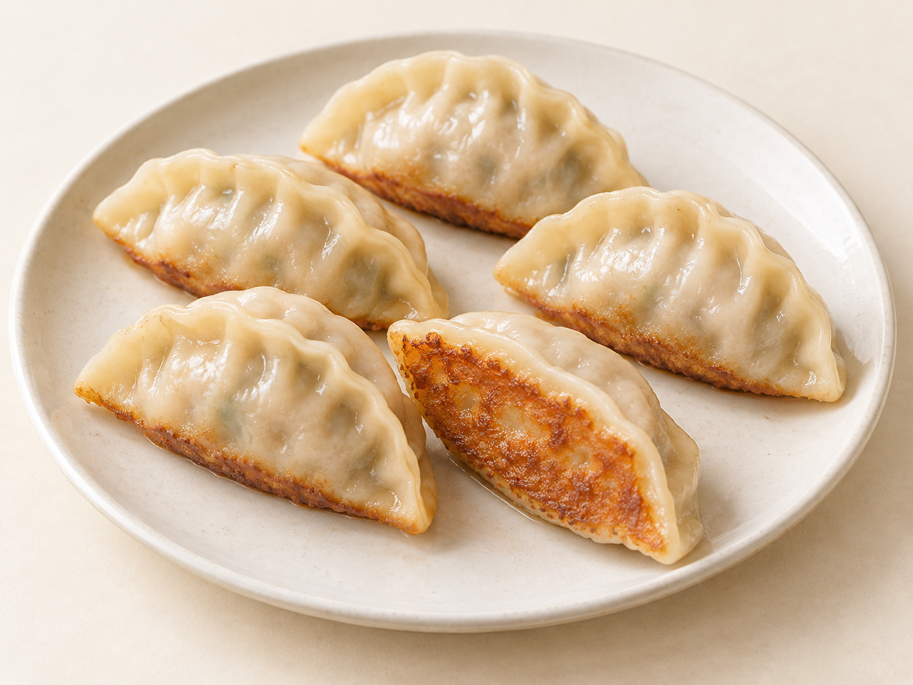

# 第19章　饺子家族：从一盘家常水饺到一口茶楼粉粿

晚饭的一盘水饺、早餐摊的一锅锅贴、茶楼蒸笼里的虾饺，都把馅料包在皮中，却不能只按“月牙形食物”理解。本章把饺子展开到一顿饭的尺度：皮怎样承受水煮，馅怎样处理水分，同一只饺子换一种加热方式后，又会发生什么变化。

## 从家常水饺建立基准

常见家常水饺以不发酵的小麦面团制皮，圆皮包入馅心，边缘压合。擀皮时保留稍厚的中心，可以承托馅料；边缘较薄，合拢后便不至于成为一条过厚的面疙瘩。这个“中间承重、四边封口”的思路，比把褶子捏得多少更基础。褶纹可以装饰，也能帮助圆皮适应鼓起的馅心，但平直捏合的水饺同样成立。

皮与馅不是彼此独立的两部分。面皮太薄，可能承受不了颗粒较粗或水分较多的馅；馅塞得太满，封口处就容易夹入菜叶和油脂。煮时水从薄弱处进入，饺子未必立即散开，却会逐渐失去原本的皮馅比例。较厚的皮也有用途：它能提供咀嚼感，适应大个饺子或某些地方口味，不能把“越薄越好”当成全部饺子的标准。

水饺进入大量热水后，外皮吸水、淀粉熟化，馅心也逐渐升温。让水保持足够的热量，同时避免猛烈翻滚持续撞破饺子，通常比不断搅动更有帮助。“浮起来”是一个可见变化，却不是所有尺寸、馅料与冷冻状态下通用的熟度证明；家庭制作应结合可靠食谱、产品说明及内部熟化情况判断。

国家民委“道中华”栏目整理的饺子材料与各地名称，展示了它在节令和日常生活中的多种形态。本章采用当代常见称呼；历史文献中的“扁食”“角子”等词，不能直接套成今天全国统一的品种表。[资料：国家民委，饺子的地域形态与历史称呼](https://www.neac.gov.cn/seac/c103391/202301/1160441.shtml)

<!-- scene-expansion:exp-jiaozi -->

图19-1　水饺代表外观：闭合月牙面皮与菜肉馅切面并置。

AI生成示意：呈现一种代表外观，具体用料与地区变体见正文。[品种与工艺参照](https://www.consumer.org.hk/sc/article/581-dumplings/581-dumplings-dumpling-overview)。

## 馅料的地图：菜肉、素馅与地方酸香

猪肉白菜、猪肉大葱，是理解菜肉组合的方便起点。肉末提供连续的馅心，蔬菜提供水分、香气和颗粒。处理白菜的目的不是把所有汁液挤尽，而是让最终馅料有适合包制的状态：盘中不积一层游离水，拌好的馅仍有湿润感。不同菜的出水量、切碎程度和调味顺序都不同，不能把一种处理方法机械复制到所有蔬菜。

韭菜鸡蛋馅展示另一条路线。鸡蛋通常先炒熟并冷却，再与韭菜等材料组合；它提供分散的小块，并不像肉馅那样形成同一种黏结组织。韭菜、粉丝、豆干、菌菇的搭配，各有地方与家庭版本。吃素也不能只看有没有肉块：虾皮、蚝油、动物油等配料仍需要逐项确认。

东北酸菜猪肉饺子值得单独认识。酸味来自馅里的发酵蔬菜，并非吃时蘸醋才获得；切碎酸菜保留的爽脆，与猪肉的油润形成对照。它与后文的酸汤水饺是两个不同方向：前者改变馅心，后者让汤汁参与调味。哈尔滨日报对酸菜饺子的地方生活记录，可作为认识其冬日家常场景的实例；它不能代表所有东北家庭的配方。[资料：哈尔滨日报，酸菜饺子与冬季生活](https://harbin.joyhua.cn/hebrb/20260209/mhtml/page_07_content_20260209008001.htm)

鱼肉饺、虾仁饺和牛羊肉饺也应放在这张地图上。鱼肉馅需要留意鱼肉组织与水分，虾可以剁细，也可以保留小块；“三鲜”则是组合名称，并没有跨地区通用的固定三样原料。牛羊肉的香气与蔬菜、香辛料搭配有关，不能只依据白色月牙外形判断里面是什么。

## 蒸饺、煎饺与锅贴：改变接触热量的方式

蒸饺不在水中持续翻滚，能保留较挺拔的外形，也方便容纳较大的馅心。小麦皮可以使用冷水面、烫面或混合处理，各自影响操作与口感；“蒸饺一定用烫面”并非通用定义。吃时可以先尝皮边，再尝靠近馅心的部分，往往能发现厚薄、含水和吸汁程度的不同。

锅贴与煎饺的称呼在各地有重叠。常见做法是在平锅中排列生坯，加油和适量水，加盖让蒸汽帮助内部熟化，随后使底部失水、上色。有的家庭也会把煮熟的饺子再煎。区别应落实到具体做法，而不宜规定“锅贴永远开口、煎饺永远封口”或“煎饺必须先煮”。锅贴有两端留口的长条形，也有封口月牙形。

| 观察对象 | 水饺 | 蒸饺 | 锅贴或煎饺代表做法 |
| --- | --- | --- | --- |
| 主要接触介质 | 大量热水 | 蒸汽 | 锅面油脂与短时蒸汽 |
| 外皮明显变化 | 吸水、柔韧 | 较少受水流碰撞 | 底面上色，上部可保持柔软 |
| 食用时的重点 | 皮馅比例与完整性 | 边缘厚薄、馅心饱满度 | 脆底与软皮之间的反差 |
| 容易误判之处 | 浮起不等于一切都熟 | 不一定都是同一种面团 | 不等于整只炸成脆壳 |

南京牛肉锅贴提示了饺子作为城市小吃的另一种生活方式：它可以与汤食搭配，在早餐、午间小食或街头餐馆中出现。南京地方志记录的蒋有记锅贴等店铺，是具体地方传统的实例，不应把一种店售规格当作全国锅贴的唯一模板。[资料：南京市地方志办，贡院西街小吃名店](https://dfz.nanjing.gov.cn/gzdt/202404/t20240429_4655828.html)

<!-- scene-expansion:exp-guotie -->

图19-2　煎饺／锅贴代表外观：上部浅色软皮，与翻起后可见的金黄底面形成对照。

AI生成示意：呈现一种代表外观，具体用料与地区变体见正文。[品种与工艺参照](https://dfz.nanjing.gov.cn/gzdt/202404/t20240429_4655828.html)。

## 酸汤水饺与蘸食：调味放在哪一层

干捞水饺常把调味留给蘸碟。醋、酱油、蒜泥、辣椒油的组合可由食客调整；少蘸一口，容易辨认馅本身的味道。酸汤水饺则把酸香、油香和配料放进汤里，饺皮外侧、馅心与汤汁一起入口，已经构成完整的一碗。

西安酸汤水饺的代表做法，会用醋和香料形成酸汁，再配韭黄、香菜、芝麻等。不同店家对酸、辣、油脂与汤浓度的安排并不相同；羊肉、牛肉或其他馅心也需要具体说明。它并非一盘普通饺子外加任意酸汤，而是把饺子与汤的味道一并设计。[资料：西安科普网，酸汤水饺](https://www.xakpw.com/single/17503)

## 超出小麦皮：虾饺、粉粿与莜面饺

虾饺常见的澄面皮以小麦淀粉（wheat starch）等制成[^ch19-wheat-starch]，通过热水调团获得可包制的状态。它与普通面粉皮的组织不同，不能靠反复揉出同样的面筋来理解。蒸熟后薄皮略透，虾的颜色可隐约显现；透明度仍取决于配方和厚度，不是越像玻璃越好。第7章解释了这一外皮路线，茶楼里的虾饺还要结合鲜虾馅的颗粒、皮的柔韧和蒸制后的完整性来观察。

潮州粉粿常有细粒复合馅，花生、菜脯、虾、肉与蔬菜等材料让一口中出现不同的颗粒。潮州市烹调协会的一个团体标准采用澄面与生粉配合，热调成皮[^ch19-shengfen]，包入处理过的馅料后蒸制。这是明确的规范实例，不表示所有名为粉粿的地方食品都必须采用同一配方。粉粿应同时放回“粿”的地方命名体系中认识。[资料：T/CZSPTXH 175—2021《潮州菜 潮州粉粿烹饪工艺规范》](https://www.ndls.org.cn/standard/detail/8d1856d666938463eab135f7355eae19)

莜面饺则让读者看到杂粮面团的另一种可能。莜面不具有与小麦面粉相同的面筋表现，地方技法通过熟化和操作配合，把它做成饺、窝窝、鱼鱼等多种形态。认识莜面饺，应看皮料、包制和蒸食方式，不要因为同样包馅就默认它能按普通水饺的方法处理。[资料：内蒙古新闻网，莜面饮食制作技艺](https://inews.nmgnews.com.cn/system/2022/02/10/013263960.shtml)

## 包制时最有用的三个检查

先检查皮边是否留出可压合的空白；再检查馅心是否大致居中，避免一侧只有皮、另一侧被顶破；最后从中间向两端压合，留意封口里有没有夹着菜叶。褶子数量可以随手法变化，封口连续却是基本条件。刚包好的饺子之间留一点距离，能减少潮湿表面粘连；整盘堆叠看起来省位置，提取时却可能撕破皮。这些检查适合普通小麦皮，澄面皮和莜面皮仍须按各自方法处理。

## 把比较放回一顿饭

若只想做一次小比较，可以选同一种菜肉馅的水饺与煎饺，先看底面，再尝皮边和馅心，减少馅料差异带来的干扰。下一次再比较酸菜馅与鲜白菜馅，分辨发酵酸香和新鲜蔬菜的差别。茶楼的虾饺、粉粿则可以从皮料另开一条线，不必硬与一盘家常水饺排出高低。

饺子有时是节庆时多人围坐包制的食物，有时是冰箱里方便取用的一餐，也可以是街口现煎的小吃。它的范围由皮、馅、加热和食用方式共同展开；把这些关系看清，比记住一串地方名称更能帮助继续认识新品种。

[^ch19-wheat-starch]: 澄面通常指小麦淀粉，英语写作wheat starch；它与普通小麦面粉（wheat flour）不能按同一种皮料理解。虾饺配方还可能加入玉米淀粉或木薯淀粉等，不能把“小麦淀粉皮”读成只能有一种粉。[原始制作者配方：The Woks of Life，Har Gow](https://thewoksoflife.com/har-gow/)。

[^ch19-shengfen]: 本段沿用所引团体标准的“生粉”用词，不在缺少明示时擅自为它指定另一种淀粉。实际制作应核对具体原料和商品说明，不能只凭食谱里的两个字便决定等量替换。[所引规范条目](https://www.ndls.org.cn/standard/detail/8d1856d666938463eab135f7355eae19)。
