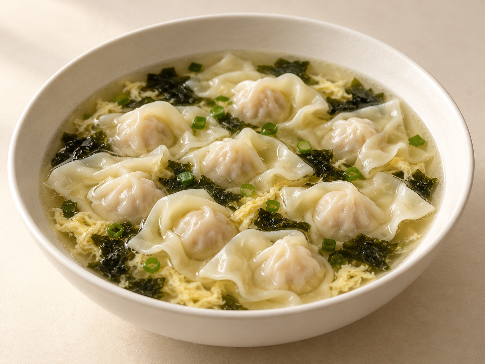
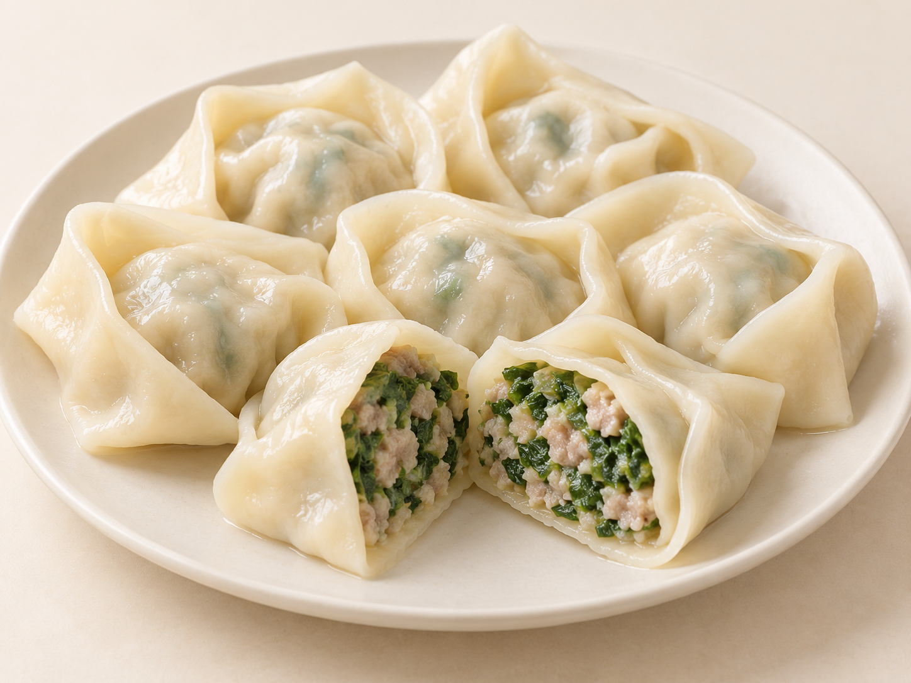
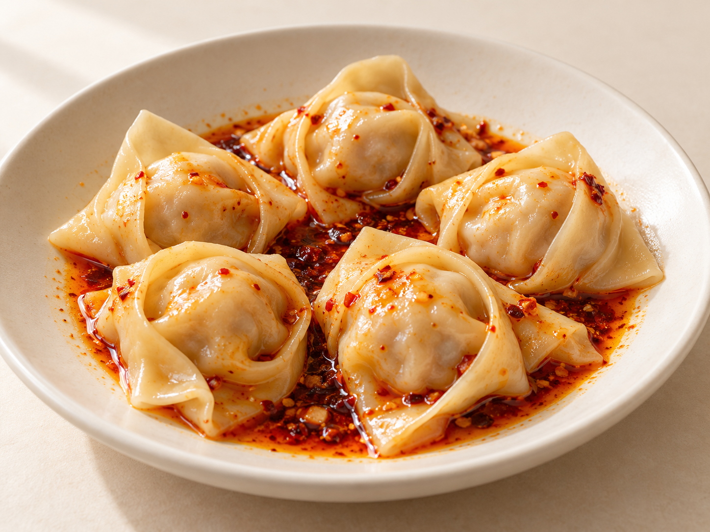

# 第20章　馄饨、云吞与抄手：一张薄皮怎样进入一碗汤

一碗小馄饨，常让人先注意飘开的皮；一只菜肉大馄饨，入口时更像在吃完整的馅团；红油抄手又把浓厚的调味裹在外面。它们拥有相近的包馅思路，分支却不是把同一份食物改几个地方名字。本章从皮、馅、折法与汤汁的组合，认识早餐、午间便食和夜宵中的这一大家族。

## 先把名称放回地方语境

“馄饨”“云吞”“抄手”“包面”“扁食”“扁肉”，在不同地区可能指向相近的薄皮包馅食品，具体皮料、大小和做法却会变。一个名字覆盖的范围，也未必与另一个地区完全重合。点餐或阅读食谱时，最好连同地方、馅料和吃法一起记录，例如“上海荠菜猪肉大馄饨”“香港鲜虾云吞”“成都红油抄手”，比只写一个总名更有用。

云吞在粤语地区常见，英语菜单常写作wonton[^ch20-wonton]；抄手是四川等地熟悉的称呼；闽南、台湾部分地方的扁食，也常放在这个家族中讨论。香港专业进修学校的语言文化专栏梳理了这些地域名称，但名称对应只宜作为入口，不能推导成所有地方食品完全相同。[资料：香港专业进修学校，馄饨的地域称呼](https://www.hkct.edu.hk/sc/abouthkct/media-centre/press-release/column-20211006)

“馄饨比饺子皮薄”是常用的辨认经验，却不是绝对边界：大馄饨可以有相当结实的皮，水饺也可以做得很薄；方皮常见于馄饨，圆皮常见于饺子，但实际制作还有多种裁切和折叠方式。更可靠的观察，是看馅心外围留下多少游离皮、皮在汤中怎样展开，以及一口中皮与馅各占多大位置。

## 小馄饨：少量馅心与展开的薄皮

小馄饨的典型外形，是一小团肉心被薄皮包住，外侧留着轻盈的褶皱。它不需要像水饺那样形成整齐的月牙边；简短的收拢和捏合，就可以让薄皮围住肉馅。实际大小与包法各家有别，不能把“越松散越正宗”当成标准。

少量馅料并不意味着它只是缩小的大馄饨。小肉心较快进入热汤的温度环境，外皮的存在感则变得突出。舀起时可以同时看到皮片、汤与少量馅心；咬下去，软滑的皮先包围肉味，和一口饱满菜肉馅的体验不同。若皮厚、馅少，却被久煮成一团黏片，就失去了这种组合想呈现的轻巧感。

汤面常见葱花、紫菜、虾皮或蛋皮丝等配料，它们各有角色：葱花提供鲜香，紫菜给汤增加海味，蛋皮丝则让一勺里出现柔软的条片。并非每碗都要全部放齐，也不宜因看见紫菜就断定汤底一定由某一种骨料熬制。清澈或浓郁可以分别成立，重点是汤是否遮住了皮馅本身。

在早餐场景里，小馄饨可以单吃，也可以搭配饼、包子等干点；夜里一碗现煮馄饨，又是另一种便利热食。场景帮助解释它为什么强调盛装迅速、方便舀食，而不是为这类食物规定唯一的食用时间。

<!-- scene-expansion:exp-small-wonton -->

图20-1　清汤小馄饨代表外观：薄皮包住少量馅心，余皮在汤中松展，配少量紫菜与蛋花。

AI生成示意：呈现一种代表外观，具体用料与地区变体见正文。[品种与工艺参照](https://english.shanghai.gov.cn/en-GlobalTasteinShanghai2026-LocalFlavors/20260605/81483538821d4e7ebfb82b5c8267c946.html)。

## 大馄饨：馅团、蔬菜和折叠的支撑

菜肉大馄饨常把猪肉与青菜、荠菜等组合。蔬菜经适当处理后切细，拌入肉馅；包皮折起，角与角连接，形成较饱满的枕形或元宝状结构。肉与菜的比例、是否焯菜、皮的颜色与弹性都有家庭和店铺差异。“大”也不是用一条全国通用的重量线划分，而是相对于当地小馄饨的习惯称呼。

菜肉馄饨的馅并非越紧越好。菜切得太长，容易横跨封口；水分处理不当，皮还没下锅就可能受潮。另一方面，蔬菜被挤得过干、肉末拌得过硬，也会使馅团显得干紧。良好的组合需要菜香、肉香与湿润感相互配合。荠菜馅有独特的草本气息，青菜馅则是另一种清甜，不应只依据颜色把它们说成一种菜肉馅。

上海市政府介绍菜肉馄饨时，列出了青菜、荠菜与猪肉的常见组合，也展示了不同店铺在面皮和汤料上的变化。这些实例说明，大馄饨既能出现在小吃店，也能成为家庭便饭。[资料：上海市政府，菜肉馄饨](https://english.shanghai.gov.cn/en-GlobalTasteinShanghai2026-LocalFlavors/20260605/81483538821d4e7ebfb82b5c8267c946.html)

煮熟的大馄饨还可以改变温度和调味方式。上海冷馄饨常用菜肉大馄饨，熟后冷却，配花生、芝麻等形成的稠酱，并用醋等调节味道。它与热汤馄饨的差别不只在“放凉”：酱汁直接附着在皮上，稠度与沥水程度都会影响入口。[资料：上海市政府，冷馄饨](https://english.shanghai.gov.cn/en-Staple-travelinshanghai/20240531/5ec4073ca768464d8bff75e41e47e405.html)

<!-- scene-expansion:exp-big-wonton -->

图20-2　菜肉大馄饨代表外观：饱满折叠面皮与绿色蔬菜、肉末相间的馅心。

AI生成示意：呈现一种代表外观，具体用料与地区变体见正文。[品种与工艺参照](https://english.shanghai.gov.cn/en-GlobalTasteinShanghai2026-LocalFlavors/20260605/81483538821d4e7ebfb82b5c8267c946.html)。

## 鲜虾云吞与云吞面：馅、面、汤一起安排

香港常见鲜虾云吞以虾与猪肉等入馅，薄皮在馅团周围保留褶皱，有的包法留下向外舒展的皮尾。虾可以保留较大的颗粒，使它与细肉馅形成不同咬感。云吞的面皮并不是虾饺常见的澄面水晶皮，不能因为同样包虾就把两者混为一类。

云吞面还加入面条这一层。面条提供连续的弹韧，云吞提供一口包馅，汤把两者联系起来。清汤可以有丰富的鲜味，并非清澈就代表味淡；不同店家使用的骨料、鱼干、虾类及调味各有组合。细面放在热汤中会继续变化，因此面量、汤温、上桌速度与食用节奏都影响最后体验。

米其林指南对香港多家云吞面店的介绍，记录了鲜虾、猪肉、竹升面和不同汤底的实际组合。它们可用于认识具体店售风格，不能把某一家店的整虾大小、数量或包法当作“正宗云吞”的统一标准。[资料：米其林指南，香港云吞面实例](https://guide.michelin.com/hk/zh_HK/best-of/best-wonton-noodles-hong-kong)

## 清汤抄手与红油抄手：把调味从汤转到表面

四川抄手常用薄方皮，包馅后折叠，再把两角相接。成都龙抄手的工艺实例，包含制皮、制馅、成形、煮制及最后调味；同一类抄手可以配清汤，也可以配红油等调料。这说明“抄手就是辣馄饨”并不准确。清汤版本让皮与肉馅更直接地呈现，红油版本则突出油香、辣味和咸鲜等共同形成的外层味道。[资料：商务部老字号数字博物馆，龙抄手制作工艺](https://lzhbwg.mofcom.gov.cn/edi_ecms_web_front/thb/detail/8236b3b91b554e27b8120caa19bd4f47)

红油抄手不需要浸在一整碗纯油中。调味汁中的酱油、醋、红油及其他配料按具体做法组合，适量汤汁可以帮助分散；捞出的抄手若带水过多，则会稀释调味。进食时先拌匀，让每只薄皮带上味道，比只看表面红不红更能理解这道小吃。红油的香气和辣度也不必完全同步：香料、辣椒与制油方法不同，闻起来香并不能预知入口有多辣。

比较清汤与红油版本，可以尽量选同样的馅心和大小，分别尝皮、馅与汤汁。若两碗连皮厚、肉馅和用量都不同，就只能说明两份具体产品的差异，不能将全部感受归因于红油。

<!-- scene-expansion:exp-chaoshou -->

图20-3　红油抄手代表外观：闭合薄皮包住馅团，折角相接，表面与盘底带有红油调味汁。

AI生成示意：呈现一种代表外观，具体用料与地区变体见正文。[品种与工艺参照](https://lzhbwg.mofcom.gov.cn/edi_ecms_web_front/thb/detail/8236b3b91b554e27b8120caa19bd4f47)。

## 扁肉与肉燕：相邻名称中的材料边界

福建小吃里的“扁肉”“扁食”，需要结合具体地方来认识。有些采用薄小麦皮包细肉馅，在一碗汤中提供柔滑与弹嫩的对比；店名和菜单常会与蒸饺、拌面等并列。不能只凭“扁”字认定它一定扁平，也不能把所有福建薄皮包馅食物都归入同一种皮料。

肉燕尤其值得另立边界。福州肉燕的燕皮以捶打的瘦猪肉与薯粉等加工成薄片，再用于包馅；肉在这里进入了外皮，而不只是藏在里面。闽侯县政府的后福肉燕制作记录，展示了捶肉、加粉和压延的过程。它与普通小麦面皮馄饨的关键区别在材料组织，单看入汤后展开的白色薄片，未必能判断。[资料：闽侯县政府，后福肉燕制作](https://www.minhou.gov.cn/xjwz/mlmh/mytc/202206/t20220621_4383035.htm)

肉燕与鸭蛋等搭配的太平燕，还进入福州年节与宴席的地方语境。福州市政府资料把肉燕的店铺发展与宴食使用联系起来。关于具体起源和命名的故事版本较多，阅读时宜把民间传说与可核对的制作材料、地方生活记录分开。[资料：福州市政府，肉燕与太平燕](https://www.fuzhou.gov.cn/zgfzzt/zjrc/mdfc/lswh/202210/t20221026_4457433.htm)

## 一碗薄皮包馅食物的观察顺序

| 先看什么 | 可以问的问题 | 不宜直接下的结论 |
| --- | --- | --- |
| 皮 | 褶皱展开多少？折叠处是否很厚？ | 透亮就一定是淀粉皮 |
| 馅 | 是细肉、菜肉，还是可辨虾粒？ | 肉越多越优质，三鲜必是固定三样 |
| 汤或酱 | 是浸泡、轻拌，还是另配蘸料？ | 清汤一定淡，红色一定很辣 |
| 同碗搭配 | 面条、蛋丝、紫菜怎样改变一口？ | 所有配料都属于同一地方的必备清单 |

吃一碗时，可以先舀一只连少量汤入口，再看皮与馅能否分辨，最后留意汤或酱怎样延续味道。若再配一份干点，就能理解“汤食加干点”的组合为什么常见：两者提供不同的水分和咀嚼节奏。馄饨家族因此既能成为轻巧的一碗小食，也能与面、饼和其他点心共同组成完整一餐。

[^ch20-wonton]: Wonton是英语中常见的云吞名称。香港食环署的熟食对照表将“雲吞”与wonton相对照；这个菜单词有助于检索，却不保证每个地区的皮、馅与汤都相同。[香港食环署，熟食名称对照](https://www.fehd.gov.hk/english/pleasant_environment/tidy_market/market_goods.pdf)。
