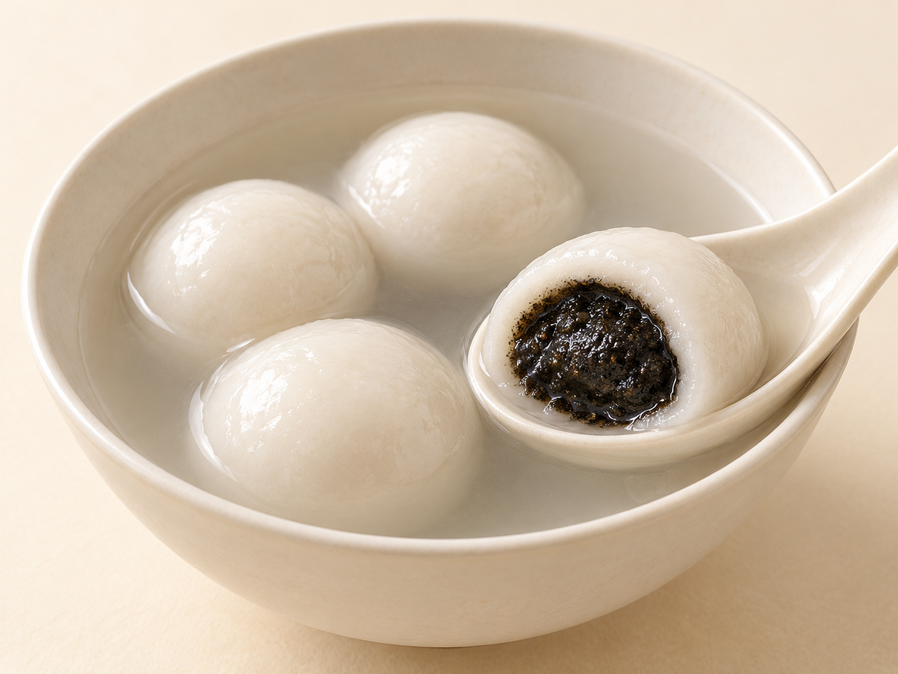
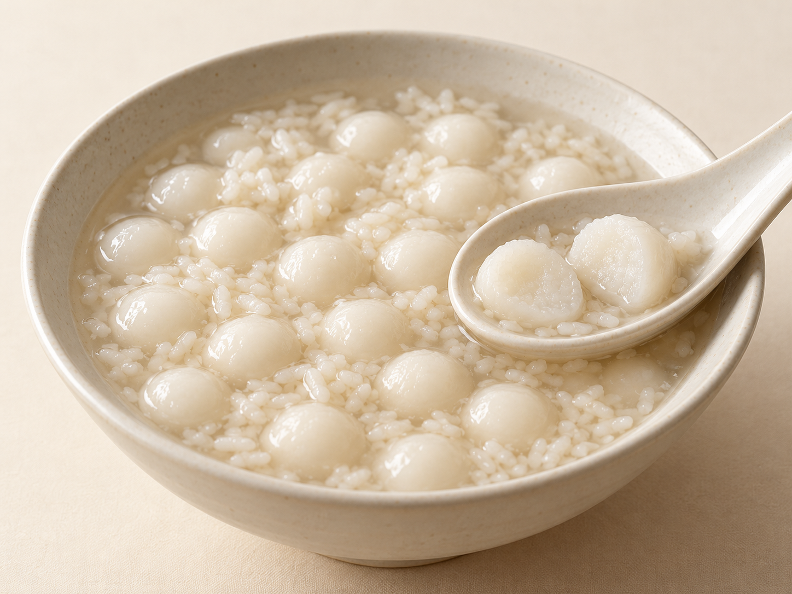
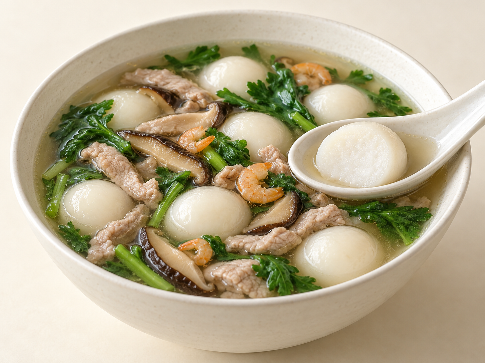

# 第21章　汤圆、元宵与圆子：一碗米食的甜咸世界

元宵节的黑芝麻汤圆、饭后的一小碗酒酿圆子、冬至家宴里的咸汤圆，看上去都有白色圆球，吃法却很不同。有的咬开才出现馅心，有的从头到尾只有米团；有的由甜汤组织风味，有的靠肉丝、香菇与蔬菜构成一碗咸食。第05章介绍米粉怎样形成糕团，第09章讨论节令意义；这一章把视线放回碗里，分清具体品种，也认识它们怎样进入日常餐桌。

## 包汤圆与滚元宵：先看形成外皮的动作

常见包制汤圆先把糯米粉加水和成可以操作的粉团，再分成小剂，捏出容纳馅心的空间，收口搓圆。馅被外皮整体包围，接缝需要闭合。滚制元宵则先把较结实的馅分块，沾水后在干糯米粉中滚动，多次重复，让粉逐层附着在馅块周围。两者都用糯米粉，却不是把同一个生坯换了名字。[资料：湖南省市场监督管理局，元宵节食用元宵（汤圆）消费提示](https://amr.hunan.gov.cn/amr/ztx/cjxxx/202202/t20220214_22481086.html)

这也解释了为什么常见元宵馅要能保住小块形状：太稀的馅难以作为滚粉的核心。包制可塑粉团则给了馅心不同的安排空间。两种方法的表面状态、粉层厚薄和煮后表现可能不同，但不能把一只已经煮好的白圆子，单靠光泽判定为汤圆或元宵。商品命名、地方口语和具体做法并不永远重合，制作说明比“南方还是北方”更能回答工艺问题。

买到滚粉元宵时，不要直接照搬另一袋速冻汤圆的煮法；购买现制与冷冻商品，也要分别看保存和加热说明。这里比较的是结构路线，不是给所有产品规定相同的水量、时间与火力。

## 黑芝麻、花生与豆沙：馅心不仅改变颜色

黑芝麻馅常呈深色，研磨后的芝麻与糖、油脂组合，吃到的是细粒、香气和油润感的共同作用。花生馅则可以保留更明显的颗粒，也可以磨得细腻。豆沙的主体是煮熟、处理后的豆类，其细度与含水状态又是另一条路线。三者都能做甜馅，但不应只记成“黑、黄、红”三个选项。[代表实例资料：中国宁波网，黑芝麻与猪油组成的宁波汤圆馅](https://news.cnnb.com.cn/system/2024/11/22/030631525.shtml)

以包制为例，较松散的颗粒馅需要适当聚拢，过湿的馅又可能让收口变得困难。入口时，皮与馅的软硬差别同样重要：馅太硬，咬下去像碰到一个芯；馅很软而外皮厚重，则可能先吃到一大口粉团。所谓“皮薄馅足”是一种常见追求，却不等于越薄越好，外皮仍须完整包住馅心。

观察一只煮熟的汤圆，可以把它放在匙里分开，先看外皮是否形成连续一圈，再看馅是细沙状、颗粒状还是流动状态。流心是特定配方与食用温度下的表现，不是黑芝麻汤圆唯一正确的状态，更不能仅凭馅流得快便推断用料优劣。

<!-- scene-expansion:exp-sesame-tangyuan -->

图21-1　黑芝麻汤圆代表款：白色米粉皮包住深色馅心，匙上的分开件显示皮馅关系。

AI生成示意：呈现一种代表外观，具体用料与地区变体见正文。[品种与工艺参照](https://news.cnnb.com.cn/system/2024/11/22/030631525.shtml)。

## 宁波猪油汤圆：地方代表款与共同类别

宁波汤团制作技艺资料记录了水磨糯米粉、猪油汤圆馅、糖桂花等原料，以及和坯、包馅、搓圆、煮制的流程。它为认识当地代表款提供了具体依据：粉皮、油润甜馅和少量桂花香共同构成一碗汤圆，而不是只靠白色圆形来识别。[资料：宁波市非物质文化遗产网，宁波汤团制作技艺](https://www.ihningbo.cn/directory/show/60)

宁波传统猪油黑芝麻汤圆，是甜馅中油脂参与组织的一个例子。猪油在这里是馅的一部分，会影响馅的软硬和入口感，不是将成品另外放进油里炸。[资料：中国宁波网，宁波传统名点中的汤圆与酒酿圆子](https://news.cnnb.com.cn/system/2024/11/22/030631525.shtml)不同家庭和商品可能改用其他油脂、改变糖量或调整馅料比例，阅读原料表才能知道吃到的具体版本。

地方代表款不应占据整个类别。不能把所有黑芝麻汤圆都称作宁波汤圆，也不必要求所有汤圆都有猪油、桂花和同样的大小。地方名称帮助我们追踪一种做法的传统，比较时仍应说明选取的是哪一种实例。

## 酒酿小圆子：风味主要在汤里

无馅小圆子不需要经历包馅收口，常把粉团搓成细条后分成小段，再搓成小球。小圆子与包馅大汤圆的差别，不只是缩小尺寸：前者把连续的糯米团作为主体，后者还包含外皮与馅心的关系。

酒酿圆子常把小圆子与酒酿、糖等配合，酒酿中可见的米粒与圆子本身应分开辨认。有些版本加蛋花、桂花或勾薄芡，有些保留较清的汤。宁波所说的“浆板”指酒酿；当地非遗资料中的浆板圆子，记录了圆子、浆板、鸡蛋及勾芡的组合，说明“圆子加甜汤”内部也有多种具体做法。[资料：中国宁波网，冬至习俗与浆板称谓](https://news.cnnb.com.cn/system/2021/12/20/030314576.shtml)；[资料：宁波市非物质文化遗产网，浆板圆子与红豆沙圆子条目](https://www.ihningbo.cn/directory/show/60)

把酒酿圆子与红豆沙圆子并看，便能理解汤的任务：酒酿带来发酵米食的气味和米粒，红豆汤则可能提供豆粒、豆沙及更厚的汤体。小圆子不一定要独自承担全部风味。饭后、甜品店与家常夜点中，一小碗汤的分量、稠度和温度，也会改变整份食物的轻重感。

<!-- scene-expansion:exp-jiuniang -->

图21-2　酒酿小圆子代表款：无馅小圆子与可见的酒酿米粒同在碗中。

AI生成示意：呈现一种代表外观，具体用料与地区变体见正文。[品种与工艺参照](https://www.ihningbo.cn/directory/show/60)。

## 咸汤圆：咸可以在馅里，也可以在汤里

“咸汤圆”至少要继续问两件事：圆子有没有馅，咸味来自哪里。鲜肉馅汤圆把咸味放进包馅结构，咬开可见肉馅；另一类则用无馅圆子搭配咸汤，肉丝、虾米、香菇、蔬菜等在圆子外面。两者都可以是有地方传统的吃法，却不能用一张剖开的肉馅汤圆代表全部咸汤圆。

台湾客家米食中的粄圆提供了无馅路线的清楚例子。客家文化资料记录了糯米粉团搓条、切段、搓圆，以及与肉条、蔬菜等配合的做法；农业部门介绍的咸汤圆，也列出以红葱头、香菇、虾米、韭菜、猪肉丝等构成汤底的组合。[资料：客家委员会客家文化发展中心，张富香客家粄圆](https://cloud.hakka.gov.tw/Details?p=86653&pid=290111)；[资料：农业知识入口网，客家咸汤圆](https://kmweb.moa.gov.tw/knowledgebase.php?func=2&id=427631&keyword=&type=13222)

客家咸汤圆也有包馅大圆子的实例。新北市政府介绍过将调味炒熟的猪肉馅包入大汤圆的店家做法。这个例子提醒我们，“客家”并不意味着只能有一套大小和包法；引用某地记录时，要保留当地与具体产品的范围。[资料：新北市政府，猪肉客家大汤圆](https://www.ntpc.gov.tw/ch/home.jsp?dataserno=a5ee7d3ab5182889a4aa10049fd929de&id=e8ca970cde5c00e1)

咸汤圆进入一餐时，可以像小份汤食，也可以成为较有分量的一碗。它与甜汤圆的差异不仅是把糖换成盐，食材组合、汤底、配菜和一口里出现的组织都会变化。

<!-- scene-expansion:exp-savory-tangyuan -->

图21-3　无馅咸汤圆的一种代表搭配：圆子与香菇、肉条、虾、蔬菜共同构成咸汤。

AI生成示意：呈现一种代表外观，具体用料与地区变体见正文。[品种与工艺参照](https://cloud.hakka.gov.tw/Details?p=86653&pid=290111)。

## 从糍粑、麻糍到艾粿：不能把糯米食品都叫汤圆

糍粑、麻糍等名称往往涉及熟糯米捶打、粉团加工或其他地方手法；即使最终也能搓圆，仍应继续看原料先煮熟还是先磨粉、是否包馅、是否再下汤。客家米食资料把粄圆与粢粑、米糕等分别列出，正说明同一米食传统内部有多条工艺路线。[资料：客家委员会，食食客客·客家米食](https://webc.hakka.gov.tw/findhakkafood/rice_list_chs.html)

艾粿、青团一类还需要辨认植物材料与成形、熟化方式。“绿色”不等于同一种草，“糯”也不等于同一种米粉比例。蒸熟后可拿取的包馅团，与在汤中煮熟的圆子，即使原料相近，食用时表面的湿润程度、承托方式和配料关系也不同。名称在地区间会交叉，最稳妥的描述是“当地所称的某某，采用何种做法”，而不是把地方食品强行塞进统一的全国命名表。

| 代表对象 | 关键结构 | 认识它时先问 |
| --- | --- | --- |
| 包馅汤圆 | 连续粉皮包围馅心 | 什么馅，怎样收口，配什么汤 |
| 滚制元宵 | 以馅块为核心逐次附粉 | 怎样滚粉，馅块怎样保持形状 |
| 酒酿小圆子 | 常见为无馅米团与甜汤组合 | 酒酿米粒与圆子是否分清 |
| 无馅客家咸粄圆 | 圆子与肉、蔬菜、汤底配合 | 汤中有什么，圆子是否包馅 |
| 包馅咸汤圆 | 米粉皮包咸馅，再与汤配合 | 馅是否先处理，地方实例是哪一种 |
| 糍粑、麻糍等 | 地方名称下的多种米食路线 | 整米或米粉，捶打或揉团，是否入汤 |

## 从节令食品读到日常的一碗

元宵、冬至、新年让圆形米食与相聚产生了紧密联系，但节令意义不要求全年只能在某一天吃它。无馅小圆子可以进入日常甜汤，咸汤圆可以出现在家宴与冬日午餐，包馅甜汤圆也可以是家庭随手准备的一份热食。食用场景改变了份量与搭配，却不会自动改写制作路线。

下一次看到菜单上的“圆子”，先确认米团、肉丸还是其他原料；看到“汤圆”，再确认有馅无馅、甜咸以及汤的组成。把这几个问题问清，读者便能从一个熟悉的圆形，走进比“糯、甜、团圆”丰富得多的食物世界。
