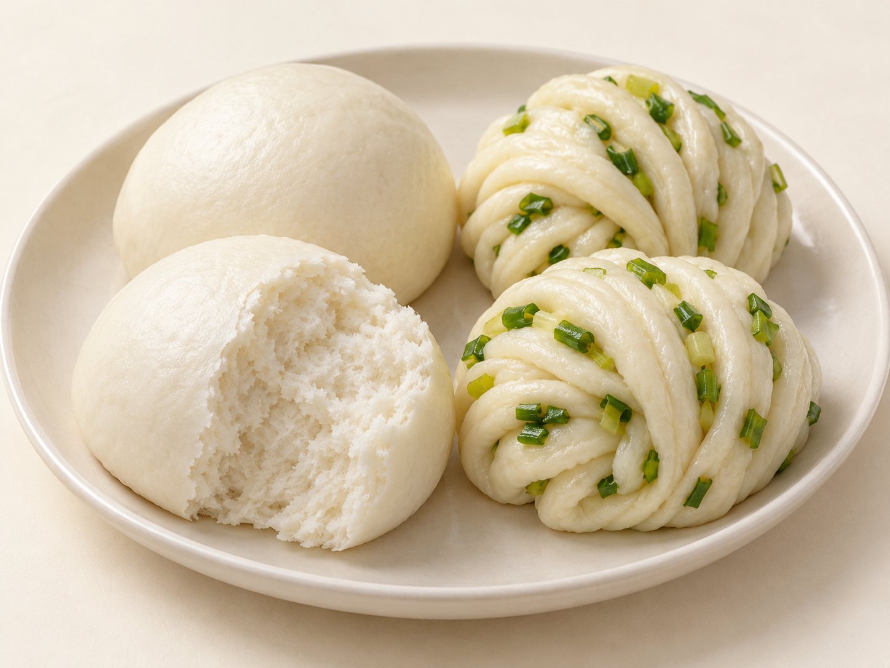
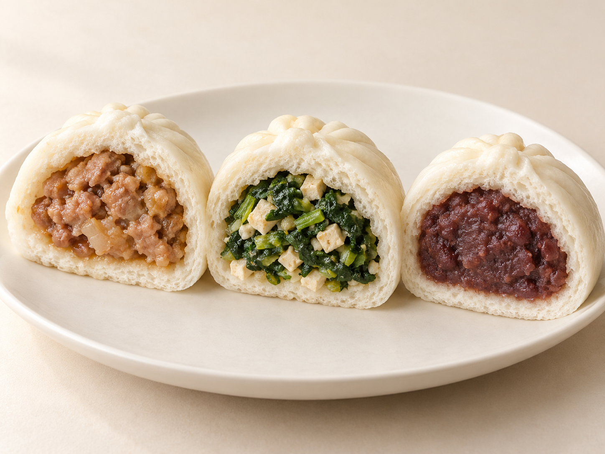
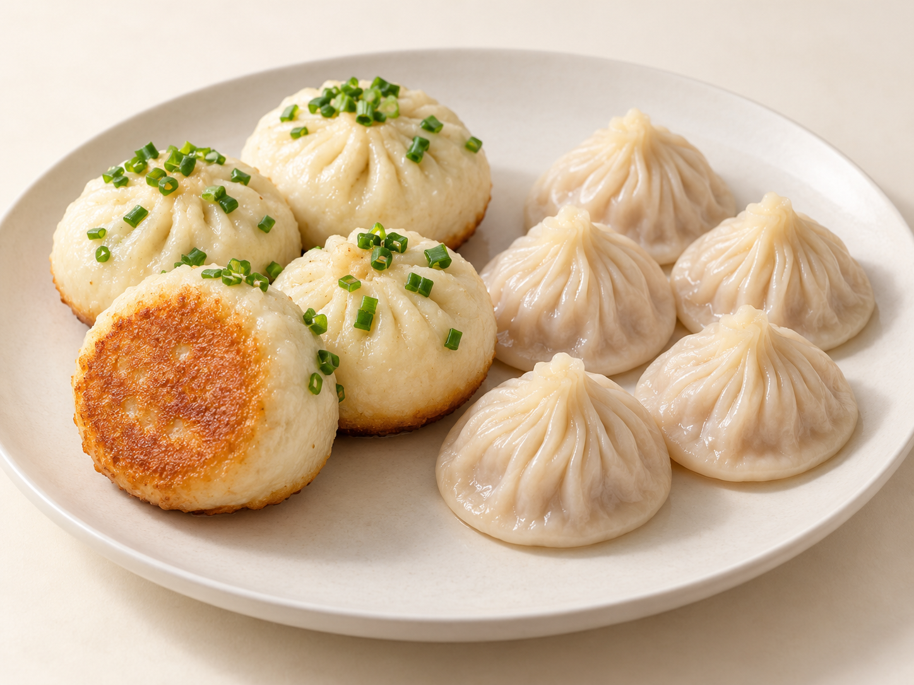
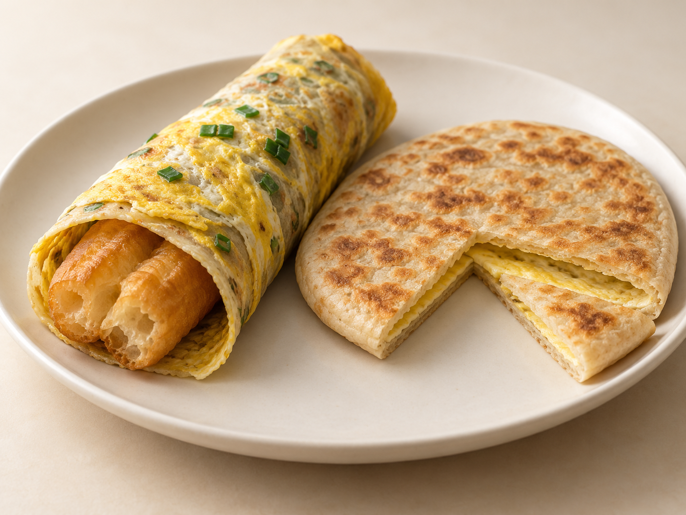

# 第22章　早餐面点：从一笼馒头到一张现摊的饼

清晨的蒸笼、平底锅、烤炉与豆浆桶，把面点带进了与下午茶不同的生活节奏。有些食品方便带走，有些适合坐下来趁热吃；有些以面皮本身为主，有些把肉、菜、蛋和酱集中进一份。早餐不是单独一种工艺，却能把“怎样熟、怎样盛、怎样搭配”这几条线索放在同一张餐桌上。

这一章以常见面点及其搭配为重点，不把所有早餐都归入点心，也不把某地的一套吃法当作全国早餐的模板。粥、汤、豆浆和豆腐脑在这里首先是理解搭配的邻近食品；它们各有独立传统，不能只因与包子一起出售，就被解释为面点的一部分。

## 馒头与花卷：从发面本身认识组织

无馅馒头把面团的表现直接交给食客：外皮、断面细孔、咬断时的弹性都没有馅心遮掩。常见小麦馒头借发酵形成气体，再经蒸制使组织定形。孔洞大小、均匀程度与细腻感共同影响入口表现，不是只有“越松越好”一个尺度。粗粮馒头、红糖馒头与白馒头也不能仅以颜色互换名称，原料和配方改变时，吸水与支撑能力可能一起改变。

花卷则把面片刷油、撒调味、卷叠或扭转的动作保留在形状中。安琪酵母的葱油花卷实例依次使用和面、擀片、刷油撒葱、折卷、成形、醒发与蒸制，适合用来理解“发酵带来的细孔”和“折卷形成的层次”是两回事。[资料：安琪酵母中式面点，葱油花卷](https://dimsum.angelyeast.com/contents/4131/83017.html)

掰开花卷，面片之间可能较容易分离，但这种层次与可颂、千层酥中的薄脆烘焙层片不同。花卷常保持湿润、柔软，不能因为看见“层”，便把它划进西式起酥家族。葱油、椒盐或红糖改变了卷层间的风味，馒头与花卷也因此能分别作为配菜主食或自身已有滋味的小份面食。

<!-- scene-expansion:exp-mantou-huajuan -->

图22-1　左为白馒头及其断面，右为葱油花卷；可分别观察发面细孔与柔软卷层。

AI生成示意：呈现一种代表外观，具体用料与地区变体见正文。[品种与工艺参照](https://dimsum.angelyeast.com/contents/4131/83017.html)。

## 肉包、菜包、豆沙包：同样包住，馅心任务不同

肉包需要让熟化后的肉馅与发面皮协调。馅的颗粒与脂肪、水分会影响口感；肉包多汁并不等于必须形成一包可以倒出的汤。菜包里的蔬菜、菌菇、豆制品或粉丝，常保留较清楚的颗粒和纤维。菜的出水会影响包制和皮馅交界，所以“素馅”并非只把肉拿掉那么简单。[原始食谱实例：The Woks of Life，肉包](https://thewoksoflife.com/steamed-pork-buns-baozi/)；[原始食谱实例：菜包及蔬菜馅去水](https://thewoksoflife.com/steamed-vegetable-buns/)

豆沙包通常把较细的甜馅包在发面皮内。与菜包比较，可关注馅是否松散、是否能形成完整团块，以及入口时馅与皮谁先被咬开。甜馅也并不意味着外皮必须做得甜；皮的味道与馅的甜度共同决定整只包子的轻重。[原始食谱实例：The Woks of Life，发面豆沙包](https://thewoksoflife.com/steamed-red-bean-buns/)

这些不是全国统一的配方规定。包子的个头、收口位置、面皮厚薄、发酵程度与馅料处理都可能变化。用一句“包子都是厚皮、汤包都是薄皮”来判断，会忽略中间大量的地方做法。观察一只包子时，先分清它是发面还是非发酵面皮，再看馅与汁，往往比数褶子更有帮助。

<!-- scene-expansion:exp-bao-fillings -->

图22-2　从左至右：肉馅包、青菜豆腐包与豆沙包的代表剖面。

AI生成示意：呈现一种代表外观，具体用料与地区变体见正文。[品种与工艺参照](https://thewoksoflife.com/steamed-pork-buns-baozi/)。

## 小笼包与汤包：笼子、尺寸与汤汁并不重合

“小笼”首先让人注意到蒸制器具和小份呈现，但不能据此推定每一种小笼包都使用同样的面团。南翔小笼馒头的非遗资料强调其面皮与馅料、包制和蒸制技艺；它是认识薄皮小笼的一种重要地方实例，而不是所有小笼名称的唯一解释。[资料：中国非物质文化遗产网，南翔小笼馒头制作技艺](https://www.ihchina.cn/Article/Index/detail?id=14647)

一些汤汁丰富的小笼包把肉皮冻等加入馅料，冷时便于包制，加热后成为汁液。这个原理与把成品挖空后灌汤不同。[配方实例：The Woks of Life，Xiaolongbao，肉皮冻与肉馅的配合](https://thewoksoflife.com/steamed-shanghai-soup-dumplings-xiaolongbao/)也存在依靠肉馅含水及其他处理形成汁水的做法，所以看见汤汁，不能自动倒推每家使用了多少皮冻。

“汤包”又包括不同尺寸、不同地方传统的产品。大汤包与小笼包可能都强调汁水，却有不同的拿取和食用安排。比较时应保留具体名字和地方：这只的皮是否发酵，个头有多大，汤汁来自什么做法，端上来时是否需要碟子承托。汤多不自动等于更好，完整外皮、馅心和食用时的温度都影响体验。

## 生煎与水煎包：锅底和顶部经历了不同的加热

生煎的一项直观线索是接触锅面的煎制部位与未接触锅面的面皮形成反差。上部可能保持浅色和柔软，底部逐渐失水上色；加水、加盖产生的蒸汽帮助内部熟化，随后继续形成煎底。它并不是把所有表面都炸成同样的金黄色。

不同生煎的皮和馅会有差异，不宜凭“上海生煎”四个字就指定唯一的发酵程度或汤汁状态。早餐场景中，一份生煎也可以与汤食构成组合。上海地方报道中记载的大壶春店内“生煎配牛肉粉丝汤”就是具体实例，说明干湿搭配同样参与一餐的安排。[资料：上海市民政局转载《上海老年报》，老字号集体搬家](https://mzj.sh.gov.cn/lnb-xw/20260113/492b829efb374c35953724c97036d5b4.html)

水煎包也有多地做法。泰安市政府介绍的泰山水煎包，用发面包蔬菜馅，再配合油与面汤水煎制。部分产品底部会连成薄脆的片，部分则让每只包子分别保留煎底；这种差别与面水、锅面和操作有关，不应成为区分所有“生煎”与“水煎包”的绝对界线。[资料：泰安市人民政府，泰山水煎包](https://www.taian.gov.cn/art/2011/2/23/art_50707_4347941.html)

<!-- scene-expansion:exp-shengjian-xiaolong -->

图22-3　左为生煎，其中一只翻转露出煎底；右为蒸制小笼包。

AI生成示意：呈现一种代表外观，具体用料与地区变体见正文。[品种与工艺参照](https://thewoksoflife.com/shanghai-pan-fried-pork-buns-shengjian-mantou/)。

## 烧饼与夹食：先看饼，再看里面放什么

烧饼不是只指一种可以掰开夹肉的厚圆饼。第06章已介绍部分酥点与烤点；早餐里还应辨认饼本身是较蓬松、较紧实，还是薄脆路线。能从中间开口的饼可以承托鸡蛋、肉或其他配料，但“可以夹”只是食用方式，不能解释它原来怎样成形与烤熟。

缙云烧饼则把肉、菜干等放在饼坯内部，随饼一起烤制。其非遗资料展示了地方原料与烧烤技艺的结合，它与烤好后再夹入熟食的做法应分开认识。[资料：中国非物质文化遗产网，缙云烧饼制作技艺](https://www.ihchina.cn/project_details/23791.html)

夹食的实际体验来自几层关系：饼是否足以承托配料，内部湿润程度是否会很快浸软外层，切口与厚度是否方便拿取。一个饼夹入很多东西，品种未必就更丰富；认识原来的饼，才能说明新增配料究竟改变了什么。

## 煎饼馃子与鸡蛋灌饼：蛋放在哪里，说明了不同的路径

煎饼馃子常见做法是把浆料摊成薄片，配合鸡蛋、酱料与油条或薄脆，再折叠卷裹。天津的地方传统突出绿豆面等原料与具体搭配；跨地区传播后，市场上还出现了更多粉料和夹料组合。因此，介绍时应说清是在讲天津代表做法，还是更广泛的摊煎饼食品，不把当代所有加料都说成原来的传统。[资料：央广网，天津煎饼果子入选市级非物质文化遗产名录](https://travel.cnr.cn/list/20170613/t20170613_523797954.shtml)

鸡蛋灌饼则先有由面团形成的烙饼，烙制中把蛋液灌入饼的内部，再继续加热使蛋熟。宁夏农业农村部门的早餐介绍明确记录了这一动作。[资料：宁夏回族自治区农业农村厅，银川早餐清单](https://nynct.nx.gov.cn/rdzt/ppny/202504/t20250423_4889342.html)

两者都可能加酱、夹菜并折起来拿走，但一个以摊成的浆片卷裹为重点，一个以饼内灌蛋为辨认线索。把半份切开，可以看见煎饼片、夹入的油条或薄脆，以及灌饼内部的蛋层。若只是给一张烙饼表面摊蛋，就不能用这个动作解释“灌”字。

<!-- scene-expansion:exp-jianbing-guanbing -->

图22-4　左为用薄片卷裹油条的煎饼馃子；右为鸡蛋灌饼，切口可见饼内的熟蛋层。

AI生成示意：呈现一种代表外观，具体用料与地区变体见正文。[品种与工艺参照](https://travel.cnr.cn/list/20170613/t20170613_523797954.shtml)。

## 油条、豆浆与豆腐脑：相邻食品怎样组成早餐

油条的长条外形、炸后孔隙和表面脆感，与蒸制面点提供了不同的口感。它可以单独吃，也可以进入煎饼馃子等组合。搭配豆浆时，蘸与不蘸会让表面保留不同程度的脆感；这属于食用方式的变化，不需要评判哪一方才正确。

豆浆是液态豆食，豆腐脑则是凝结后的柔嫩豆食，二者不能因原料相近而当成同一种汤。豆腐脑的甜咸及浇头又有明显地方差异。天津市文化和旅游局的早餐地图同时收录煎饼馃子、油条、烧饼、豆腐脑、浆子、馄饨等，恰好说明真实早餐往往跨越面点、豆食与汤食，而不是一个整齐的工艺分类。[资料：天津市文化和旅游局，天津早餐地图](https://whly.tj.gov.cn/TJSWHHLYJ/gabsycs/gzdtgh/202306/t20230620_6327085.html)

认识这张桌子，可以分别记录三件事：主要吃的是面、馅还是汤；哪一部分需要现做现吃；带走后什么变化最明显。花卷凉后、油条受潮、煎饼包起后内部蒸汽聚集，都会改变入口感。早餐面点的丰富，不只在于名字多，也在于它们用不同结构适应了清晨一段具体的生活。
