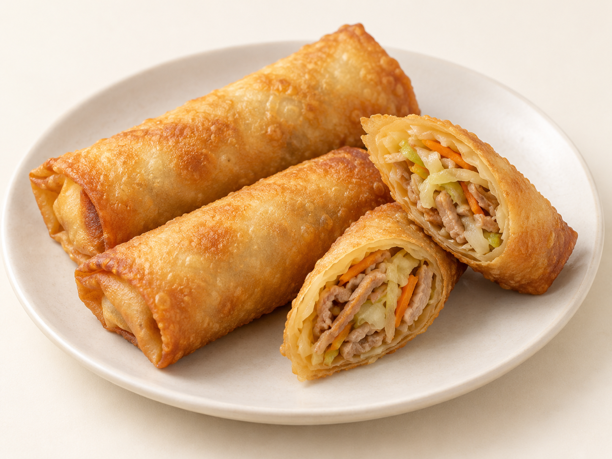
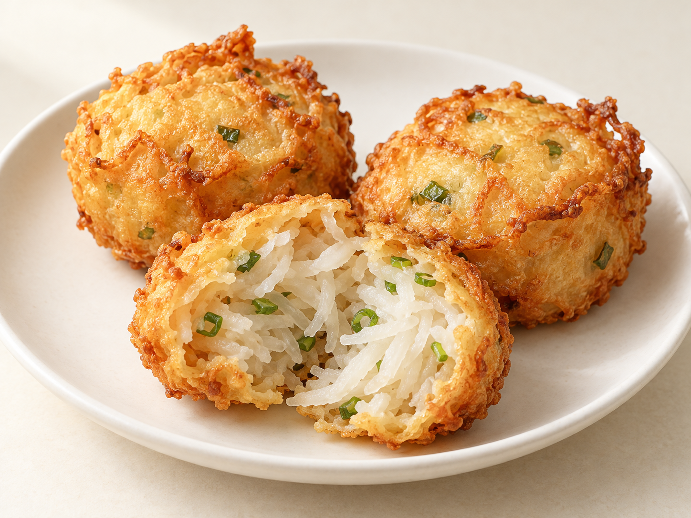
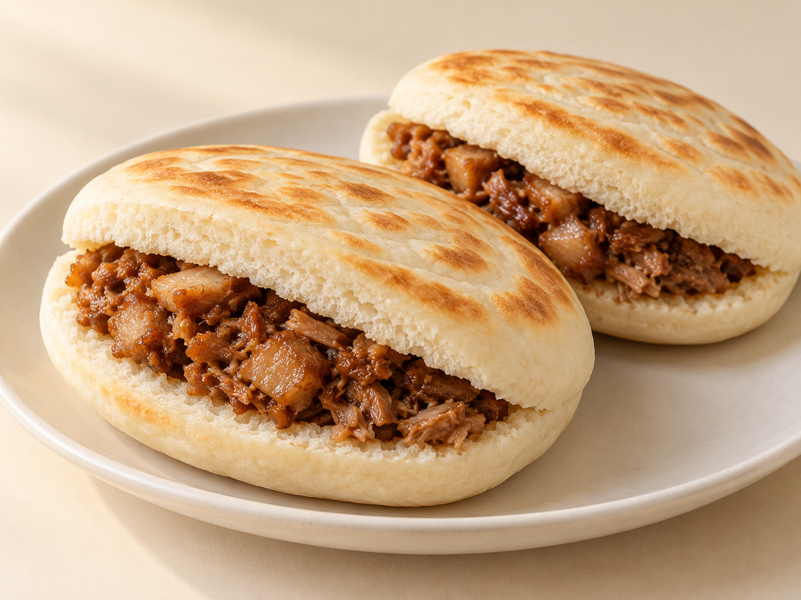

# 第23章　街头与夜市：卷、炸、夹与一份现吃的小食

街头小吃并不等于油炸食品，夜市也不只有烤串。薄皮卷物、模炸面糊、炉烤面饼、夹馍和米饭团，都能成为手拿的一份；它们又各自需要不同的温度、包装和进食节奏。第8章从地区餐桌认识小吃，本章进一步走近食品本身：外壳怎样形成，馅放在哪里，为什么有的适合边走边吃，有的装进袋里很快就变了口感。

这里讨论的是与面、米、糕点结构相连的小份食物。卤味、烧烤和整套餐食当然属于街头饮食，但不因此全部纳入点心图鉴。一份肉夹馍可以是便餐，一个小春卷也可以是宴席上的热点；份量与场景会改变，食品的组织仍有可以学习的线索。

## 春卷、春饼与润饼：先辨认皮是否再经油炸

一张薄皮包住切细的馅，可以走向几条不同的路线。常见炸春卷将熟制薄皮包成长筒，折入两侧，封口后再油炸；成品外层失水变脆，内部馅料仍保持一定湿度。切口能同时看到薄壳与菜丝、肉丝等馅料，这种反差比“金黄色”更有识别意义。表皮的微小鼓泡来自具体皮料与炸制条件，不能把泡越大当成品质越好。

春卷不是全国统一的馅料。潮州春卷的介绍列出绿豆、蒜白、虾米、香菇和猪肉等组合；它与以蔬菜丝为主的常见版本不同。这类差别会改变馅的颗粒、松散程度和香气，而非只给同一个馅换名字。[资料：中国潮州美食网，潮州春卷](https://www.czcityofgastronomy.com/detail/1467)

春饼通常以薄饼卷配菜食用，卷好后并不必须油炸。闽南薄饼及润饼的地方名称、皮料与馅料也有自己的用法，不能见到“春卷”二字便断定是脆壳。读菜单时可以直接问：皮是现摊还是现成薄皮，卷完是否再炸，馅是熟料还是随后一起加热。这三个问题已经能把许多易混食品分开。

在现炸摊位，春卷常是短时间内吃完的一两件；在家庭聚餐里，则可能提前备馅、临近开饭再炸。两种场景都要处理同一个矛盾：馅中的水汽会逐渐进入脆皮。外卖盒完全密闭，水汽更难散去；放置后的软化不必立即归结为“油不够热”，也可能只是食品离开油锅后继续发生的变化。

<!-- scene-expansion:exp-springroll -->

图23-1　炸春卷的薄壳与细切蔬菜肉馅。

AI生成示意：呈现一种代表外观，具体用料与地区变体见正文。[品种与工艺参照](https://www.czcityofgastronomy.com/detail/1467)。

## 萝卜丝饼与油墩子：面糊外壳不同于酥皮

“萝卜丝饼”是一个容易把结构说模糊的名称。它可能指面团包萝卜丝后煎烙的饼，也可能指用模勺承托面糊、入油炸定形的小食。后者在一些地方称油墩子、油墩儿或油端子。盐城市文旅资料记载的版本，是先在椭圆铁勺内放稀面糊，加入萝卜丝、葱花等馅，再覆盖面糊入油锅；当地也有荤素之分。[资料：盐城市人民政府，盐城油端子](https://www.yancheng.gov.cn/art/2023/9/21/art_34163_4060455.html)

由此可以理解它为什么不是“一个小型酥饼”。成形时的支撑主要来自模具，熟后依靠面糊受热形成连续外壳；不会自然出现水油皮反复擀折的片层。切开观察，萝卜丝与面糊壳的界面才是重点。若馅料水分多，内部可能柔软湿润；外侧能脆，并不要求整件都干透。

一条街上两个摊位即使都叫萝卜丝饼，也可能采用不同皮料。比较前先确认是“面糊模炸”还是“面团包馅”，再说厚薄、油润和层次。把做法不同的两件食品直接排出优劣，容易把风格差异误当成技术高低。

<!-- scene-expansion:exp-radish-fritter -->

图23-2　模炸油墩子的面糊壳与萝卜丝馅。

AI生成示意：呈现一种代表外观，具体用料与地区变体见正文。[品种与工艺参照](https://www.yancheng.gov.cn/art/2023/9/21/art_34163_4060455.html)。

## 葱油饼与锅盔：薄、厚、层与烤炉

葱油饼的葱花是香气与馅层的一部分，饼的层次则还与卷叠、油脂和压薄方式有关。熟后掰开，有的松软而分层，有的偏薄脆；表面有煎斑，内部却未必都像千层酥那样干而可剥。上海葱油饼的一个制作实例采用油酥、猪油、葱花并先煎后烘，说明“煎饼”也可能结合不止一种加热方式。[资料：上观新闻，上海葱油饼的制作流程实例](https://www.shobserver.cn/wx/detail.do?id=801962)

锅盔又不能只凭名字想成厚圆饼。湖北公安锅盔是值得单独认识的炉烤支线：面饼抻开，贴入炉膛烤制，可以加入肉末或菜馅，薄饼边缘和中心会形成不同的焦香与脆度。当地介绍列有鲜肉、牛肉、梅菜和甜味等版本。它与其他地方厚实耐嚼的锅盔，不宜混用一张标准外形。[资料：湖北日报客户端，公安美食之锅盔](https://news.hubeidaily.net/pc/c_2356889.html)

摊主把饼从炉壁取下后，薄处很快失去热量，厚处继续保留蒸汽。立刻装入不透气的袋子，可能让刚形成的脆边回软；让它裸露太久，又会迅速变凉。这是“现吃”场景的重要组成，而不是另加的一句口号。观察外带食品时，包装本来就是影响口感的条件。

## 肉夹馍：面饼与肉汁共同完成一件食品

白吉馍与腊汁肉组合，是肉夹馍中清楚可辨的一条传统。白吉馍不是西式汉堡胚：外层经烙烤形成薄壳，内部组织与切口承担吸纳肉汁、保持手拿形态的工作。肉被切碎后夹入馍内，肥瘦比例、切碎程度和带入多少汁，会共同影响每口的湿润感。[资料：商务部老字号数字博物馆，樊记](https://lzhbwg.mofcom.gov.cn/edi_ecms_web_front/thb/detail/f1b29e1774c04ec690cdab178e18f8ba)

“夹”与“包”的差别在此很直接：馍先熟，肉也先熟，临吃前组合；它不依赖外皮包着生馅一起定形。由此，饼壳可以追求单独的烙烤口感，肉也可以用自己的炖煮方法达到柔软。若一口吃到较干的馍边，另一口吃到较多肉汁，这是组合食物天然的不均匀，需要靠切口和填馅分布协调。

陕西不同地区的肉夹馍也有差异，潼关版本的馍与白吉馍在酥层表现上不能简单画成同一件。陕西非遗资料将潼关肉夹馍作为独立技艺介绍，提醒我们名称后的地方限定有实际内容。[资料：陕西省非物质文化遗产网，潼关肉夹馍](https://www.sxfycc.com/home/Index/library_detail.html?id=524)

<!-- scene-expansion:exp-roujiamo -->

图23-3　肉夹馍代表外观：带烙斑的白吉馍横切，夹入切碎腊汁肉。

AI生成示意：呈现一种代表外观，具体用料与地区变体见正文。[品种与工艺参照](https://lzhbwg.mofcom.gov.cn/edi_ecms_web_front/thb/detail/f1b29e1774c04ec690cdab178e18f8ba)。

## 米饭团、粢饭糕与煎米粿：颗粒和粉浆的两条路

糯米饭团用熟米粒包裹油条或其他配料。外层虽然能黏结，切口仍应看见米粒；它与糯米粉揉成的团子不同。油条带来松脆与孔隙，但被热米饭包住后会吸收水分，所以现包与久放的咬感可能明显不同。甜味与咸味饭团又可以选择芝麻糖、肉松、菜脯等不同组合，实际配料要看店家的版本。[资料：新民晚报，粢饭的生活实例](https://paper.xinmin.cn/html/xmwb/2020-03-27/22/63416.html)

粢饭糕则把米饭压成块，再煎炸形成外壳。饭团是“熟米包物”，米饭糕更适合观察“米粒黏结后再做脆表层”。米粿、菜头粿等又可能从米粉或粉浆开始，内部更连续，不应期待看见完整米粒。第5章和第8章已有相关糕粿的原料与地区解释，遇到“米饼”“米糕”的菜单名称时，可以返回这些结构区别，而不只按外形认食品。

## 甜炸点也是夜市的一部分

炸糕、糖油饼和糖油粑粑都可能呈褐金色，却不能因此当成同一种甜点。炸糕常有包馅与外皮的关系；油饼往往更适合观察摊开的面团、膨起区域及表面甜层；长沙糖油粑粑则以糯米粉、油、糖构成另一种软糯炸点。湖南文旅部门将糖油粑粑明确介绍为当地糯米粉小吃，不能把它等同于小麦面油饼。[资料：湖南省文化和旅游厅，Tang You Baba](https://whhlyt.hunan.gov.cn/whhlyt/english/TourismInRegions/Changsha/Food/202205/t20220527_24655444.html)

尝一份夜市组合，可以让一件脆壳卷物、一件软米制品和一份汤食相邻，而不必全选同样油炸、同样甜的品种。这样既容易区分工艺，也能看见摊位为什么需要不同器具。记录名称、皮料、馅料、加热方法与食用时机，比把所有感受写成“外酥里嫩”更能保留真正的差别。

## 从摊位的一份，读到家庭的一餐

购买场景会影响一件小吃应该怎样组合。早餐的手拿饼往往需要能迅速吃完，午后的点心可以少量共享，夜市里则适合把一份分开比较。回到家后，盘子、汤碗和刀叉改变了进食方式，却不会把原来的原料关系全部改掉。一只肉夹馍切成小块，仍然是熟馍夹熟肉；一个饭团摊开在碗里，仍能分辨米粒与油条。

观察时还可以把“外壳为什么存在”作为问题。春卷壳围住松散细馅；油墩子借模具形成可拿取的壳；白吉馍给肉汁提供吸纳与承托的位置；锅盔可以同时成为主体和携带薄馅的平面。明白这些用途后，便不会只用一种理想口感去要求所有食品。

| 用餐情况 | 适合比较的组合 | 主要观察点 |
| --- | --- | --- |
| 摊前现吃 | 春卷、油墩子 | 薄皮炸壳与面糊炸壳的差别 |
| 手拿便餐 | 肉夹馍、饭团 | 小麦面饼组织与完整米粒的承托方式 |
| 多人分食 | 葱油饼、锅盔 | 厚薄、层次、煎面与烤斑 |
| 甜咸轮换 | 炸糕、糖油粑粑、咸点 | 粉类、包馅与糖层是否属于同一路线 |

这张表是观察路线，并非固定菜单。真正值得带走的经验，是能把小吃的名称、实际结构和食用条件连在一起，在别的城市遇到新版本时继续辨认。
