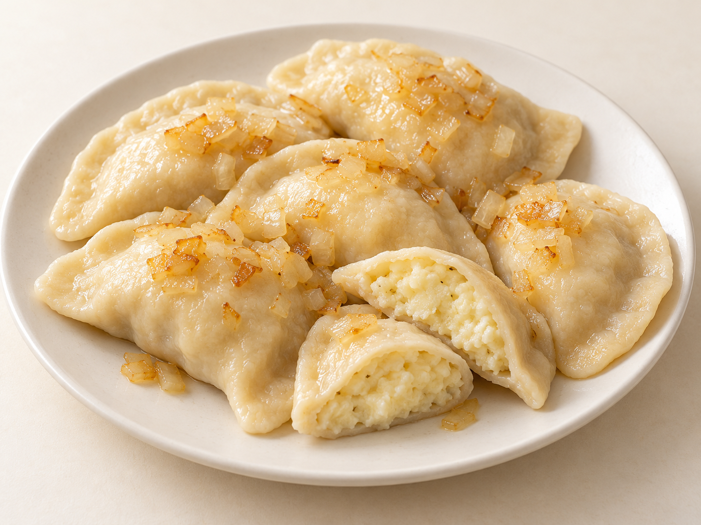
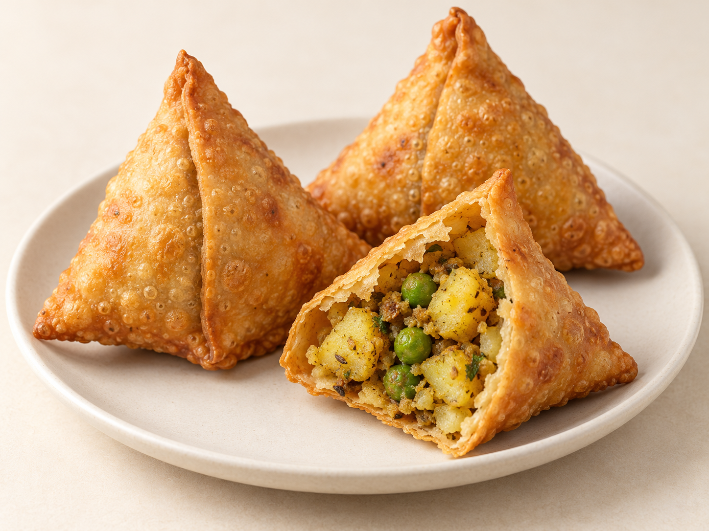
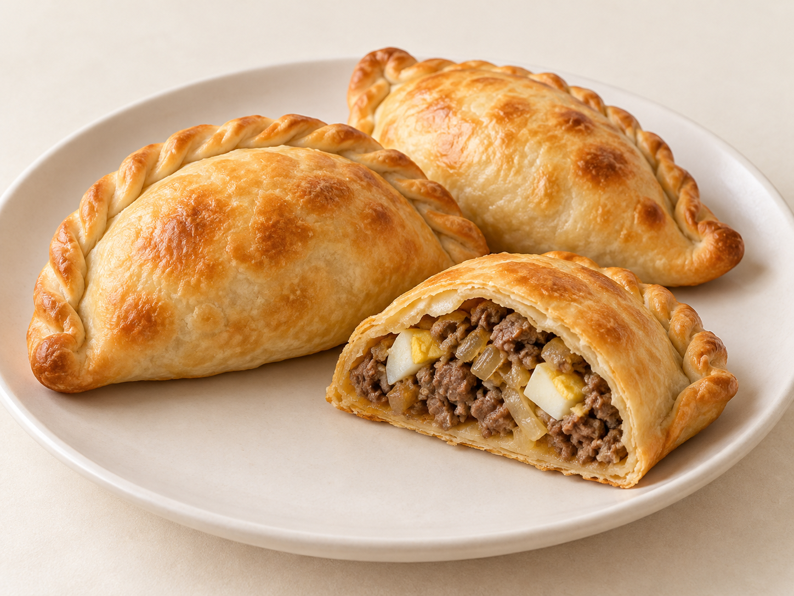

# 第24章　世界咸点：从一盘水煮饺到手拿烤馅饼

世界各地都能见到皮与馅、谷物与油脂的组合，但这不意味着它们只有一条传播路线。饺子的中文类比有助于入门，却容易把不同食品都缩成“外国饺子”；西式点心若只讲蛋糕与甜酥点，又会错过烘焙店、集市和家庭餐桌上的大块内容。本章沿着湿热包馅、炸制包馅、烘烤包馅与开放式咸点四条路线阅读。

这些食品在当地可能是主食、便餐、前菜或小吃。是否属于点心，并不存在一张全球共同采用的名单。书中纳入它们，是因为小份谷物食品的结构可以相互比较；阅读时同时保留其原名、地方语境和用餐方式。

## Gyoza、mandu与momo：一盘包馅食品的不同日常

日本常见的煎制gyoza适合与第19章的煎饺对照：薄小麦面皮包肉菜馅，底部接触锅面形成焦脆，上部通过蒸汽等方式熟透，盛盘时常突出煎面。日本国家旅游局介绍宇都宫gyoza时，特别提到薄皮和煎后脆感；这是当地代表案例，不能用来规定日本所有gyoza的厚度和馅料。[资料：日本国家旅游局，Utsunomiya Dumplings](https://www.japan.travel/en/spot/293/)

这种食品可以作为一盘共享的小食，也可与米饭等构成一餐。蘸料改变的是入口时的酸、咸与油脂感，不等于把面皮重新调味。比较两盘时，可以分开记录煎面面积、上部皮的厚薄、馅的颗粒以及是否需要蘸汁，不必把“更脆”当作唯一目标。

韩国mandu的馅料与形态更不应只看一种。肉、豆腐、蔬菜、粉条和泡菜可以形成不同组合，蒸食、煎食及入汤也会改变同一份包馅食品的角色。韩国旅游发展局的街头食品资料将肉馅、泡菜馅和虾馅列作可见分支，首尔官方旅游资料也展示了整盘上桌与放进汤中的不同食用方式。[资料：韩国旅游发展局，Street Food Loved by Koreans](https://english.visitkorea.or.kr/svc/thingsToDo/foodTrip/special_view.do?vcontsId=184669)；[资料：首尔官方旅游，Ribuk Sonmandu](https://english.visitseoul.net/restaurants/Ribuk-Sonmandu1/ENP006014)

尼泊尔日常饮食中的momo则提供另一组观察对象。蒸制的圆形或月牙形包馅件与蘸酱相邻，馅可以采用鸡肉、水牛肉或蔬菜，也有炸制和带汤汁的版本。尼泊尔旅游局图片平台的食品记录保留了这些多样名称；研究某一款时仍应核实实际店家的做法，不能看到收口褶便把它认成中式小笼包。[资料：尼泊尔旅游局图片平台，Momo](https://photo.ntb.gov.np/photo/6508/momo)

## Pierogi与pelmeni：熟馅、生馅和上桌后的第二次加热

波兰pierogi常见半月形面皮，水煮后可直接上桌，也可以再用油脂煎出少量上色。它的馅并不限于肉：土豆与鲜奶酪、酸菜蘑菇、肉馅以及水果都能形成独立分支。波兰文化机构对pierogi的介绍同时记录水煮、烤制与炸制，提醒我们“半月水煮饺”是常见入口，不是全部定义。[资料：波兰亚当·密茨凯维奇学院Culture.pl，Podstawy polskiej kuchni: pierogi](https://culture.pl/pl/artykul/podstawy-polskiej-kuchni-pierogi)

土豆鲜奶酪馅特别适合初学者建立新经验。馅先经过烹调和混合，装入面皮时已具有较均匀的软实组织；水煮主要让外皮熟化并使内外一起达到适于食用的状态。波兰农业部门收录的Pilzno地方版本采用土豆和鲜奶酪等原料；不要因此用任何一种黄色硬奶酪替代整个传统，也不要把名称ruskie简单解释成现代俄罗斯国籍。[资料：波兰农业与农村发展部，Pierogi ruskie pilzneńskie](https://www.gov.pl/web/rolnictwo/pierogi-ruskie-pilznenskie)

煎制是另一层选择。水煮后的皮已含水，表面再接触热油脂，局部会形成烘香与焦色；它不需要变成全件深炸的酥壳。炒洋葱、酸奶油或黄油等搭配，也不能反过来当作馅料组成的证据。烘焙学校的pierogi教学提供了“先煮、再煎”的可核对实例。[资料：King Arthur Baking，Pierogi课程](https://www.kingarthurbaking.com/baking-school/classes/online/pierogi)

Pelmeni常见肉馅和较小的环状折合形态，面皮包住肉馅后水煮，具体肉类与调味随家庭或店家变化。它可以帮助比较另一种皮馅关系：肉馅的颗粒与汁液，和土豆泥类熟馅的黏结方式不同。实际制作者提供的小型肉馅pelmeni菜单，是认识这一类食品的当代实例；不应仅由环形外观推断所有带环包馅面食都同源。[资料：Pelmeni Club，Dumplings菜单](https://pelmeni-club.com/menu/dumplings/)

<!-- scene-expansion:exp-pierogi -->

图24-1　半月形水煮pierogi，切口露出土豆鲜奶酪馅。

AI生成示意：呈现一种代表外观，具体用料与地区变体见正文。[品种与工艺参照](https://www.gov.pl/web/rolnictwo/pierogi-ruskie-pilznenskie)。

## Samosa与pastel：炸脆外壳有不同的空间

第16章已介绍samosa的基本工艺，这里把它放回咸点餐桌。常见北印度土豆豌豆馅samosa以面皮围成有体积的三角锥状，内部容纳熟制颗粒馅；它不是把一张薄片随意折出三角形便完成。封口、角部厚度和馅的含水量会影响炸后的完整性。印度地方政府资料列出的面皮、土豆、豌豆与香料，提供了一个明确版本，而非所有南亚地区的共同配方。[资料：印度恰塔普尔地区政府，Samosa](https://chhatarpur.nic.in/en/culinary-delight/samosa/)

巴西pastel常见较扁的长方形炸包，边缘压合，表面形成薄脆鼓泡。牛肉、奶酪等馅料使内部留有不同程度的空隙，不必像面包一样充满细密孔洞。把它译作“炸馅饼”可以理解基本用途，却不能把外壳画成厚面团。巴西戈亚尼亚市旅游部门把集市现炸pastel与甘蔗汁并提，呈现它作为市场小食的真实场景。[资料：戈亚尼亚市旅游局，Roteiros Turísticos](https://www.goiania.go.gov.br/goianiatur/turismo/roteiros-turisticos/)

这两种食品都依赖新鲜脆感，但形状服务于不同结构：samosa的立体外壳围住较厚馅心，pastel的扁薄皮容易形成大面积脆片。比较时先看皮与馅的体积比例，再看油炸色泽；一味要求两者“皮薄馅满”，可能恰好抹去各自成立的方式。

<!-- scene-expansion:exp-samosa -->

图24-2　立体三角炸samosa与土豆豌豆颗粒馅。

AI生成示意：呈现一种代表外观，具体用料与地区变体见正文。[品种与工艺参照](https://chhatarpur.nic.in/en/culinary-delight/samosa/)。

## Empanada：半月外形下面，是地区配方

Empanada与中国饺子相似的半月轮廓，不足以说明其全部特点。烤制版本常有较干的外壳与压褶封边，馅料可能预先烹调；炸制版本又有另一种表皮。阿根廷政府的地区介绍显示，肉的切法、土豆、鸡蛋和调味组合都有差别，不能把一款牛肉洋葱馅指定为整个拉丁美洲的标准。[资料：阿根廷政府，Empanadas](https://www.argentina.gob.ar/jefatura/turismo/viaja-por-argentina/empanadas)

可以选一款烤牛肉馅作为入门样本：先看封边是否连续、底部和顶部的上色怎样分布，再看切开后的牛肉颗粒和配菜。馅中有少量汤汁，并不等于它需要像汤包一样形成可流动的独立汤池；外壳干脆也不意味着所有empanada都采用层酥。关于面皮是否含油、肉是否预熟，仍应回到该款配方确认。

<!-- scene-expansion:exp-empanada -->

图24-3　半月形烤empanada，封边与牛肉洋葱馅。

AI生成示意：呈现一种代表外观，具体用料与地区变体见正文。[品种与工艺参照](https://www.argentina.gob.ar/jefatura/turismo/viaja-por-argentina/empanadas)。

## Pasty与sausage roll：手拿烘焙也有不同骨架

Cornish pasty提供一个边界很清楚的地方案例：D形烤包、侧边褶压封口，以及牛肉、土豆、芜菁甘蓝（康沃尔当地也称turnip）与洋葱构成的馅。康沃尔馅饼协会公开配方使用生的肉菜包入外皮后一起烤熟，皮必须具备承托馅料和保留形状的能力。外壳并不只追求入口即碎，强度也是用途的一部分。[资料：Cornish Pasty Association，Cornish Pasty Recipe](https://www.cornishpastyassociation.co.uk/wp-content/uploads/2014/11/Cornish-Pasty-recipe-updated.pdf)

Sausage roll则常以起酥皮围住调味香肠肉，卷成长条后分切烘烤。切面应该区分外层酥片和内部较紧实的肉馅；它与热狗面包的主要差别，不是“香肠露没露出来”，而是外壳属于起酥还是发酵面包。英国National Trust的制作实例也将它放进野餐与聚会小食的语境。[资料：National Trust，Pork sausage rolls](https://www.nationaltrust.org.uk/discover/food/recipes/pies-savoury-treats/pork-sausage-rolls)

## Quiche与focaccia：咸点可以不把馅完全包起来

Quiche把蛋奶体系放在开放式酥底中，受热后凝固，适合切块分享。Lorraine版本以蛋、奶油和腌熏猪肉等组合著称；加入蔬菜、奶酪的其他咸塔很常见，但不能把所有咸塔的配料都写成洛林传统的必要部分。[资料：法国农业部，Pique-nique idéal : sur la route de l’Est](https://agriculture.gouv.fr/pique-nique-ideal-sur-la-route-de-lest)

Focaccia则把读者带回发酵面团。热那亚式常见表面凹坑、油脂光泽与盐粒，主体是有孔隙的面包，而不是承托蛋奶的酥塔底。意大利官方旅游资料同时区分热那亚式与薄皮夹奶酪的Recco支线，说明一个名称下也可能包含不同的面皮结构。[资料：Italia.it，Traditional Food of Liguria](https://www.italia.it/en/liguria/things-to-do/11-food-of-liguria)

将这些食品放在同一张桌上，可以沿“水煮软皮—炸脆薄皮—烤制强壳—开放式酥底—发酵面包”比较，不必强迫它们成为同一种糕点。遇到陌生名字时，先确认原料、熟制方法与实际份量，再理解当地如何吃它。外形相似提供了提问的起点，具体做法和地方生活才让名字获得完整含义。

## 把相似外形拆成可以核对的问题

先不要替陌生食品寻找一个最像的中文名字。可以在纸上画三个简单区域：外皮、内部、旁边的酱汁，分别写下自己确实看见的东西。外皮有层片还是光滑面皮？内部是米粒、蔬菜丁、肉末还是均匀泥馅？蘸酱是在旁边，还是已与食品一起煮成一碗？这些记录能帮助把外观推断与实际信息分开。

接着选择一组只改变部分条件的对照。水煮pierogi与煎过的同款pierogi，适合看第二次加热如何改变表面；empanada与pasty则适合看两种烤制包馅如何采用不同馅料与封边。若直接拿一只煎饺、一块奶酪focaccia和一份甜水果pierogi比较，变量太多，所得感受便很难对应到具体工艺。

最后补上用餐语境：这份食品在当地是单独一餐，还是与汤、饭、茶或其他小点搭配？分量和售价可以变化，家庭、烘焙店、餐馆也可能提供不同版本。认识世界咸点的目标，是建立比较的能力，同时给这些差异留下位置。
