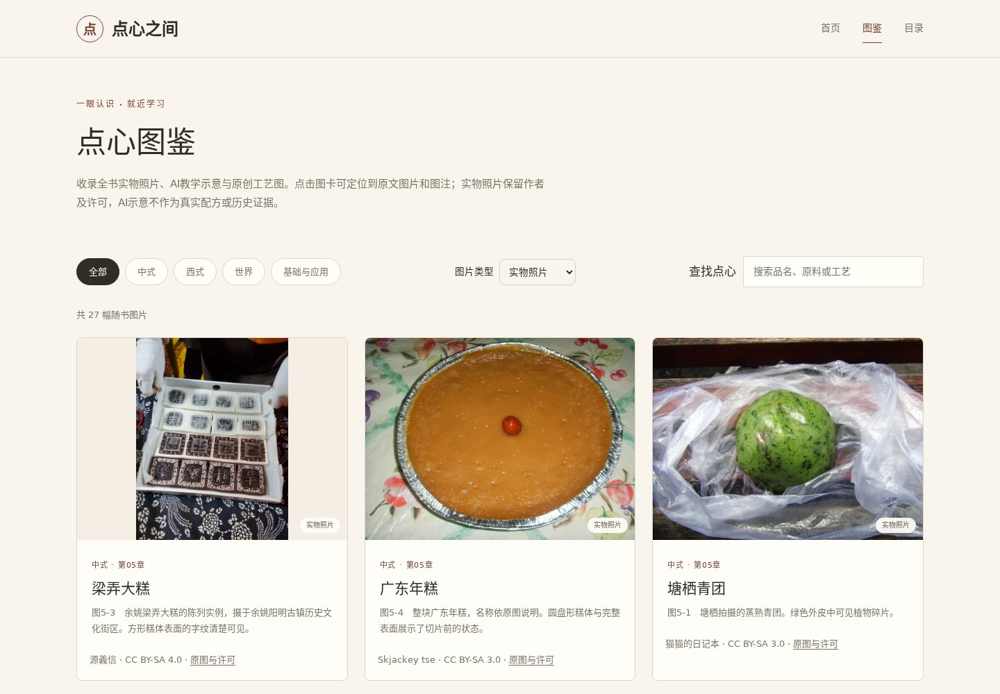
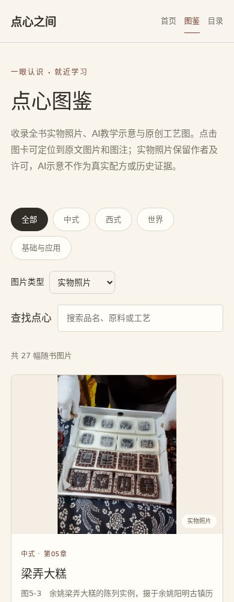
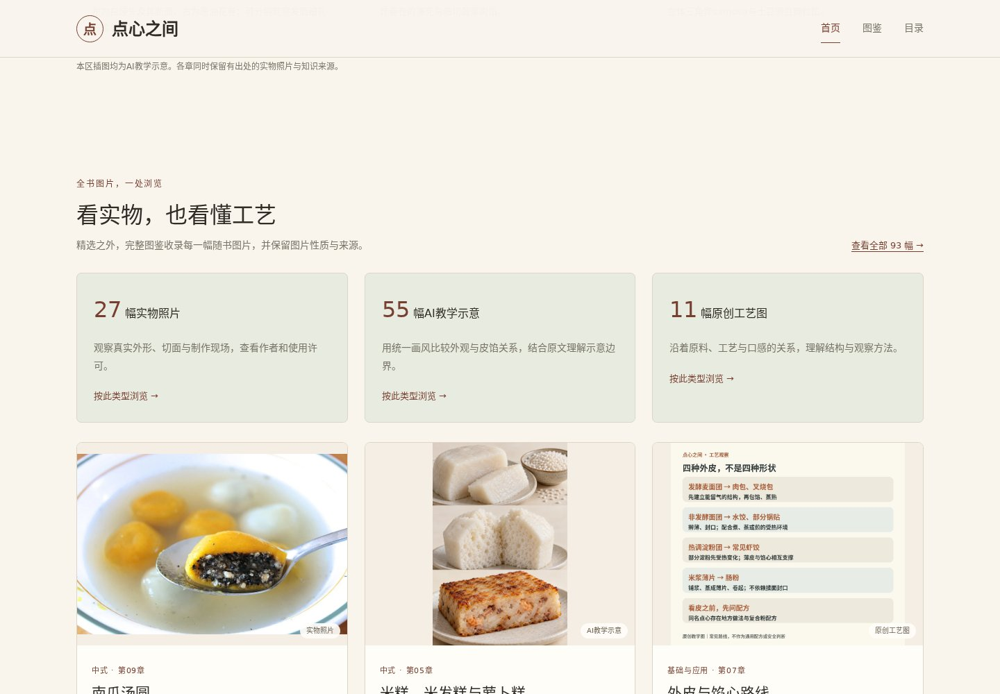
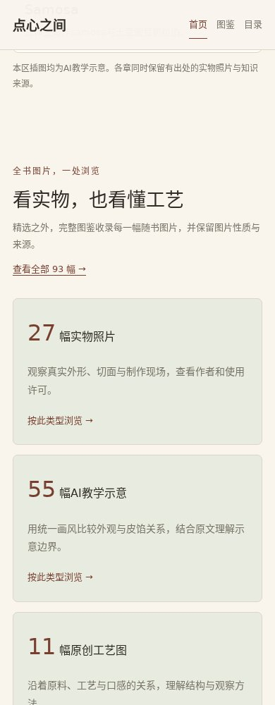

# 首页与完整图鉴更新

原图鉴只读取40张手选AI图卡，漏收53幅正文图片：27幅照片、11幅原创图、15幅AI示意。

现在收录范围由正文中的实际图片引用决定，图片性质与来源来自已有图片清单；原有配置只覆盖精选与展示文案。首页增加三类图片入口与混合示例。图卡链接到稳定的原文图片锚点，照片显示作者、许可及来源。支持类别、图片类型与关键词联合筛选，以及可分享的筛选网址。无JavaScript时提供全部图片链接。

验证结果：

- 7项单元测试通过，包括独立于手选配置的覆盖核验、新图自动收录及缺失元数据拒绝构建。
- 33页静态网站独立构建成功；93幅图片全部收录，类型数量为27/55/11；站内资源及片段链接零错误。
- Chromium在1440与390像素宽度下检查全部8页、筛选、搜索、空结果、首页类型入口和布局。
- 93个图卡目标逐个验证为可载入的原文图片；无JavaScript的完整索引含93个链接；浏览器控制台零错误。
- 保留68条脚注，未重新生成或修改食物图片。

预览：

